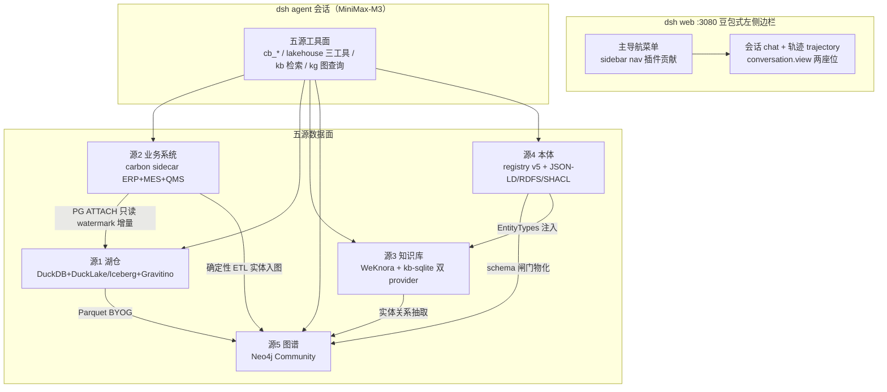
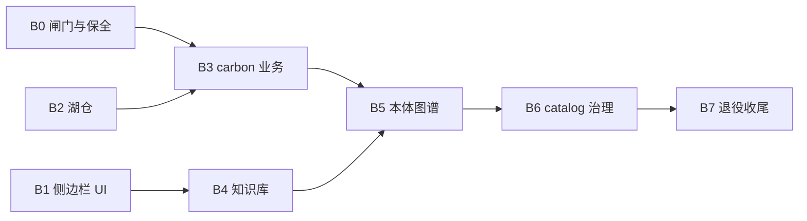

# W24 轮「完完全全的重构」总体规划（主计划）

- 日期：2026-10-09 ｜ 轮次：W24 ｜ 阶段：PLANNING（本计划是 IMPLEMENTING 阶段的权威源）
- 成熟度判定：**Level2（Clear Feature）→ ENGINEERING TRACK**；任务类型：**Architectural**（数据面+业务面+UI 面+平台面四层同时动）
- 意图回写（贯穿全部下游产物的锚点）：把 deepseek-harness 完完全全重构为「**湖仓 + 知识库 + 业务系统(carbon 插件) + 本体 + 图谱**」五源 LLM 数据架构——全部插件化为 dsh 包、NocoBase 退役、UI 改豆包网页版式左侧边栏（仅会话/轨迹保留 tab）、每源可启动+有初始化数据+被会话真实调用、业务数据自动同步进湖仓、本体以 LLM 自动生成为主（手动仅备选）+ Obsidian 式可视化、每域整合最佳开源完整方案、**拒绝 MVP 化**。

## 0. Spec 溯源

| 输入 | 位置 |
|---|---|
| 用户七条原始指令（逐字，规划全部覆盖） | W24 任务书（本会话），逐条映射见 §1.2 |
| carbon 解剖报告（形态/许可证/嵌入路径裁决） | [`r1-carbon-anatomy/REPORT.md`](../r1-carbon-anatomy/REPORT.md:1) |
| 湖仓+治理 L4 调研（六域选型+Tier 分层演进） | [`r2a-lakehouse-governance/report.md`](../r2a-lakehouse-governance/report.md:1)（结论章 [`sections/07-结论与整合方案.md`](../r2a-lakehouse-governance/sections/07-结论与整合方案.md:1)） |
| KB/图库/本体/可视化 L4 调研 | [`r2b-kb-graph-ontology/report.md`](../r2b-kb-graph-ontology/report.md:1)（总览 [`sections/00-执行摘要与选型总览.md`](../r2b-kb-graph-ontology/sections/00-执行摘要与选型总览.md:1)） |
| 仓库盘点（tab 机制/资产回收/退役面/新包成本） | [`r3-repo-inventory/r3-report.md`](../r3-repo-inventory/r3-report.md:1) |

执行者动工前必读：本主计划 + 对应分域计划（§8 索引）+ R1 报告 §13（许可证红线）。

## 1. 全局约束（逐条抄录，不得改写概括）

### 1.1 用户七条指令原文

1. 用 /Users/mac/Downloads/carbon-main 的 carbon 替换现有的 nocobase 业务系统，nocobase 废弃了，同时保证其他模块也要正确适配
2. carbon 不能照抄，也做成 dsh 的一个插件/包
3. 其他 dsh 新增的一些 tab（除了会话和轨迹），应该都是插件，不过都改成侧边栏菜单的形式，参考豆包网页版的产品形式
4. llm 会话用到的数据源都要打通并且都要有初始化数据，业务系统要把数据同步到数据湖仓
5. 图谱本体功能现在都没完善，显示可以参考 obsidian，要实现给你资料，自动生成本体，手动只是备选
6. 所有功能不要最小化 mvp，要标准的完全的最佳的产品。实现前要找到最佳的开源方案进行整合，比如知识库可以是 weknora，还有湖仓，不要什么简化的，开源肯定有很多，而且不只是存储，数据治理什么的，图数据库什么的，还有很多，都要加上
7. 这次是一个完完全全的重构，不要被现有的代码所束缚，最终的目的就是要实现，湖仓+知识库+业务系统+本体+图谱，作为 llm 的数据源。完完全全的重构！！！

### 1.2 七条指令 → 计划章节映射

| # | 指令要点 | 承载章节/批次 |
|---|---|---|
| 1 | carbon 替换 nocobase | §3 选型、§5 B3、§9 退役策略、分域 03/06 |
| 2 | carbon 做成 dsh 插件/包 | §4 包清单 connector-carbon/tool-carbon、分域 03 |
| 3 | tab→豆包式侧边栏（会话/轨迹保留） | §5 B1、分域 01 |
| 4 | 数据源全打通+初始化数据+业务→湖仓同步 | §5 B2/B3/B4/B5 各批验收、§2 数据流 |
| 5 | 图谱本体完善+Obsidian 式+自动生成 | §5 B5、分域 05 |
| 6 | 禁 MVP，最佳开源完整整合 | §3 选型表（每域主选）、Tier 分层=完整能力的分批交付（非阉割） |
| 7 | 完完全全重构，五源北极星 | §2 目标架构、§4 包清单三表 |

### 1.3 仓库级硬约束（AGENTS.md 约定，违反即返工）

- 一切插件经 `ctx.effect()`/`ctx.on()` 注册；能力 seam 三件套（Service Definition/Provider/Consumer）完整成缝
- 模型可见⟺落日志（SessionEventMap）；无硬编码可调参数（Config 字段化 + cordis.yml 可改）；misconfiguration fails loud
- 全部 `@deepseek-ai/dsh-*` 命名、ESM、pnpm workspace；opaque 跨界 id 用 Branded
- 新增 client 包三注册面缺一不可（[`packages/client/AGENTS.md`](../../../packages/client/AGENTS.md:132)）；新增/删除 dsh.client 包必须重启 dsh web
- 非平凡变更同 PR 附 Agent Note；doc-sync 门禁自动再生成目录文档；每文件恰一个尾换行
- **carbon 许可证红线（R1 §13/§14）**：不得引入/运行/移植任何 `.ee.` 文件与 `packages/ee/` 代码；不得代码级移植 carbon 社区代码（ports 传染条款）；允许：借鉴数据模型概念 clean-room 自研

## 2. 目标架构（五源北极星）

六条铁律（每源验收基线）：
1. **可启动**：每源有明确启动方式（进程内/sidecar），compose profile 分组管理
2. **有初始化数据**：食品制造业演示数据全量灌入（老业务数据 + 行业语料 + 本体种子）
3. **被会话真实调用**：工具调用链真实实跑，拒绝 mock 汇报（用户历史偏好）
4. **业务→湖仓自动同步**：carbon PG → 湖仓 watermark 增量链路常跑
5. **一切皆插件**：五源接入层全部是 packages/ 下 dsh 包
6. **模型可见⟺落日志**：新增工具输入输出全部有 SessionEventMap 事件

## 3. 开源选型结论表（一页表）

| 域 | 主选 | 备选 | 关键理由（证据等级：documented 除标注外） |
|---|---|---|---|
| 业务系统 | **carbon（crbnos/carbon）社区版 sidecar** | 询价商业许可（含 API/MCP/审批）；只读直连 PG 降级线 | 唯一候选即用户钦点；ERP+MRP+MES+QMS 产品级硬 schema（170+ migrations）强于 NocoBase 配置态；AGPL 双许可 → 条件 BLOCKER 见 §7 R-1 |
| 湖仓表格式 | **DuckLake v1.0（Tier0）→ Apache Iceberg 1.12（Tier1）** | Delta 4.4 | DuckLake MIT 单文件+Parquet 与 DuckDB 原生直写（Tier0 最短真跑路径）；Iceberg 生态盟主（pyiceberg 无 JVM 写 + REST spec），Tier1 MinIO 解锁 REST 写 |
| 湖仓查询引擎 | **DuckDB 1.5.6（进程内嵌入）** | Doris 4.1.4.1（中文全文+向量线）、StarRocks 4.1 | `@duckdb/node-api` TS 进程内零容器；iceberg 读 + VSS/FTS；MIT |
| Catalog 枢纽 | **Apache Gravitino 1.3.1** | Polaris 1.8、Nessie 0.109 | 唯一 3.5/4 四源枢纽（湖仓+fileset+PG+model）+ 内嵌 Iceberg REST + UI + MCP；Apache-2.0 |
| 数据治理 | **轻量自建 TS（目录+血缘+质量+告警四能力）** | DataHub 1.8（HTTP 端点预留升级） | 治理平台单机 8GB 常驻 + 无 TS SDK；自建 <1GB 纯 TS 且预留 OpenLineage→DataHub 升级路径；四能力完整不阉割 |
| 业务→湖仓同步 | **自写 TS 批量（DuckDB postgres ATTACH → watermark 增量）** | SeaTunnel 3.0 Zeta（真 CDC 线） | 零 JVM 零服务；w6b1 链路已验证模式泛化 |
| 知识库/RAG | **WeKnora v0.8.2（腾讯，MIT）sidecar** | FastGPT、Dify External KB | 中文一等公民 + macOS 多架构 + 8GB 起 + ParadeDB 混合检索+RRF+rerank + GraphRAG→Neo4j 可选 + **官方 dsh 插件 `@wxg-prc-cpg/dsh-weknora` v0.1.0 npm 直装已验证**；现有 kb-sqlite 保留为轻量 fallback provider |
| 图数据库 | **Neo4j Community 5.26 LTS（docker arm64）** | Apache AGE v1.8（PG 统一路线）、Memgraph CE（bolt 同构备胎） | GPLv3 内部部署+API 调用零传染；driver Apache-2.0 周下载 92 万；CE 含向量索引；n10s RDF 桥；与 WeKnora GraphRAG 共用实例 |
| 本体建模 | **JSON-LD 1.1 + RDFS/少量 OWL RL + SKOS + SHACL 闸门** | Turtle（人工审阅面） | LLM 出 JSON→代码确定性序列化→SHACL（rdf-validate-shacl TS）校验回喂，杜绝 LLM 直写 Turtle；FoodOn/AgrO 种子 |
| 本体自动生成 | **LLM schema induction（OntoGPT/OneKE 范式，自写 TS 管线）** | GraphRAG prompt_tuning 反向归纳 | 「给资料自动生成本体」= extract→归纳→JSON-LD→SHACL→registry v5 draft→Neo4j 物化；手动编辑走既有 KG 工作台（备选化） |
| 图谱可视化 | **react-force-graph-2d（Obsidian 范式复刻）** | sigma.js v3（>1万节点 WebGL） | d3-force-3d 与 Obsidian 力模型同族；expandable-nodes 增量展开；周下载 82.6 万；React peer `*` + TS 自带 |
| 五源互通 | GraphRAG BYOG + APOC load.jdbc + 本体三通道注入 | — | 业务 parquet 直连社区摘要 + PG→图确定性 ETL 零 LLM 成本 + schema 注入 WeKnora EntityTypes/GraphRAG entity_types |

## 4. 包清单（新增/改造/退役）

### 4.1 新增（10 包，命名遵循 @deepseek-ai/dsh-*）

| 包 | 组 | 职责 | 引入批次 |
|---|---|---|---|
| `packages/lakehouse/lakehouse-engine` | lakehouse | DuckDB 实例管理（fromCache/READ_ONLY attach/memory_limit/threads/allowed_paths 全 Config 化） | B2 |
| `packages/lakehouse/lakehouse-sync` | lakehouse | 同步编排：调度→ATTACH postgres→watermark 增量→DuckLake append（w6b1 链路泛化包化） | B2 |
| `packages/connector/connector-carbon` | connector | carbon 能力 Service Definition + HTTP Provider（PostgREST Data API / oRPC `/api/v1`），对标 connector-nocobase 同缝 | B3 |
| `packages/connector/tool-carbon` | connector | cb_* 工具行（查询/开单/收货/过账），工具 risk 标注采用 carbon manifest 的 READ/WRITE/DESTRUCTIVE 分类 | B3 |
| `packages/kb/weknora` | kb | WeKnora 接入插件：官方 `@wxg-prc-cpg/dsh-weknora` 审查改造（不合格则按 MIT 自写 REST connector）+ kb seam 双 provider 注册 | B4 |
| `packages/graph/graph-neo4j` | graph（新组） | Neo4j 存储引擎 Provider（neo4j-driver）+ 本体/schema 物化 + 向量索引 | B5 |
| `packages/graph/tool-graph` | graph | 图查询工具行（kg_subgraph/kg_cypher/kg_vector 邻域/路径/语义） | B5 |
| `packages/kb/ontology-induction` | kb | 本体自动生成管线：语料→LLM JSON→SHACL 校验回喂→registry v5 draft→Neo4j 物化 | B5 |
| `packages/client/ui-nav` | client | 豆包式主导航层（sidebar nav slot 声明者 + 菜单结构 + 折叠态） | B1 |
| `packages/client/ui-governance` | client | 治理面板（元数据目录/血缘图/质量规则/告警），侧边栏菜单项 | B6 |

注：Gravitino 接入（Tier1）优先以 `lakehouse-sqlite-catalog` 的兄弟 provider 形态扩展 `packages/lakehouse/lakehouse-gravitino-catalog`（B6 视进度，允许并入 B6 或顺延 R6 后单独批次 B6.5——开放问题 O-6）。

### 4.2 改造（既有包换轨）

| 包 | 改造内容 | 批次 |
|---|---|---|
| `packages/client/ui-layout` | 导航几何重构（主导航列 + 会话列表栏双层结构，[`columns.ts`](../../../packages/client/ui-layout/src/client/columns.ts:17) 契约扩展） | B1 |
| `packages/client/ui-sidebar`、`ui-workspace` | sidebar.footer.action 座位（kb=5…business=9）升格为 sidebar nav 主导航段 | B1 |
| `packages/client/ui-kb`、`ui-assets`、`ui-connectors`、`ui-kg`、`ui-business`、`ui-mobile-preview` | 从 conversation.view tab 环撤出（保留页面本体），注册为侧边栏菜单项 | B1 |
| `packages/bundle/web-app` | cordis.patch.yml 注册新 client 包行 + 依赖行 | B1~B6 |
| `packages/host/apiproxy` | nocobase 域 8 方法（[`rpc-map.ts`](../../../packages/host/apiproxy/src/api/rpc-map.ts:102)）→ carbon 域对标新增 | B3 |
| `packages/host/webserver` | 复刻 [`nocobase-proxy.ts`](../../../packages/host/webserver/src/nocobase-proxy.ts:20) 为 /carbon 前缀代理（HTML/manifest 重写 + ws + fallback） | B3 |
| `packages/client/ui-business` | 数据面 nocobase.listMeta/list → carbon | B3 |
| `packages/client/ui-mobile` | signIn/docs/alerts 数据腿 → carbon 身份与 API | B7 |
| `packages/kb/kg-build` | mappings sources[].system 扩 carbon（[`kg-mappings.yml`](../../../examples/kb-agent/kg-mappings.yml:5)）+ 映射广度 5→49 表 + induction 管线挂接 | B3/B5 |
| `packages/kb/kb-graph`、`kb-graph-sqlite` | Neo4j sink（graph-neo4j 对接）+ registry v5 与 Neo4j 物化双写；sqlite 账本保留 episode/时间旅行 | B5 |
| `packages/client/ui-kg` | sigma → react-force-graph-2d + Local Graph/hover 预览/backlink 范式 | B5 |
| `packages/lakehouse/tool-lakehouse` | 三工具升级（introspect_schema/dry_run/execute_readonly + 三层只读防御） | B2 |
| `examples/kb-agent`（cordis.patch.yml + scripts） | persona 五源路由总纲术语换轨 + carbon 配置段 + compose 编排 | 各批 |

### 4.3 退役

| 对象 | 时机 | 前置 |
|---|---|---|
| `platform/nocobase`（14,031 文件）+ `platform/nocobase-portals` | B7 | B0 全量数据导出 + B3 carbon 正式可用 + R3 验收 |
| `packages/connector/connector-nocobase`、`tool-nocobase` | B7 | connector-carbon/tool-carbon 等价面就绪 |
| apiproxy nocobase 域、webserver nocobase 代理、ui-business/ui-mobile nocobase 数据腿 | B7 | 同上 |
| examples/kb-agent nocobase 脚本 28 个 + w* 系直连脚本（60 个中 nocobase 专属者）、nocobase e2e 三件 | B7 | 引用替换完成 |
| **保留**：approval-engine（:13110）——独立于 NocoBase，补 carbon 社区版审批规则空白（EE 门控）；kb-sqlite 全缝——降级为轻量 KB provider | — | — |

## 5. 批次蓝图 B0..B7 + R 轮

原则：每批 = 可验证的**完整增量**（真实实跑判据），不是功能阉割；批内任务可并行，批间按依赖排序。

| 批次 | 名称 | 范围（一句话） | 依赖 | 真实实跑验收（摘要，全文见分域计划） |
|---|---|---|---|---|
| **B0** | 闸门与保全 | carbon PoC 决定性实验 + nocobase 全量数据导出 + 商务询价 B 计划启动 | 无 | carbon dev 栈起 + `--dataset satellite` 种子灌入 + Data API/session 机器调用实测记录落盘；49+5+wfl 全表 Parquet 落地 + 行数对账 |
| **B1** | 豆包式侧边栏 | ui-nav 主导航 + tab 环收缩（chat/trajectory/view-context 保留）+ 六功能页迁侧边栏 + view-context 深链适配 + e2e 全绿 | 无（与 B0 并行） | 左侧边栏菜单导航全部功能页；会话/轨迹仍为 tab；snapshot/e2e 更新后 `test:web` 全绿 |
| **B2** | 湖仓（五源①） | lakehouse-engine + lakehouse-sync + 三工具 + 只读防御 + 老数据入湖 + 治理 v0 目录 | 无（与 B0/B1 并行；入湖数据用 B0 导出则串 B0 尾） | 会话真实 text-to-SQL 查老业务数据；DELETE 注入被拒；watermark 增量可见 |
| **B3** | carbon 业务（五源②） | connector-carbon + tool-carbon + apiproxy 域 + webserver /carbon + ui-business 换轨 + 初始化灌数 + carbon→湖仓同步 + zh 校验 | B0 闸门结论 + B2 | 会话经 cb_* 真实查/开 carbon 单据；carbon PG 插行→湖仓同步→查询可见；中文界面可用性记录 |
| **B4** | 知识库（五源③） | WeKnora sidecar + dsh 插件接入 + 46 篇语料迁移 + 食品新语料 + 检索双轨 + 自建中文基准 | B1（侧边栏入口）；与 B3 可并行 | 会话 RAG 引用真实 WeKnora 检索（chunk 溯源）；基准达标线实测；GraphRAG 组件可启 |
| **B5** | 本体+图谱（五源④⑤） | Neo4j sidecar + graph-neo4j + ontology-induction 管线 + 映射广度扩展 + 孤岛收敛 + ui-kg Obsidian 式改造 + 五源互通 | B3（业务表进图）+ B4（KB→图）；induction 管线可先行 | 给一批食品资料→自动生成本体→SHACL 过闸→入图全程无手写；Local Graph/hover/backlink 实跑；会话 kg 查询真实；孤岛数下降 |
| **B6** | catalog+治理 | Gravitino + MinIO（Tier1）+ 四源登记 + 治理面板四能力 + OpenLineage 事件 + DataHub 预留 | B2~B5 源全在 | Gravitino UI 浏览四源元数据；血缘图展示 carbon→湖仓→图谱；质量规则失败触发告警实测 |
| **B7** | 退役收尾 | nocobase 六步拆除 + mobile 身份换轨 + QUICKSTART/DEPLOY 重写 + 五源联合验收 | B3 验收 + 全部 R 轮 | platform/ 删除；一条会话问题串五源（查 carbon→湖仓汇总→KB 引用→图谱邻域）全链路实跑 |
| **R0~R7** | 验证轮 | 每批后的独立验证（verify-executor 委派，真实服务在线判据） | 各批 | 见各分域计划验收节 |

### 5.1 依赖与并行图

- **并行窗口 1**：B0 ∥ B1 ∥ B2（外部栈实验 / client 包 / lakehouse 包，互不触碰）
- B3 必须等 B0 闸门结论（GO/降级/转向三态，见 §7 R-1）；B4 与 B3 可并行；B5 的 induction 管线部分可在 B3 期间先行（不依赖业务表）
- B6 需五源全部在线；B7 收尾必须在 R3（B3 验证）通过后

## 6. Machine-Executable Blocks（Loop 编排器首选委派单元）

> 每块由编排器 `new_task(code)` 委派；Prompt 自包含（执行者先读本主计划 + 对应分域计划）。所有块共享执行契约（§9）。

#### To execute B0:

**Skill:** 无特定技能（PoC 协议 + 数据导出脚本工程；遵循仓库 AGENTS.md）
**Prompt:** 读 [`research/2026-10-09-w24-rebuild/plan/00-master-plan.md`](../00-master-plan.md:1) 与 [`research/2026-10-09-w24-rebuild/r1-carbon-anatomy/REPORT.md`](../../r1-carbon-anatomy/REPORT.md:1) §7/§11/§13/§14。执行 W24-B0 闸门与保全批，三个任务：(1) carbon PoC——在 /Users/mac/Downloads/carbon-main 按其 README 与 packages/dev/docker/docker-compose.dev.yml 起社区 dev 栈（Docker + Node22 + pnpm10；ERP :3000；零外部账号），灌 `--dataset satellite` 种子，dev 直登 test@carbon.ms；决定性实验：验证社区 edition 下机器调用通路——(a) session 登录后 PostgREST Data API（经 kong :54321）CRUD 是否可用且条款可接受，(b) `/api/v1` oRPC 面无 API key 时的行为；全程禁止触碰 packages/ee/ 与 .ee. 文件（许可证红线）；实测证据（curl 往返 + 截图）落 research/2026-10-09-w24-rebuild/b0-poc/。(2) nocobase 全量数据导出——泛化 examples/kb-agent/scripts/w6b1-lakehouse-transfer.mts 为全表导出（清单从 13 张扩到 49 hub_/crm_ + 5 collections + wfl 五表 + alert_rules/kpi_snapshots 全集），落 workspace/lakehouse/legacy/ Parquet + pg_dump -d nocobase 兜底归档；行数对账表落盘同目录。(3) 起草 carbon.ms 商务询价邮件（self-hosted 商业许可含 API/MCP/审批的报价）存 research/2026-10-09-w24-rebuild/b0-poc/inquiry-draft.md，不发送。产出三态结论（GO=Data API 可用合规 / DEGRADE=只读直连 PG 线 / PIVOT=询价等待）写入 research/2026-10-09-w24-rebuild/b0-poc/VERDICT.md。只写 research/ 与 workspace/lakehouse/legacy/，不改任何产品代码。中文汇报。

#### To execute B1:

**Skill:** ui-ux-pro-max | Why: 豆包式侧边栏导航的产品形态设计标尺（W8 轮已验证有效） | Args: 导航/工作台类产品形态，延续 W7 设计语言（普鲁士深蓝 #1E4E8C 语义五态） | Fallback: 直接参考豆包网页版（左侧固定窄导航：图标+文字菜单，点击切换功能区；对话页内保留会话列表栏），逐像素对齐交互范式：菜单分组、hover 态、激活态、折叠态
**Prompt:** 读 [`00-master-plan.md`](../00-master-plan.md:1) §2/§4/§5 与 [`01-ui-sidebar.md`](01-ui-sidebar.md:1) 全文。执行 W24-B1 豆包式侧边栏批：新增 packages/client/ui-nav（主导航层，sidebar nav slot 声明者），改造 ui-layout（[`columns.ts`](../../../../packages/client/ui-layout/src/client/columns.ts:17) 几何契约：新增主导航列，sidebar 永不让步语义保留）与 ui-sidebar/ui-workspace；conversation.view tab 环收缩为 chat(0)/view-context(0.5)/trajectory(15) 三座位，kb(10)/scenarios(10.5)/market(11)/connectors(12)/kg(13)/business(14)/mobile-preview(16) 七页面从 tab 撤出改为侧边栏菜单项（页面本体不动，入口与路由换轨，view-context 深链适配）；client 包三注册面（aggregate tsconfig / web-app patch 行 / web-app 依赖）+ bundle + 重启 web；更新受影响 e2e/snapshot（navigation-panes、rail-search-expand、overview-home、biz-navigator 等）。验收：豆包式左侧边栏导航全部功能页可往返；会话/轨迹仍为会话体内 tab；`pnpm run test:web` 与 typecheck/lint 全绿；新增 Agent Note。遵循 ui-ux-pro-max 设计标尺产出导航视觉（图标语义、分组、激活态、折叠 rail 态）。中文汇报，附 before/after 截图证据。

#### To execute B2:

**Skill:** 无特定技能（工程实现；DuckDB 扩展加载验证是第一风险项）
**Prompt:** 读 [`00-master-plan.md`](../00-master-plan.md:1) §2/§3/§5 与 [`02-lakehouse.md`](02-lakehouse.md:1) 全文，以及 [`r2a-lakehouse-governance/sections/07-结论与整合方案.md`](../../r2a-lakehouse-governance/sections/07-结论与整合方案.md:1) 包边界与初始化策略。执行 W24-B2 湖仓批：第一验证项 = @duckdb/node-api 加载 postgres/ducklake 社区扩展冒烟（失败则按 07 章 B' 变体降级 pyiceberg sidecar 并先汇报）；新增 packages/lakehouse/lakehouse-engine（DuckDB 实例管理，memory_limit/threads/allowed_paths/attachMode 全 Config 字段化）与 lakehouse-sync（调度触发→ATTACH postgres READ_ONLY→watermark 增量→DuckLake append，w6b1 模式泛化）；升级 tool-lakehouse 为三工具 introspect_schema/dry_run/execute_readonly + 三层只读防御（语句白名单解析+只读会话+资源限额）+ Vanna 式 prompt 模板（仅借鉴不引入依赖）；B0 导出的 legacy Parquet 登记入 catalog + 食品种子三表续用；治理 v0（表目录浏览 + 用量）；全程 SessionEventMap 落日志、Config 化、coverage 100%、doc-sync。验收：dsh 会话真实执行「introspect→dry_run→execute_readonly」查老业务数据返回真实行；DELETE/DROP 注入被拒并落事件；PG 侧插行→sync→湖仓查询可见。中文汇报，附真实会话工具调用日志摘录。

#### To execute B3:

**Skill:** 无特定技能（工程实现；凭据走 dsh-credentials env 链）
**Prompt:** 读 [`00-master-plan.md`](../00-master-plan.md:1) §2/§3/§5 与 [`03-business-carbon.md`](03-business-carbon.md:1) 全文，以及 [`r1-carbon-anatomy/REPORT.md`](../../r1-carbon-anatomy/REPORT.md:1) §8/§12/§13。前置检查 research/2026-10-09-w24-rebuild/b0-poc/VERDICT.md 三态结论：GO 则全量实施；DEGRADE 则只实施只读直连线（connector 降级 PG 只读 + 同步 + UI 外链人工使用）并在汇报首行声明降级；PIVOT 则停止并升级给编排者。GO 路径：新增 packages/connector/connector-carbon（Service Definition + HTTP Provider，B0 验证的通路；凭据 CARBON_URL/CARBON_API_KEY 走 credentials env 链，Config 字段化）与 tool-carbon（cb_list/cb_get/cb_create/cb_post_receipt 等工具，risk 标注按 carbon manifest 的 READ/WRITE/DESTRUCTIVE 分类，写操作走审批面板确认）；apiproxy 新增 carbon 域（对标 nocobase 域 8 方法）；webserver 复刻 nocobase-proxy.ts 为 /carbon 前缀代理；ui-business 数据面换轨；carbon 初始化数据灌入（workspace/data/{experts,market} 真源 + 八角色账号，经 bulk/seed 通道）；carbon→湖仓自动同步接 lakehouse-sync（表清单 Config 化）；中文本地化可用性校验记录。验收：会话经 cb_* 真实查/开 carbon 单据（工具调用日志为证）；carbon PG 插行→湖仓同步→查询可见；中文 UI 截图证据。中文汇报。

#### To execute B4:

**Skill:** 无特定技能（sidecar 部署 + 插件接入；中文语料工程）
**Prompt:** 读 [`00-master-plan.md`](../00-master-plan.md:1) §2/§3/§5 与 [`04-knowledge-weknora.md`](04-knowledge-weknora.md:1) 全文，以及 [`r2b-kb-graph-ontology/sections/01-WeKnora深度解剖.md`](../../r2b-kb-graph-ontology/sections/01-WeKnora深度解剖.md:1) 与 [`sections/07-W24整合方案草案.md`](../../r2b-kb-graph-ontology/sections/07-W24整合方案.md:1)。执行 W24-B4 知识库批：docker-compose 起 WeKnora v0.8.2 sidecar（8GB 起，compose profile 分组）；评估官方 npm 插件 @wxg-prc-cpg/dsh-weknora v0.1.0——审查其 seam 合规（ctx.effect 注册/Config 化/事件落日志），合格则以 fork-patch 方式纳入（MIT），不合格则按 REST/MCP 双通道自写 packages/kb/weknora；kb seam 注册双 provider（WeKnora 主检索 + kb-sqlite 轻量 fallback）；语料迁移（现有 46 篇 kb-corpus + 食品制造业新语料：W6 合规四件套/HACCP/标准文档）；会话检索工具双轨切换（kb_search 路由 WeKnora，[n] 引用与 chunk 溯源保留）；构建自建中文基准（沿用 eval/questions.json 120 题模式扩 WeKnora 面向）实测检索质量。验收：会话 RAG 引用真实 WeKnora 检索结果（带 chunk 溯源）；自建基准达标线（混合 Top5 ≥ 现 kb-sqlite 基线 98.3% 的 95% 或绝对值 ≥90%，以实测记录）；WeKnora GraphRAG→Neo4j 组件可启用（为 B5 铺路）。中文汇报，附基准实测数据。

#### To execute B5:

**Skill:** frontend-design | Why: 图谱页 Obsidian 式视觉与交互设计（Local Graph/hover 预览/backlink 范式） | Args: 数据可视化工作台，W7 设计语言延续 | Fallback: 严格按 r2b sections/05 的 Local Graph 范式规格（邻域展开/hover 卡片/backlink 面板）与 07 章蓝图实现
**Prompt:** 读 [`00-master-plan.md`](../00-master-plan.md:1) §2/§3/§5 与 [`05-ontology-graph.md`](05-ontology-graph.md:1) 全文，以及 [`r2b-kb-graph-ontology/sections/04-本体建模与LLM自动本体生成.md`](../../r2b-kb-graph-ontology/sections/04-本体建模与LLM自动本体生成.md:1)、[`sections/05-图谱可视化Obsidian范式与选型.md`](../../r2b-kb-graph-ontology/sections/05-图谱可视化Obsidian范式与选型.md:1)、[`sections/06-五源互通参考架构.md`](../../r2b-kb-graph-ontology/sections/06-五源互通参考架构.md:1)。执行 W24-B5 本体图谱批：docker 起 Neo4j Community 5.26（arm64）；新增 packages/graph/graph-neo4j（存储 Provider：neo4j-driver、本体 schema 物化、向量索引、与 kb-graph registry v5 双写——sqlite 账本保留 episode/时间旅行）与 tool-graph（kg_subgraph/kg_cypher/kg_vector 工具行）；新增 packages/kb/ontology-induction（管线：语料→LLM 出 JSON（OntoGPT/OneKE prompt 范式，DeepSeek/MiniMax 通道）→代码确定性序列化 JSON-LD→SHACL（rdf-validate-shacl）校验回喂修复→registry v5 draft→Neo4j 物化；FoodOn/AgrO 种子参照）；kg-build 映射广度 5→49 表（sources[].system 扩 carbon）+ 孤岛收敛策略 + PPR/louvain 检索产品化；ui-kg 可视化换轨 react-force-graph-2d + Obsidian 范式（Local Graph 邻域展开/节点 hover 预览/backlink 面板；>1万节点降级 sigma WebGL 备选路径）；五源互通：carbon 业务库确定性 ETL 入图（零 LLM 成本）+ WeKnora 实体抽取入图通道。验收：给一批食品资料自动生成本体全程无手写（SHACL 过闸记录为证）；Local Graph/hover/backlink 浏览实跑（截图）；会话 kg_subgraph 查询真实返回；孤岛数较 343 基线显著下降（目标 <100，实测记录）；本体 schema 注入 WeKnora EntityTypes 生效。中文汇报。

#### To execute B6:

**Skill:** 无特定技能（sidecar 部署 + 治理面板工程；面板 UI 延续 W7 设计语言）
**Prompt:** 读 [`00-master-plan.md`](../00-master-plan.md:1) §2/§3/§5 与 [`02-lakehouse.md`](02-lakehouse.md:1) 治理节，以及 [`r2a-lakehouse-governance/sections/03-Catalog与元数据枢纽.md`](../../r2a-lakehouse-governance/sections/03-Catalog与元数据枢纽.md:1)、[`sections/04-数据治理.md`](../../r2a-lakehouse-governance/sections/04-数据治理.md:1)。执行 W24-B6 catalog 治理批：docker 起 Gravitino 1.3.1（docker pull 验证 tag，fallback 裸进程 bin/gravitino.sh 支持 macOS ARM64）+ MinIO :9000（解锁 DuckDB→Iceberg REST 写，湖仓 Tier0 DuckLake→Tier1 Iceberg 迁移脚本）；metalake 登记四源（湖仓 Iceberg + fileset 知识库语料 + PG 业务库 + model 本体）；新增 packages/client/ui-governance 治理面板（元数据目录浏览/血缘图[carbon→湖仓→图谱链路，OpenLineage 事件驱动]/质量规则[GE/dbt 范式 TS 实现，失败告警]/用量告警），侧边栏菜单项注册；预留 DataHub HTTP 端点升级路径（Config 化开关）。验收：Gravitino UI 浏览四源元数据（截图）；血缘图展示真实同步链路；质量规则故意注入脏数据触发告警实测；DuckLake→Iceberg 迁移后 DuckDB ATTACH iceberg 读写往返。中文汇报。

#### To execute B7:

**Skill:** dsh-doc-standards（QUICKSTART/DEPLOY 重写）+ dsh-pre-push-checks（大删除提交前最小检查集） | Why: 文档层级/预算规范与提交门禁是本仓硬约束 | Fallback: 对照 docs/AGENTS.md 与 .agents/skills/dsh-pre-push-checks/SKILL.md 手工执行等价检查
**Prompt:** 读 [`00-master-plan.md`](../00-master-plan.md:1) §9 与 [`06-decommission-nocobase.md`](06-decommission-nocobase.md:1) 全文。前置：确认 R3（B3 验证）已通过且 B0 导出数据三重在档（Parquet + pg_dump + workspace/data 真源）。执行 W24-B7 退役收尾批，严格六步序：①停服务（先 dsh web 后 nocobase，网关持 inode 教训）②确认数据导出完整（对账表复核）③换运行时引用（connector-nocobase/tool-nocobase 删除、apiproxy nocobase 域拆除、webserver 代理拆除、ui-business/ui-mobile 数据腿终检、expert-orders/kg-build 依赖终检）④删 examples/kb-agent nocobase 脚本与 patch 段、retire nocobase e2e ⑤删 platform/ 整树 + nocobase-portals ⑥清文档（AGENTS.md 布局图、packages/README 组表、QUICKSTART/DEPLOY/WEBSITE 全量重写为五源架构版）。mobile 身份换轨（signIn → carbon 身份面）。最终五源联合验收：一条会话问题串五源（查 carbon 单据→湖仓汇总→KB 引用→图谱邻域→本体 schema）全链路真实实跑记录。全部提交过 lefthook 门禁。验收：`ls platform/` 不存在；全仓 grep -r nocobase 仅剩历史 research/ 与 git 记录；五源联合验收 transcript 落盘。中文汇报。

## 7. 风险与依赖顺序

### 7.1 风险登记（Tigers 真风险 / Paper Tigers 想象风险 / Elephants 已知未认领）

| 编号 | 风险 | 等级 | 分类 | 缓解 | 归属批次 |
|---|---|---|---|---|---|
| R-1 | **carbon API 许可条件 BLOCKER**：社区版 API_KEYS/MCP 商业门控；上游正在加硬 API 守卫 | 高 | Tiger（Launch-Blocking） | B0 决定性实验（Data API/session 通路实测）+ 询价并行；三态结论（GO/DEGRADE/PIVOT）；DEGRADE 线=只读直连 PG + UI 人工使用 + 湖仓承担 LLM 数据面 | B0→B3 |
| R-2 | DuckDB 社区扩展（postgres/ducklake）加载行为未背书 | 高 | Tiger（Tier0 阻断） | B2 第一验证项冒烟；失败降级 pyiceberg sidecar（B' 变体） | B2 |
| R-3 | 内存预算：全栈 sidecar（carbon dev 栈 6.5G + WeKnora 8G + Neo4j 2G + Gravitino 2G + MinIO 0.5G）≈20G | 中 | Tiger（Fast-Follow） | compose profile 分组（demo 全启/开发按需）；实测记录峰值 | 各批 |
| R-4 | carbon 中文本地化未验证 + 食品行
业层缺失（配方/HACCP/营养标签） | 中 | Tiger（Track） | B3 zh 校验记录；行业层以 dsh 自建插件补（clean-room，借鉴数据模型概念）；approval-engine 补审批空白 | B3+ |
| R-5 | 老业务数据迁移 schema 差异（49 表→carbon 170+ 表无直接映射） | 中 | Tiger（Fast-Follow） | 全量进湖仓（永久可查）+ 精选子集进 carbon（workspace/data 真源 + 八角色 + 订单）；不追求 1:1 迁移 | B3/B7 |
| R-6 | WeKnora 官方 dsh 插件质量未知 | 中 | Elephant | B4 先审查后决策；不合格自写（MIT 允许） | B4 |
| R-7 | carbon 上游高频演进（3 天前仍改 schema） | 中 | Tiger（Track） | 锁定快照基线（2026-10-06）+ 按月评估 rebase；BACKWARD_COMPATIBILITY 契约为兼容判据 | 全程 |
| R-8 | 「NocoBase 数据不能丢」 | — | Paper Tiger | B0 全量导出 + pg_dump + workspace/data 真源三重在档后才允许 B7 删树 | B0/B7 |
| R-9 | Gravitino 官方镜像 tag 存在性未验证 | 低 | Paper Tiger | docker pull 验证 + 裸进程 fallback | B6 |
| R-10 | tab→侧边栏迁移破坏 e2e/snapshot 面 | 中 | Tiger（Fast-Follow） | B1 全量更新测试基线；snapshot 用 DSH_SNAPSHOT=refresh 明示 | B1 |
| R-11 | B3 ∥ B4 并行时同改 cordis.patch.yml / 工具行注册面（patch 文件与 persona 段冲突） | 中 | Tiger（Fast-Follow） | 并行窗口内分文件段提交（B3 动 carbon 段/cb_*、B4 动 kb 段/kb_search）；编排器若无法隔离则 B4 串行于 B3 后 | B3/B4 |

### 7.2 并行/串行判定（编排器调度依据）

- **可并行**：B0 ∥ B1 ∥ B2（窗口 1）；B3 ∥ B4；B5 的 ontology-induction 管线 ∥ B3
- **必须串行**：B3 → B5（业务表进图）；B4 → B5（KB→图通道）；B2~B5 全部 → B6 → B7；R3 通过 → B7
- **资源独占**（避免互踩）：docker 端口段分配表（carbon 栈 3000/3001/54321、WeKnora 独立、Neo4j 7687、Gravitino 8090、MinIO 9000——B3/B4/B5 各自 sidecar 互不冲突）；pnpm install/build 全局锁按仓例串行

## 8. 分域计划索引（执行者必读对应篇）

| 文件 | 域 | 批次 |
|---|---|---|
| [`01-ui-sidebar.md`](01-ui-sidebar.md:1) | 豆包式侧边栏（slot 机制/几何/座位迁移） | B1 |
| [`02-lakehouse.md`](02-lakehouse.md:1) | 湖仓+同步+治理（Tier 分层/三工具契约） | B2/B6 |
| [`03-business-carbon.md`](03-business-carbon.md:1) | carbon 接入（PoC 协议/三态降级/初始化） | B0/B3 |
| [`04-knowledge-weknora.md`](04-knowledge-weknora.md:1) | WeKnora 知识库（双 provider/语料/基准） | B4 |
| [`05-ontology-graph.md`](05-ontology-graph.md:1) | 本体自动生成+图谱（induction 管线/Neo4j/可视化） | B5 |
| [`06-decommission-nocobase.md`](06-decommission-nocobase.md:1) | 退役与数据迁移（六步序/引用全景） | B0/B7 |

## 9. NocoBase 退役与数据迁移策略（指令 1/4 落点）

**策略：先保全、后切换、最后拆除。老业务数据三重在档，精选子集进 carbon，全量永久进湖仓。**

1. **保全（B0）**：49 hub_/crm_ 表 + 5 collections + wfl 五表 + alert_rules/kpi_snapshots 全量 REST→Parquet（w6b1 链路泛化）+ `pg_dump -d nocobase` 归档 + workspace/data 真源（experts 32 人/market 63 资产/订单 24 条）原样保留。对账表落盘。
2. **初始化分工**：carbon 侧=workspace/data 真源 + 八角色账号（[`QUICKSTART.zh.md`](../../../examples/kb-agent/QUICKSTART.zh.md:326) 密码清单）+ 订单演示子集（经 bulk/seed 通道，走 B0 验证的应用层通路）；湖仓侧=全量 legacy Parquet 永久登记（`legacy_*` 命名空间）；图谱侧=49 表全量映射进图（B5）；wfl 审批资产随 approval-engine 保留（引擎独立于 NocoBase UI）。
3. **切换（B3）**：运行时引用等价面替换（connector/apiproxy/webserver/ui 四层，R3 §5.3 引用点全景表为拆除清单底稿）。
4. **拆除（B7）**：六步序（停服务[先 dsh web 后 nocobase——网关持已删库 inode 教训]→数据复核→换引用→删脚本→删树→清文档）。
5. **不可迁残留处置**：carbon schema 无对应的食品合规配置域（HACCP 四件套等）→ 湖仓 legacy 表 + KB 语料承载查询面，行业层新建走 dsh 自建插件（clean-room）。

## 10. 执行契约（Agent Execution Contract）

- **权威源与冲突裁决顺序**：用户七条指令（§1.1）> 本主计划 > 分域计划 > 四份研究报告 > 现有代码。研究报告与代码现状冲突时以代码现状为准并回报编排者。
- **禁触清单**：carbon 的 packages/ee/ 与一切 .ee. 文件（读可以，禁运行/改/抄）；vendored Cordis 语义（waterfall next() 等）；agent-loop 核心（新能力走插件不改循环）；platform/nocobase 在 B7 前只读。
- **每需求验证方式与验证人**：各批验收（§5 真实实跑判据）由独立 verify-executor 子任务执行（R 轮），判据=服务在线 + 真实 API/工具调用往返 + 物理证据（日志/截图/对账表）。制作者不得自验通过。
- **停止并升级条件**：①B0 VERDICT=PIVOT；②B2 扩展冒烟失败且 B' 变体不可行；③任何批验收两轮修复后仍 FAIL；④发现许可证新证据违反 §1.3 红线——立即停工升级编排者，owner=Loop 编排器。
- **验证等价**：未经验证的需求视为未完成；「验证人通过」≠「用户验收」，B7 五源联合验收 transcript 是用户验收的物理底稿。

## 11. 开放问题（问题 + 声明假设 + 错误成本三元组）

| 编号 | 问题 | 声明的假设 | 错误成本 |
|---|---|---|---|
| O-1 | carbon 社区版 Data API/session 机器调用是否可用且条款可接受？ | PoC（B0）可验证；假定 session 通路可用 | 若不可用且不购许可：B3 整批转 DEGRADE 线（只读直连 + 人工 UI），LLM 业务查询面由湖仓承担——功能不缺失但实时性降 |
| O-2 | 老业务数据是否全部迁移进 carbon？ | 全量进湖仓 + 精选进 carbon（真源+账号+订单子集） | carbon 内无完整历史单据——湖仓可查全量，业务操作面仅新数据；可接受（历史数据本质是分析资产） |
| O-3 | WeKnora 官方 dsh 插件质量？ | v0.1.0 基本可用 + MIT 允许 patch | 质量差→自写 weknora 插件（REST 通道），B4 工作量 +30% |
| O-4 | 本机内存是否扛得住全栈 sidecar？ | 高端 mac（≥32G）可承受 demo 全启 | 不行→compose profile 按需启停（永久形态），demo 脚本顺序启源 |
| O-5 | approval-engine 长期去留？ | 保留补 carbon 社区版审批空白 | 若购 carbon 商业许可（含审批规则）→B7 后追加退役批（低成本低风险） |
| O-6 | Gravitino 接入是否独立成批？ | 并入 B6；若 B6 过重则拆 B6.5 | 顺延不阻塞五源验收（Gravitino 是枢纽不是源） |
| O-7 | carbon 商业许可询价结果？ | 不依赖询价推进（DEGRADE 线保底） | 询价周期长于 W24 → 本轮以社区版/DEGRADE 交付，商业版留 W25 |
| O-8 | approval-engine 的 wfl_* 五表是否在 nocobase PG 库内（共库）？ | 共库（QUICKSTART 线索）→ B7 前把 wfl 五表迁独立存储 | 若漏迁：审批引擎 B7 后断数据——B7 联合验收外补 wfl 冒烟防漏（详见 06 分域计划风险节） |

## 12. 置信度声明（Cynefir 情境）

- 湖仓/知识库/图谱/可视化/治理五域选型与整合：**Complicated → Medium-High**（L4 调研多源证实 + 仓库 seam 已验证可回收）
- carbon 接入：**Complex → Low + 实验计划**（B0 PoC 是显式实验设计；三态降级路径预置）
- UI 侧边栏：**Complicated → Medium**（slot 机制已插件化，R3 座位表精确到注册行；风险集中在 e2e 基线面）
- 整体交付节奏：批次间依赖清晰、每批可独立验收，无 Chaotic 迹象

## 13. 后续建议（计划完成后的下一阶段链）

1. Loop 编排器按 §6 Machine-Executable Blocks 逐块委派（窗口 1 三批并行开局）
2. 每批 R 轮验证后把「实测修正」回写分域计划（计划文件是活文档，VERDICT/实测数据就地更新）
3. B7 完成后：carbon 商业许可评估（O-7）→ W25 候选题：食品行业层自建插件群（配方/HACCP/营养标签 clean-room）、SeaTunnel 真 CDC 线（Tier2）、Doris 混合检索线（Tier1.5）
