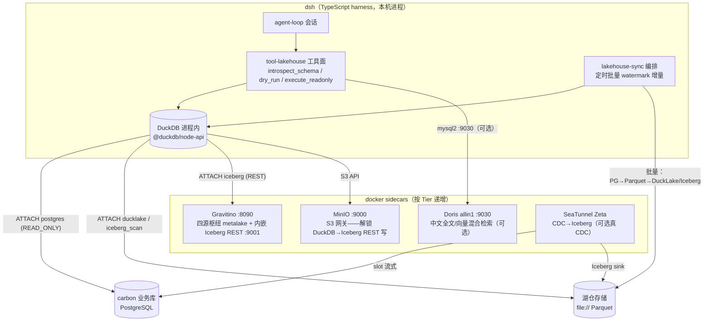

# R2a｜湖仓 + 数据治理开源选型 L4 深度调研报告（W24 轮前置研究）

> 归档：`research/2026-10-09-w24-rebuild/r2a-lakehouse-governance/`
> 日期：2026-10-09 ｜ 深度：Exhaustive ｜ 报告语言：中文
> 上游任务：deepseek-harness W24 轮架构级重构——「湖仓 + 知识库 + 业务系统(carbon) + 本体 + 图谱」五源统一作为 LLM 会话数据源；本报告覆盖其中「湖仓 + 数据治理」两域。

## 0.1 执行摘要

本报告由 1 个 SCOUT 侦察分支 + 6 个 DIVE 深挖分支（表格式 / 查询引擎 / Catalog / 治理 / 同步链路 / LLM 工具调用面）并行调研合成，全部 62 个数据源于 2026-10-09 当日实测（GitHub API releases、官方文档站直读、Docker Hub tags API、npm/PyPI/crates.io registry、GitHub issues 检索），关键论断均经 ≥2 独立来源三角互证。六域结论一览：

| 域 | 主选 | 备选 | 出局 | 一句话理由 |
|---|---|---|---|---|
| 表格式 | **Apache Iceberg 1.12**（pyiceberg 0.12 sql catalog + file://） | DuckLake v1.0（单机极简、全 TS 链路）；Delta 4.4（delta-rs 成熟） | Hudi（无 JVM 不能写）、XTable（仅互转工具） | Iceberg 是唯一同时满足「无 JVM + SQL catalog + 完整写 API + 生态盟主」的格式；DuckLake 是单机约束下的极简新物种 |
| 查询引擎 | **DuckDB 1.5.6**（@duckdb/node-api 进程内嵌入 TS） | Apache Doris 4.1（中文全文 + 向量 + MySQL 协议）；StarRocks 4.1（4GB shared-data） | — | 嵌入式零容器是单机最优；Doris 是唯一原生中文分词全文检索引擎 |
| Catalog | **Apache Gravitino 1.3.1**（唯一 3.5/4 四源枢纽） | Polaris 1.8（纯 Iceberg 最轻 418MB）；Nessie 0.109（版本化叠加层） | Hive Metastore、Amoro（13 个月未发版） | 五源架构需要统一元数据中心，只有 Gravitino 的 metalake 模型覆盖湖仓+文件+关系库+模型 |
| 数据治理 | **轻量自建**（REST catalog 元数据直读 + GE/dbt 质量 + OpenLineage 手工事件） | DataHub 1.8（唯一 Neo4j GA connector + OL HTTP 直收端点） | Atlas（推荐 15G heap + Solr 32G，无 arm64 镜像）、Soda（v4.0 起 ELv2） | 两平台均无官方 TS SDK 且最低 8GB 常驻——平台不省任何 TS 集成成本 |
| 同步链路 | **自写 TS 批量**（DuckDB postgres ATTACH → DuckLake/Parquet，watermark 增量） | SeaTunnel 3.0 Zeta 单 JVM（真 CDC → Iceberg）；memiiso/debezium-server-iceberg | Airbyte（abctl 内嵌 K8s，直接违反无 K8s 约束） | 演示级数据量下批量 ETL 资源占用 MB 级 vs CDC JVM 常驻 GB 级 |
| LLM 工具调用面 | **自研 TS 工具面**（introspect_schema / dry_run / execute_readonly 三工具 + 三层只读防御） | WrenAI MCP sidecar（Apache-2.0，16 工具）；apache/doris-mcp-server（若选 Doris） | DB-GPT 整体引入（Python 平台型过重） | 工具面是 dsh 的核心竞争力，借鉴 Vanna prompt 模板 + WrenAI dry_run + Genie 截断回填 |

**推荐整合方案（分层演进）**：Tier 0 纯 TS 内嵌（DuckDB 进程内 + DuckLake 文件 catalog + pyiceberg 可选 sidecar）→ Tier 1 docker sidecar（Gravitino 单容器四源枢纽 + MinIO 解锁 DuckDB→Iceberg 写路径）→ Tier 2 可选 CDC（SeaTunnel Zeta 单 JVM）→ Tier 3 可选重引擎（Doris allin1 中文全文/向量）。详见第 7 章。

## 0.2 硬约束回顾（选型裁判规则）

本报告全程以下列用户硬约束为裁判规则，任何候选违反即出局：

1. **禁止 MVP / 简化玩具版**——表格式、查询引擎、catalog、元数据/血缘/质量/告警都要真能力，不接受演示性残缺实现。
2. **开发者 macOS 单机**（大概率 Apple Silicon）——必须单机可跑、资源占用可接受；docker sidecar 可以，必须 K8s 集群的方案直接出局（此规则淘汰了 Airbyte：其 OSS quickstart 官方原文 "runs on Kubernetes...uses Docker to create a Kubernetes cluster on your computer"，来源 https://docs.airbyte.com/platform/using-airbyte/getting-started/oss-quickstart）。
3. **业务库（carbon，大概率 PostgreSQL）自动同步进湖仓**（CDC 或批量）。
4. **LLM 会话通过 agent 工具调用真实查询湖仓**（text-to-SQL / schema introspection / 只读安全边界），拒绝 mock——这是「真实 API 实跑验证」的用户偏好。
5. **dsh 侧 TypeScript**——引擎 API/SDK 对 TS 客户端友好度是独立选型维度。

## 0.3 调研方法论与证据形态

### 0.3.1 编排流程

SCOUT（1 个 ask 子任务测绘全景 + 发现清单外新玩家）→ MAP（知识图谱 6 分支入图）→ DIVE（6 个 ask 子任务并行深挖，每支探索至饱和）→ SATURATE（聚合饱和判定）→ SYNTHESIZE（编排者合成本报告）→ DELIVER（分节落盘 + 双通道校验）。

### 0.3.2 搜索通道实况（重要：影响证据形态）

标准协议为 chrome-devtools DuckDuckGo 搜索，但侦察阶段实证 **duckduckgo.com / google.com 在本机不可达（无代理通路）**，各 DIVE 分支按降级协议采用等效通道组合：

- **GitHub API**（`api.github.com`：releases/latest、tags、search/issues、search/repositories）——版本/许可证/活跃度的第一权威源；匿名配额在并发分支间耗尽后等待 reset 恢复；
- **官方文档站直读**（curl -sL 或浏览器导航；raw.githubusercontent.com 取文档源文件）——能力边界的第一手原文；
- **Docker Hub Registry tags API**（`hub.docker.com/v2/repositories/<repo>/tags`）——arm64 架构支持与镜像尺寸的只读探测（本机无 docker CLI，`docker manifest inspect` 的等效替代；全程未启动任何容器）；
- **npm / PyPI / crates.io registry API**——TS/Python/Rust SDK 存在性与版本线的直接证据；
- **GitHub issues 检索**（mysql2 兼容、OOM 吐槽、single-machine 等关键词）——真实生产口碑。

所有子任务遵循「每个障碍 ≥3 条路径再降级；绝不编造内容」原则。未能取到的信息在报告中显式标注「未获得」，不冒充。

### 0.3.3 饱和判定

六分支全部报告 saturated：

| 分支 | 判定 | 备注 |
|---|---|---|
| A 表格式 | saturated | 9 个指定数据源全部触达，版本/许可证/活跃度四源交叉（tags.atom + dlcdn + PyPI + crates.io）；iceberg-python 完成源码级克隆审计 |
| B 查询引擎 | saturated | 四引擎六问全部拿到官方文档原文或 API 实测；残余缺口（报错原文、个别默认值）低决策权重 |
| C Catalog | saturated | 架构级核心问题（四源枢纽）获决定性答案：Gravitino 3.5/4 > UC 2.5/4 > 其余各 1/4 |
| D 治理 | saturated* | *中文社区口碑子分支被百度/bing 验证码环境性封锁（7 条路径全败），已在 4.8 节记录为已知局限 |
| E 同步 | saturated | 6 条路径全部下探到官方文档级一手证据；Airbyte 出局证据为官方原文引用 |
| F LLM 调用面 | saturated | 核心链路每环节 ≥2 独立来源；含 5 处任务书假设的修正性负发现 |

### 0.3.4 证据等级标注约定

- **[Critical]**：多独立来源互证的论断（版本号、许可证、能力边界原文）；
- **[Important]**：单一来源但来源权威（官方文档单页、单一 issue），措辞带 hedge；
- **[Observation]**：推断性/建议性内容（本报告的设计建议），显式标注为设计建议而非行业实证。

## 0.4 知识网络全景图

```mermaid
graph TB
    subgraph SCOUT["SCOUT 侦察（ask × 1）"]
        S1[全景测绘 + 新玩家发现]
    end
    subgraph DIVE["DIVE 深挖（ask × 6，并行）"]
        A[A 表格式]
        B[B 查询引擎]
        C[C Catalog]
        D[D 治理]
        E[E 同步链路]
        F[F LLM 工具调用面]
    end
    subgraph FMT["表格式层"]
        ICE[Apache Iceberg 1.12]
        PYI[pyiceberg 0.12]
        IGO[iceberg-go 0.7]
        DEL[Delta 4.4.1 + delta-rs 1.0]
        HUD[Hudi 1.2.1 — 无 JVM 不能写]
        PAI[Paimon 2.0 + PyPaimon]
        DUK[DuckLake v1.0 — 单机新物种]
        XT[XTable 0.4-incubating]
    end
    subgraph ENG["引擎层"]
        DDB[DuckDB 1.5.6 嵌入式]
        DOR[Apache Doris 4.1.4.1]
        STR[StarRocks 4.1]
        TRI[Trino 483 — 参照系]
    end
    subgraph CAT["Catalog 层"]
        GRA[Gravitino 1.3.1 — 四源枢纽]
        POL[Polaris 1.8 — 最轻 Iceberg REST]
        UCS[UnityCatalog 0.6 — AI 资产]
        NES[Nessie 0.109 — 版本化]
        AMO[Amoro 0.8.1-inc — 表维护]
    end
    subgraph GOV["治理层"]
        OMD[OpenMetadata 2.0.5]
        DAH[DataHub 1.8rc]
        ATL[Atlas 2.5 — 出局]
        GE[Great Expectations 1.24]
        SODA[Soda — ELv2 风险]
        DBT[dbt v2 Rust]
        OL[OpenLineage 1.53]
    end
    subgraph SYNC["同步层"]
        DEB[Debezium 3.7 + memiiso iceberg sink]
        FCC[Flink CDC 3.6/3.7]
        SEA[SeaTunnel 3.0 Zeta]
        AIR[Airbyte — 内嵌 K8s 出局]
        ETL[自写 TS 批量 + pg_mooncake]
    end
    subgraph LLML["LLM 调用面"]
        WRE[WrenAI — Apache-2.0 MCP]
        VAN[Vanna MIT — prompt 模板金矿]
        DBG[DB-GPT MIT]
        MCPD[doris-mcp-server / mcp-trino]
        BIG[Genie / Cortex Analyst 参照]
    end
    S1 --> A & B & C & D & E & F
    A --> ICE & PYI & IGO & DEL & HUD & PAI & DUK & XT
    B --> DDB & DOR & STR & TRI
    C --> GRA & POL & UCS & NES & AMO
    D --> OMD & DAH & ATL & GE & SODA & DBT & OL
    E --> DEB & FCC & SEA & AIR & ETL
    F --> WRE & VAN & DBG & MCPD & BIG
    ICE -.REST spec.-> GRA & POL & NES
    DDB -.iceberg 扩展直读/REST 写.-> ICE
    DDB -.ducklake/postgres 扩展.-> DUK
    GRA -.Iceberg REST 内嵌.-> ICE
    GRA -.jdbc 联邦.-> PG[(carbon 业务库 PG)]
    SEA -.CDC→Iceberg sink.-> ICE
    ETL -.批量→DuckLake.-> DUK
    MCPD -.只读直连.-> DOR
```



## 0.5 阅读指引

第 1–6 章对应任务书的调研问题 1–6（每章：候选逐个深挖 + 对比矩阵 + 可操作产出）；第 7 章为问题 7（每域主选/备选理由表 + 整合方案草案 + 与 dsh 现有 `packages/lakehouse/` 包的边界 + 初始化数据策略）；第 8 章为全量来源清单。报告全部论断的 URL 证据见各章行内引用与第 8 章汇总表。

# 第 1 章 湖仓表格式选型：Iceberg vs Delta vs Hudi vs Paimon vs DuckLake

本章回答调研问题 1：单机本地文件系统（file:// catalog）场景成熟度、写入路径（必须 Spark/Flink 吗？轻量写入库现状）、REST catalog 规范与表维护、社区活跃度与基金会背书。所有版本号均为 2026-10-09 当日经 GitHub tags.atom / dlcdn 镜像 / PyPI / crates.io 四源交叉实测。

## 1.1 Apache Iceberg 1.12.0 —— 生态盟主，单机路径完整度最高

**基本盘 [Critical]**：Iceberg 1.12.0 发布于 2026-09-30（rc0→rc2 九月连发；1.10.2/1.9.x 维护线仍在镜像），Apache-2.0，9,313 ★，Apache 顶级项目（https://iceberg.apache.org ，版本与 star 数经 `api.github.com/repos/apache/iceberg` 实测）。REST Catalog 规范页 https://iceberg.apache.org/rest-catalog-spec/ 自述为「community created the REST catalog protocol…a common API (using the OpenAPI spec)」，在 1.12 文档导航中列为 Catalogs 下的一等公民——尽管「draft→正式转正」的官方措辞未找到（见 1.8 矛盾 3），四家独立实现（Polaris/Gravitino/Nessie/UnityCatalog 另线）佐证其事实标准地位。

**sql/jdbc catalog（单机核心形态）[Critical]**：官方文档 https://iceberg.apache.org/docs/latest/jdbc/ 给出 `type=jdbc`、`uri=jdbc:mysql://…`、`jdbc.*` 前缀透传的完整配置（示例即 1.12.0 版本页面）。与之配套的 HadoopCatalog 文档页已 404，但 1.12 导航仍列条目——deprecation 原文未获（见 1.8 矛盾 4），不影响结论：**单机首选 sql catalog（SQLite 后端）而非 HadoopCatalog**。

**表维护 API [Critical]**：Java 侧 Java API + SparkActions 双路径齐备：`expireSnapshots` / `rewriteDataFiles` / `deleteOrphanFiles` / `rewriteManifests` / `rewritePositionDeletes`（来源：iceberg.apache.org/docs/latest/maintenance/ 与 API 文档实测）。

### 1.1.1 pyiceberg 0.12.0 —— 无 JVM 写入主通道（含源码审计）

**版本与依赖 [Critical]**：pyiceberg 0.12.0 发布于 2026-09-01（PyPI 实测；0.11.1=2026-03-03），仓库 apache/iceberg-python（1,154 ★）。克隆审计 `pyproject.toml` 得出关键事实：**Python ≥3.10~3.14；`pyarrow>=18` 是 extra 而非核心依赖**——核心安装轻量，extras 按需启用：`sql-sqlite=sqlalchemy`、`sql-postgres`、`duckdb/polars/daft/pandas/bodo`、`pyiceberg-core>=0.10.1`（Rust DataFusion FFI 绑定）、`bigquery/dynamodb/glue/hf/encryption`。

**写入 API 全集 [Critical]**（源码 `pyiceberg/table/__init__.py:489-1803`，参数类型 `pa.Table`）：
- `append(df)` —— 追加
- `dynamic_partition_overwrite(df)` —— 动态分区覆写
- `overwrite(df, delete_filter=...)` —— 条件覆写
- `delete(delete_filter=...)` —— 条件删除
- `upsert(df)` —— 主键 upsert
- `add_files(...)` —— 已有 Parquet 文件登记

**维护 API 边界 [Critical]**：`pyiceberg/table/maintenance.py:30-46` **仅有 `expire_snapshots()`**（builder + autocommit Transaction 模式）；`rewrite_data_files` / `remove_orphan_files` 不在 pyiceberg——需要 Spark/Amoro（或容忍小文件，由 DuckDB 引擎侧的 iceberg 扩展处理读取端合并）。

**SqlCatalog 实现策略 [Critical]**（源码 `pyiceberg/catalog/sql.py:117` 起）：基于 SQLAlchemy DeclarativeBase 双表（`iceberg_tables`：catalog/namespace/table 三主键 + metadata_location；`iceberg_namespace_properties`），MetastoreCatalog 抽象下与 REST/Hive/Glue 平级；`_init_catalog_tables` 开关自动建表；schema_version v0/v1（v1 增 `iceberg_type` 列支持视图）。CatalogType 枚举 = `rest/hive/glue/dynamodb/sql/in-memory/bigquery`。官方测试范式（`tests/conftest.py:3146`）：

```python
SqlCatalog(name, uri="sqlite:///:memory:", warehouse=f"file://{warehouse}")
```

file:// 路径由 `PyArrowFileIO` 分派处理（configuration 文档）。

### 1.1.2 iceberg-go 0.7.0 —— 写能力全绿的官方 Go 实现

**[Critical]** 0.7.0 发布于 2026-10-01（0.6.0=2026-05-28），472 ★，Go 1.26+。README 实测写能力矩阵**全绿**：Append Stream / Append Data Files / Rewrite Files / Rewrite manifests / Overwrite Files / COW Delete / Pos Delete / Eq Delete / Row Delta 全部 ✅——**不是只读库**。Catalog 矩阵：REST/Hive/Glue/SQL/Hadoop 建表删表改表全支持。自带类 pyiceberg CLI（配合 apache/iceberg-rest-fixture 官方测试 fixture 镜像）。0.7 新增 REST 远程 scan planning（UUIDv7 幂等重试）。来源：https://github.com/apache/iceberg-go 。对 dsh 的意义：若未来需要编译型 sidecar，Go 是现成选项。

## 1.2 Delta Lake 4.4.1 —— Kernel 路线 + delta-rs 双保险

**[Critical]** Delta 4.4.1 发布于 2026-10-05（4.4.0=2026-08-20），9,040 ★，Linux Foundation 托管（https://github.com/delta-io/delta ）。4.4 博客主打 **UC Delta API**（Unity Catalog 0.5+，「versioned, intent-based, atomic REST surface」，可本地跑 Spark+DuckDB）。**Delta Kernel**（https://docs.delta.io/latest/delta-kernel.html ）Java+Rust 双实现：单进程读写、盲追加/幂等追加、checkpoint；Table API + 可插拔 Engine API；**Delta Standalone 已标 deprecated**；Rust Kernel 已进 ClickHouse。DuckDB 的 delta/unity 扩展已转正支持写入 + time travel（详见第 2 章）。

**delta-rs（Rust 引擎）[Critical]**：Rust 核心 1.0.0=2026-09-28（1.1.1=2026-10-04）；Python 绑定 `deltalake` 1.6.6=2026-09-24（PyPI 实测）。`write_deltalake("tmp/some-table", df)` 本地路径直写，merge/optimize/Z-Order/delete 齐备（https://delta-io.github.io/delta-rs/latest/ ）。3,329 ★。

## 1.3 Apache Hudi 1.2.1 —— 无 JVM 不能写，出局

**[Critical]** 1.2.1 发布于 2026-09-24（dlcdn 线：1.0.2→1.1.0→1.1.1→1.2.0→1.2.1），6,285 ★，Apache-2.0。README 定性：内置摄取工具「for Apache Spark/Flink users」；表服务「integrated into Spark/Flink writers or operated independently」。**脱离 Spark/Flink 不能写**：`hudi-rs`（`pip install hudi` / `cargo add hudi`，https://hudi.apache.org/docs/python-rust-quick-start-guide/ ，1.2.1 版）**仅读**——snapshot/time-travel/incremental/RO 查询 + DataFusion 扩展，文档明示表需先由 Spark quick start 创建；DeltaStreamer 是 Spark 作业。Hudi 文档另提供 catalog_polaris 接入页（Polaris 联邦可行，但改变不了写路径依赖）。**对单机无 JVM 约束直接出局。**

## 1.4 Apache Paimon 2.0 —— 流式黑马 + 纯 Python 客户端

**[Critical]** 2.0 stable（官网版本器实测，2026-08 大版本）、**2.1.0-rc4 = 2026-10-08**（发布在即）、master=2.2-SNAPSHOT，3,416 ★。**文件系统表脱离 Flink 完全可写**：Spark Quick Start 给出 `--conf spark.sql.catalog.paimon.warehouse=file:/tmp/paimon` 单机范式，PK 表 deduplicate merge engine 原生。**PyPaimon**（https://paimon.apache.org/docs/master/pypaimon/ ）：纯 Python 实现，**核心 API 无需 JDK**，catalogs/scan splits/explicit commits + Multimodal API（向量/全文/BLOB）+ Ray/Daft/PyTorch。2.x 主打 Multimodal Table 与 AI 场景。导航含 Iceberg Compatibility 页（页面本体 404，存在性由导航证实，见 1.8 矛盾 5）；catalog 支持 Hive/JDBC/REST。

**定位判断 [Important]**：Paimon 是「Flink 原生流式湖仓」——若同步链路走 Flink CDC 则它是 Iceberg 正面对手；但 dsh 场景 Flink 非必选，Paimon 的流式优势用不上，且生态（引擎直读支持面）仍以 Iceberg 为宽。列为备选观察项。

## 1.5 DuckLake v1.0 —— 单机约束下的极简新物种

**[Critical]** DuckLake 官网 FAQ 实测：**v1.0 于 2026-04 发布，production-ready + 向后兼容保证**（规格版本）；Rust crate 0.0.21=2026-10-03（crates.io，规格版本与 crate 版本双轨，见 1.8 矛盾 1）；3,253 ★，**MIT**（https://ducklake.select ，https://github.com/duckdb/ducklake ）。架构：**元数据存任何 ACID SQL 库（PostgreSQL/MySQL/SQLite/DuckDB——单文件即可）、数据存纯 Parquet**（官网称 Parquet 与 Iceberg 兼容）；**无 catalog server**；快照无需 compaction；**多 DuckDB 实例可并发读写同一数据集**。体验：

```sql
INSTALL ducklake; INSTALL sqlite;
ATTACH 'ducklake:sqlite:metadata.sqlite' AS dl (DATA_PATH 'data/');
```

**对 dsh 的独特价值**：整条「业务库→湖仓→查询」链路可纯 TS 化（@duckdb/node-api + INSTALL postgres + INSTALL ducklake），零 JVM、零 Python、零服务进程。它是「Iceberg 候选」而非 Iceberg——多引擎互操作（Trino/Doris 直读）依赖 DuckDB 生态（duckdb.org 文档另载 iceberg_to_ducklake 互转函数，DIVE-B 发现）。

## 1.6 Apache XTable（孵化）—— 跨格式互转保险丝

**[Critical]** 0.4.0-incubating = 2026-08-24，1,256 ★（https://xtable.apache.org ）。定性：非新格式，**全向翻译 Delta/Hudi/Iceberg 元数据层**（写入 `_delta_log` / `metadata/` / `.hoodie`），数据文件不动；与 Delta UniForm（单向、Delta 仓内治理）对比明确。定位为多格式选型的「保险丝」——若未来要从 DuckLake/Delta 迁 Iceberg，数据文件无需重写。仍孵化中，不作为主链路依赖。

## 1.7 对比矩阵与决策

| 维度 | Iceberg 1.12 | Delta 4.4.1 | Hudi 1.2.1 | Paimon 2.0 | DuckLake v1.0 |
|---|---|---|---|---|---|
| 许可证 | Apache-2.0 | Apache-2.0（LF） | Apache-2.0 | Apache-2.0 | **MIT** |
| 基金会/公司 | Apache 顶级 | Linux Foundation | Apache 顶级 | Apache 顶级 | DuckDB Labs |
| 单机 file:// 写入（无 JVM） | ✅ pyiceberg 0.12（append/overwrite/delete/upsert）+ iceberg-go | ✅ delta-rs / deltalake Python | ❌ hudi-rs 只读 | ✅ PyPaimon（无 JDK） | ✅ DuckDB ATTACH 直写 |
| catalog（单机） | sql（SQLite）/ REST / in-memory | 文件系统 _delta_log | hive/catalog_polaris | 文件系统 / REST | **SQL 库即 catalog（SQLite 单文件）** |
| REST catalog 规范 | 定义者 | UC Delta API（另线） | — | 支持 | —（无 server 概念） |
| 表维护 | Java 全集 / pyiceberg 仅 expire | optimize.compact（delta-rs） | 内置表服务 | 自带 compaction 过程 | 宣称无需 compaction |
| 引擎直读面 | 最宽（DuckDB/Trino/Doris/StarRocks/Spark） | 宽（Kernel 路线） | 中 | 中（Flink/Spark/部分引擎） | DuckDB 系 |
| TS 生态可及性 | iceberg-js（npm，REST 客户端） | DuckDB delta 扩展 | ❌ | ❌ | **@duckdb/node-api 原生** |
| 2026 活跃度 | 1.12.0（09-30） | 4.4.1（10-05） | 1.2.1（09-24） | 2.1.0-rc4（10-08） | crate 0.0.21（10-03） |

**决策**：主选 **Iceberg**（生态 + REST spec + pyiceberg/iceberg-go 双轻量写入 + 全引擎直读——第 2/3 章的引擎与 catalog 结论都建立在 Iceberg 面上）；**备选 DuckLake**（单机极简、纯 TS 全链路、MIT——若「必须 Iceberg」约束放松，它是开发体验最优解）；Delta 为次备选（delta-rs 1.0 刚稳定，若走 Databricks 兼容路线）；Hudi 出局；Paimon 观察流式需求。

## 1.8 未解决矛盾（全部低决策权重，已逐项尝试 ≥3 路径）

1. **DuckLake 版本双轨**：官网 FAQ「v1.0 published April 2026」（规格）vs crates.io crate 0.0.21（Rust 实现）；DuckDB 扩展形态版本未实测（受研究期禁装约束）。
2. **Hudi 0.14.2 tag updated=2026-06-08** 与历史发布时间（2024）矛盾——判定为 tag 对象更新时间，1.x 时间线以 dlcdn 为准。
3. **Iceberg REST spec「转正」表述**：规范页自称社区协议 + OpenAPI YAML，未找到官方「draft→正式」措辞；事实标准地位由四家独立实现佐证。
4. **HadoopCatalog deprecation 原文未获**（文档页 404，导航条目仍在）。
5. **Paimon Iceberg Compatibility 页面 404**（三路径均失败，存在性由导航证实）。

# 第 2 章 查询引擎选型：DuckDB vs Doris vs StarRocks vs Trino

本章回答调研问题 2：单机部署形态与资源占用、Iceberg 表格式读取支持（含 latest snapshot / 时间旅行）、MySQL wire protocol 对 TS mysql2 客户端的直连友好度、向量/全文检索能力、text-to-SQL 场景错误信息友好度。架构探测经 Docker Hub Registry tags API 只读完成（未启动任何容器）。

## 2.1 DuckDB 1.5.6 —— 唯一进程内选项，TS 嵌入首选

**版本与 Node 客户端 [Critical]**：核心 v1.5.6（2026-09-28，MIT，42k★）。**新 Node API `@duckdb/node-api` npm latest = 1.5.6-r.1（与核心同日同步发布）**；旧 `duckdb` npm 包停在 1.4.4（duckdb/duckdb-node 仓 2026-01-30 后为维护线）——**新项目必须用 `@duckdb/node-api`**。双包架构：高层 `@duckdb/node-api` + 贴 C API 的 `@duckdb/node-bindings`；平台矩阵含 **osx_arm64**（linux/windows amd64+arm64 均有），预编译分发、无本地编译。API 风格：`DuckDBInstance.create(':memory:')` / `create('my.db', { threads: '4' })`、`DuckDBInstance.fromCache()` 防同库多实例、`connection.run/prepare/stream`、参数绑定 `$1`/`$a`、2048 行 chunk 流式、`getRowObjectsJson()`。Roadmap 未完成项：MAP/UNION append、逐行默认值、UDF/UDTF、Arrow API。（来源：duckdb.org/docs/current/clients/node_neo/overview 、registry.npmjs.org/@duckdb/node-api）

### 2.1.1 iceberg 扩展——能力边界（官方文档原文级）

**无 catalog 直读 [Critical]**：`iceberg_scan('path' [, allow_moved_paths=true])`，可直指 `metadata/v1.metadata.json`；`version` 参数 / version-hint.txt；无 hint 时 `version='?'` 猜测需 `SET unsafe_enable_version_guessing=true`（可能破坏 ACID）；仅支持 gzip 压缩 metadata。**Time travel 双形态**：直读 `snapshot_from_id=` / `snapshot_from_timestamp=`；REST catalog 表 `SELECT ... AT (VERSION => id)` / `AT (TIMESTAMP => ts)`。

**写支持边界 [Critical]**（原文："Writing to a table read directly from storage with iceberg_scan is not supported: the catalog is required to commit the new table metadata"）：必须 attach REST catalog 后方可写。支持 CREATE/DROP SCHEMA/TABLE、INSERT、UPDATE、DELETE、MERGE INTO、ALTER TABLE（schema evolution）、`COPY FROM DATABASE` 双向深拷贝；分区 identity/bucket/truncate；**v3 表支持 VARIANT、TIMESTAMP_NS、列默认值、binary deletion vectors(Puffin)、row lineage**；限制：仅 merge-on-read、只写 positional deletes（v3 为 DV）、不支持 copy-on-write、UPDATE/DELETE 不能用于 sorted 表、GEOGRAPHY/UNKNOWN 未支持（计划 v2.0.0）。

**REST catalog attach 与存储后端限制 [Critical]**：`CREATE SECRET (TYPE ICEBERG, CLIENT_ID..., OAUTH2_SERVER_URI...)` + `ATTACH 'warehouse' AS c (TYPE ICEBERG, SECRET s, ENDPOINT '...')`；官方适配 S3 Tables/Glue/R2/**Polaris**/**Lakekeeper**/SeaweedFS/BigLake；**存储后端仅支持 S3/S3 Tables/GCS**（"Support for other storage backends is not yet available"）——**本地 file:// 后端不可用**；单机要走 DuckDB→Iceberg 写路径需 S3 兼容网关（MinIO/SeaweedFS）sidecar。[Important] 推论「MinIO（S3 API）即满足 S3 后端要求」未在文档逐字确认，W24 实施时需一次实测。

**delta / unity_catalog 扩展 [Critical]**：delta 基于 Delta Kernel 只读（本地+远端）；uc attach 后 SELECT/INSERT（含 Databricks CMC 表透明读写）、time travel、checkpoint；**不支持 DELETE/UPDATE/DDL**；平台 osx_amd64/osx_arm64/linux_arm64/linux_amd64/windows_amd64。

### 2.1.2 向量（VSS）与全文（FTS）——嵌入式能力面与边界

**VSS [Critical]**：`CREATE INDEX ... USING HNSW (vec)`，metric ∈ l2sq/cosine/ip，超参 ef_construction=128 / ef_search=64 / M=16；查询靠 `ORDER BY array_distance(...) LIMIT` 或 `min_by()` 自动加速；`SET hnsw_ef_search` 运行时调 recall。**限制**：仅 FLOAT[32]；索引不受 buffer 管理、须整体驻 RAM 且不计入 memory_limit；持久化默认仅内存库（`hnsw_enable_experimental_persistence` 实验，WAL 恢复不完善）；删除为标记式，需 `PRAGMA hnsw_compact_index`。**FTS [Critical]**：`PRAGMA create_fts_index('t','id','txt')`（schema fts_main_t）+ `match_bm25(id, query)` Okapi BM25（k=1.2, b=0.75），27 种 stemmer、571 英文停用词；**无中文 stemmer 且默认 ignore 正则剔除非 a-z 字符——中文全文需自定义方案**。**两套索引均只能建在 DuckDB 数据库内表上，不适用于 iceberg_scan/外部 catalog 表**（文档明确分离两条访问路径）。

### 2.1.3 配置与只读

**[Critical]** `SET memory_limit='10GB'`（默认 80% of RAM）、`SET threads TO 1`；`ATTACH 'file.db' (READ_ONLY)`；HTTP/S3 端点 attach 默认只读；attach 不跨会话持久；AES-256-GCM 加密。`enable_external_access` 默认 true、配套 `allowed_paths` 运行时白名单（「只能构建时启用」的流传说法经 DIVE-F 证伪）。

## 2.2 Apache Doris 4.1.4.1 —— Iceberg 写能力最强 + 唯一原生中文全文

**部署与 arm64 [Critical]**：官方脚本 `curl -fsSL https://doris.apache.org/files/start-doris.sh | bash -s -- -v 4.1.0`；本地部署需 JDK17+。Docker Hub tags API 实测：`apache/doris:fe-4.1.4.1` / `be-4.1.4.1` / `ms-4.1.4.1` 与 `all-in-one-4.1.3(-full)` **均含 arm64/linux**（fe 压缩 1.6GB、be 2.9GB、allin1 1.78GB/2.24GB；all-in-one 尚未跟进 4.1.4.1）。FE+BE 架构（云模式 FE+CN），MySQL 协议端口 **9030**。4.x 官方定位已改为 "hybrid search database **for AI agents**"。

**Iceberg 支持（四引擎最强）[Critical]**：Iceberg catalog 支持 hms/rest/hadoop/glue/dlf/jdbc/s3tables 七种 catalog type；**读写双向：INSERT / INSERT OVERWRITE / UPDATE / DELETE / MERGE INTO**；time travel `FOR TIME AS OF 'ts'` / `FOR VERSION AS OF snapshot_id`，且支持 **branch/tag**（3.1.0+，`@bra/@tag()` 多语法兼容 Spark/Trino）；**V3 表 UPDATE/DELETE 用 Puffin deletion vectors 替代 position deletes**；`_file/_pos` 隐藏列；`ALTER TABLE ... EXECUTE expire_snapshots` 表维护；4.x 支持 Iceberg 视图查询（3.1+，仅 hms）。（来源：raw.githubusercontent.com/apache/doris-website/master/docs/lakehouse/catalogs/iceberg-catalog.mdx）

**倒排索引 + 中文分词 [Critical——本场景独一份]**：`INDEX idx(content) USING INVERTED PROPERTIES("parser"="chinese","support_phrase"="true")`——**原生中文分词 parser**；查询 MATCH_ANY/MATCH_ALL/MATCH_PHRASE/MATCH_PHRASE_PREFIX/MATCH_REGEXP；**4.0+ BM25 score() 相关性排序 + SEARCH() 统一 DSL**（多列布尔组合），官方明确定位 "Hybrid search: text + vector"。

**向量索引 [Critical]**：基于 **Faiss**，index_type ∈ hnsw/ivf/ivf_on_disk，`"metric_type"="l2_distance"/"dim"/"quantizer"=flat` 等；限制：`Array<Float> NOT NULL`、仅 Duplicate Key 或 merge-on-write Unique Key 表（**不能对湖上 Iceberg 外表建**）；调优：segment≤5、`enable_segment_cache_prune=false` 常驻、`parallel_pipeline_task_num=1`；生态 SDK doris_vector_search（uchenily）。

**资源管理与 mysql2 [Critical]**：Workload Group 进程内 CPU（cpu_share）/内存/IO 隔离 + 查询排队；云模式必须显式 `FOR <compute_group>`。MySQL 协议证据：PR#68745（open，2026-10-06）zlib 压缩协议开发中（mysql2 默认不启用压缩，不受影响）；Issue#47060（closed 2025-09）nodejs 驱动 multipleStatements 已修复；未发现 mysql2 认证系统性失败 issue（Doris 用 MySQL 原生密码体系）。**官方 MCP：apache/doris-mcp-server（351★，2026-10-08 活跃，read-only 定位）**。

## 2.3 StarRocks 4.1 —— 湖仓直查性能标杆 + 官方 4GB 单机教程

**部署与 arm64 [Critical]**：GitHub release 4.1.3（2026-09-17），**Docker 镜像线已到 4.1.6**：`starrocks/allin1-ubuntu:4.1.6`（1.92GB）与 `cn-ubuntu`/`fe`/`be-ubuntu` 全线 **arm64**；shared-data 快速开始 = docker compose（minio + fe + cn，~30s 健康）；**官方 MCP 教程标注最低 ~4GB RAM（1FE+1CN+MinIO，笔记本可跑）**；Apple Silicon 提示原文 "StarRocks leans on AVX2 (x86); use an ARM build or expect slower emulation"（arm64 原生镜像存在，SIMD 优化以 x86 为主）。MySQL 协议 **9030**。4.x 文档站重构、提供 **llms.txt + 全页 .md 直读**（AI 友好，docs.starrocks.io/llms.txt）。许可 ELv2/免费社区版。

**Iceberg [Critical]**：`CREATE EXTERNAL CATALOG ... ("type"="iceberg","iceberg.catalog.type"="rest","iceberg.catalog.uri"=...)`；**REST catalog 上可 CREATE TABLE + INSERT（写支持）**；time travel 3.4+；4.0+ Iceberg compaction / hidden partitions、3.5 Iceberg 视图创建；异步物化视图（3.1+）+ 多分区列 MV（3.5+）湖仓加速；TPC-DS 官方数据比 Trino 快 8.13x（内表）/ 6.93x（Iceberg 查询）。

**向量索引（Beta）[Critical]**：`INDEX v(vector) USING VECTOR("index_type"="hnsw"/"ivfpq","dim","metric_type"="l2_distance"/"cosine_similarity"/"inner_product","M","efconstruction"/"nbits","nlist")`；approx_* 函数族与 exact 分离；HNSW 支持 sq4/sq8/pq 前置量化；`index_build_threshold` 默认 10000 行；shared-data 支持 sync/async 构建；**限制：每表仅一个向量索引、ARRAY<FLOAT> NOT NULL、仅原生 DUPLICATE/PRIMARY KEY 表（不可建在 Iceberg 外表）**。另有 inverted_index / Ngram Bloom Filter / Bitmap / Prefix 索引族。**官方 MCP：mcp-server-starrocks（uv/PyPI 分发）**。

## 2.4 Trino 483 —— 生产参照系，单机偏重

**[Critical]** 483（2026-07-18，Apache-2.0，13.3k★）。`docker run trinodb/trino:483`（**amd64+ppc64le+arm64 三架构，988MB 压缩**）；**JVM 内存决定性证据（镜像默认 jvm.config 原文）：`-XX:InitialRAMPercentage=80 -XX:MaxRAMPercentage=80` + G1——堆=容器内存的 80%**（给容器 8GB→堆 6.4GB）。HTTP :8080（**无 MySQL 协议**）；TS 客户端 **@trinodb/trino-js-client 1.0.0（2026-09-28 官方 1.0 里程碑）**。Iceberg connector：`iceberg.catalog.type` ∈ hive_metastore/glue/jdbc/**rest**/nessie/snowflake 六种；time travel `FOR TIMESTAMP AS OF`；`"table$snapshots"` 元数据表；CREATE/INSERT/UPDATE/DELETE/MERGE 全支持——**connector 成熟度是四引擎中最久经生产验证的参照系**（Doris/StarRocks 文档均以兼容 Spark/Trino 语法为荣）。MCP：无官方，社区最高 tuannvm/mcp-trino（Go，121★）。

## 2.5 四引擎对比矩阵

| 维度 | DuckDB 1.5.6 | Doris 4.1.4.1 | StarRocks 4.1 | Trino 483 |
|---|---|---|---|---|
| 许可证 | MIT | Apache-2.0 | ELv2 社区版 | Apache-2.0 |
| 部署形态 | **进程内嵌入 TS** | docker FE+BE/allin1 | docker fe+cn+minio / allin1 | docker 单 JVM |
| 单机资源 | MB 级（memory_limit 可调，默认 80% RAM） | allin1 建议 ≥8-16GB | **官方 4GB 可跑** | 堆=80%×容器内存 |
| arm64 | osx_arm64 预编译 npm | ✅（4.1.4.1 全线） | ✅（4.1.6 全线，SIMD 偏 x86） | ✅ |
| Iceberg 读 | iceberg_scan 直读 + REST catalog | catalog 七类型 + time travel + branch/tag | external catalog + time travel 3.4+ | connector 六 catalog type（最成熟） |
| Iceberg 写 | REST catalog（MERGE INTO，merge-on-read） | **最全（INSERT/UPDATE/DELETE/MERGE + V3 DV）** | REST catalog CREATE+INSERT | 全 DML |
| MySQL 协议（mysql2） | ❌（Node API） | ✅ 9030（无系统性 issue） | ✅ 9030（JWT auth-switch 坑） | ❌（HTTP + trino-js-client 1.0） |
| 中文全文 | ❌（FTS 无中文 stemmer） | **✅ parser="chinese" + BM25 + SEARCH()** | 倒排（中文分词支持度待核） | ❌ |
| 向量 | VSS HNSW（实验性持久化，FLOAT[32]） | Faiss hnsw/ivf（内表） | Beta hnsw/ivfpq + approx_*（内表） | ❌ |
| 湖上外表建索引 | ❌ | ❌（内表 only） | ❌（内表 only） | ❌ |
| 官方 MCP | 生态（MotherDuck/duckdb_mcp） | ✅ apache/doris-mcp-server 351★ | ✅ mcp-server-starrocks | ❌（社区 tuannvm） |
| 报错风格 | Binder Error + 建议（生态常识，原文未取——见 2.7） | errCode/detailMessage（MySQL 客户端风格） | 同源 MySQL 风格 | ANALYSIS 错误带行号（文档级证据未取） |

**决策**：主选 **DuckDB**（唯一进程内、零容器、@duckdb/node-api 同日发版、TS 原生——单机开发体验无出其右）；**备选 Doris**（需要中文全文/向量混合检索或 MySQL 协议生态时，allin1 arm64 单容器）；StarRocks 二备选（湖仓直查性能 + 4GB 教程，但 ELv2 与向量 Beta 减分）；Trino 作为「连接器行为参照系」保留在知识库，不作部署目标。

## 2.6 可操作产出

**mysql2 直连 Doris/StarRocks（9030）**：
```ts
import mysql from 'mysql2/promise';
const conn = await mysql.createConnection({
  host: '127.0.0.1', port: 9030, user: 'ro_agent', password: '***', database: 'carbon_dwh',
  // Doris/StarRocks 走 MySQL 原生认证，无 caching_sha2 处理需求
}); // multipleStatements 保持 false，逐句执行便于 text-to-SQL 重试
```

**@duckdb/node-api 嵌入 + ATTACH Iceberg（REST catalog 读写）**：
```ts
import { DuckDBInstance } from '@duckdb/node-api'; // pnpm add @duckdb/node-api（osx_arm64 预编译）
const db = await DuckDBInstance.create('lake.duckdb', { threads: '4' });
const c = await db.connect();
await c.run(`SELECT count(*) FROM iceberg_scan('data/tbl', allow_moved_paths = true)`); // 无 catalog 只读直扫
await c.run(`CREATE SECRET (TYPE ICEBERG, CLIENT_ID 'admin', CLIENT_SECRET 'pw',
  OAUTH2_SERVER_URI 'http://localhost:8181/v1/oauth/tokens')`);
await c.run(`ATTACH 'warehouse' AS cat (TYPE ICEBERG, SECRET secret, ENDPOINT 'http://localhost:8181')`);
await c.run(`CREATE TABLE cat.db.events (id BIGINT) WITH ('format-version'='2')`);
// 时间旅行：SELECT * FROM cat.db.events AT (TIMESTAMP => TIMESTAMP '2026-10-01 00:00:00');
```

**arm64 镜像清单（Docker Hub tags API 实测 2026-10-09）**：

| 引擎 | 镜像:tag | 架构 | 压缩大小 |
|---|---|---|---|
| Doris | apache/doris:fe-4.1.4.1 / be-4.1.4.1 / ms-4.1.4.1 | amd64+arm64 | 1.6/2.9/0.79 GB |
| Doris | apache/doris:all-in-one-4.1.3（-full 2.24GB） | amd64+arm64 | 1.78 GB |
| StarRocks | starrocks/allin1-ubuntu:4.1.6 | amd64+arm64 | 1.92 GB |
| StarRocks | starrocks/cn-ubuntu:4.1.6（fe/be-ubuntu 同线） | amd64+arm64 | 1.27 GB |
| Trino | trinodb/trino:483 | amd64+ppc64le+arm64 | 0.99 GB |
| DuckDB | npm @duckdb/node-api@1.5.6-r.1 | osx_arm64 等 8 平台预编译 | — |

## 2.7 未解决矛盾与缺口

1. **报错原文**：Doris/StarRocks/Trino 对错误 SQL 的官方「错误处理」章节原文未取到（Doris errCode 结构、DuckDB "Binder Error + 建议"属生态常识，本轮无一手来源）——对 text-to-SQL 重试回路设计影响低（错误信息必然回喂模型，风格差异不改变架构）。
2. **StarRocks 版本口径**：GitHub release=4.1.3 而 Docker 镜像=4.1.6（镜像先行），采用时以镜像 tag 为准。
3. **Doris query_timeout 默认值 / StarRocks CREATE RESOURCE GROUP 语法原文**未取证（workload group 原文已取；只读超时语法在第 6 章经 DIVE-F 补齐了 Doris query_timeout 默认 900s + exec_mem_limit 默认 100G 的 FE 源码证据）。
4. **DuckDB REST catalog 本地后端**：仅 S3/S3 Tables/GCS 的限制与「Lakekeeper+本地盘」设想冲突——MinIO 是否满足未逐字确认，W24 实施时实测。
5. **StarRocks arm64 性能折扣**：官方提示 SIMD 偏 x86，量化数据无。

# 第 3 章 Catalog / 元数据枢纽：Gravitino vs Polaris vs UnityCatalog vs Nessie vs Amoro vs HMS

本章回答调研问题 3：轻量单机选谁；REST catalog 协议与 Iceberg 的配合；**能否同时当「湖仓+知识库+图库+业务库」四源统一元数据中心**（五源架构的关键枢纽）；自带 UI 有无。本章对 W24 北极星架构权重最高——五源统一的第一落点就是 catalog 层。

## 3.1 Apache Gravitino 1.3.1 —— 唯一接近四源枢纽的候选（3.5/4）

**基本盘 [Critical]**：v1.3.1 发布 2026-09-30；**TLP 毕业确认**（v0.9.0-incubating 为末个孵化 tag，v1.0.0 起无后缀）；Apache-2.0；3,243★；pushed_at 2026-10-09（日活）。datastrato 捐赠。（来源：api.github.com/repos/apache/gravitino 、github.com/apache/gravitino/releases）

**单机部署 [Critical]**：Java 17；**Linux + macOS x86_64/ARM64 官方声明**；单进程 `bin/gravitino.sh` 起 :8090，**内嵌 H2 缺省存储，无外部 DB 依赖即可跑**；官方 docker 镜像 apache/gravitino（86 tags，arm64 确认存在；amd64 压缩 ~1.98GB——偏重，内嵌多 catalog 依赖）。（来源：gravitino.apache.org/docs/1.3.1/）

**catalog 支持矩阵（1.3.1 官方清单，任务书点名的矩阵页）[Critical]**：
- **Relational（12）**：**PostgreSQL（12–16，可写 DDL 代理）**、MySQL、Doris、Hologres、StarRocks、OceanBase*、ClickHouse*、Hive、**Iceberg**、**Paimon**、**Hudi**、Lakehouse-generic（**Lance**，1.3 新）；*=contrib 目录不在标准发行包；
- **Fileset**（**本地 file:// 内置** + HDFS 内置 + S3/GCS/ADLS/OSS/COS bundle jar；location 三级继承、建 schema 自动建目录）——知识库文件源的直接挂载点；
- **Messaging**（Kafka）；
- **Model**（名称→URI 映射注册表 + 版本 + production/champion 别名 + 多 URI，自管不外联）——本体/模型资产登记位；
- 治理：metalake 级 **Tag / Policy / Job Template / Role / Job**；RBAC = ownership + role(privileges: SELECT_TABLE…)→user/group，授权向下继承、默认拒绝、**显式 DENY 压倒一切**（authorization 默认关闭）。

**REST 兼容 [Critical]**：内嵌 **Iceberg REST Catalog Service**（实现 Apache Iceberg REST spec，Iceberg 1.11，端点 `/iceberg/`；standalone 缺省 :9001 或 aux 模式挂主服务 :8090；**不支持 multi-table transaction 与 view registration**；后端 memory/Hive/JDBC/REST；OAuth2 + HTTPS + 审计 + 事件监听）。另有 **Lance REST 服务**（1.3 新，向量湖格式）。OpenAPI 全量文档：gravitino.apache.org/docs/1.3.1/api/rest/gravitino-rest-api 。

**UI/CLI/SDK 与彩蛋 [Critical]**：**官方 Web UI**（:8090，metalake/catalog/schema/表/文件集/模型浏览，模型可看版本与别名；打 tag 需走 API）+ 官方 CLI。SDK 仅 **Java + Python**（官方文档声明）——**npm 无官方/社区 TS client**（搜索仅命中无关包 @gravitino-dev/erp-lib，33 月下载）。认证 simple/basic/OAuth2/Kerberos。**彩蛋：官方 Gravitino MCP Server**（gravitino.apache.org/docs/1.3.1/gravitino-mcp-server）——直接面向 AI 工具管理元数据，对 agent harness 场景高价值。

**四源覆盖判定 [Critical]**：湖仓 ✅（Iceberg/Paimon/Hudi/Lance + Iceberg REST 服务）；知识库 ✅（fileset 挂本地目录/对象存储）；业务库 ✅（PG/MySQL 元数据联邦 + DDL 代理）；**图谱 ❌——catalog 清单无 Neo4j/图数据库连接器**（relational 均为 JDBC-SQL 系）→ **3.5/4**。图谱源的折中：Neo4j 自管 schema API + 在 Gravitino 侧以 fileset/model 资产登记（或等 contrib 出图连接器）。

## 3.2 Apache Polaris 1.8.0 —— 纯 Iceberg 湖仓枢纽，最轻（418MB）

**基本盘 [Critical]**：apache-polaris-1.8.0（2026-09-28）；**TLP 毕业确认**（1.3.0-incubating 后缀止于 1.4.0）；Apache-2.0；2,086★；日活。Snowflake 捐赠，**Iceberg REST Catalog 规范 reference implementation**（0.9.0 文档树即挂 Iceberg OpenAPI 页）。

**持久化（任务书重点问题）[Critical]**：1.8.0 三种 metastore——**In-Memory（默认，测试用，重启丢数据、禁多副本）/ PostgreSQL JDBC（生产推荐）/ MongoDB NoSQL（beta）**；Eclipse Store 与 Derby 在 1.8.0 文档 0 命中（已非当前持久层话术）。单机开发可 in-memory 起步，持久化需外部 PG。配置 `polaris.persistence.type=relational-jdbc` + `quarkus.datasource.jdbc.*`。（来源：polaris.apache.org/releases/1.8.0/helm-chart/persistence/ 、/metastores/relational-jdbc/）

**部署与能力 [Critical]**：Quarkus 应用；官方镜像 apache/polaris（14 tags，arm64 确认，amd64 压缩 ~418MB）+ apache/polaris-admin-tool（bootstrap realm）；RBAC（principal/role）+ OAuth2 token broker + Keycloak 指南 + **OPA 外部 PDP** + vended-credentials；**无 Web UI**（1.8.0 文档树无 UI 页；有 Admin Tool/CLI）；1.8 新增 Generic Table 实体与 **Federation**（Iceberg REST/HMS/BigQuery metastore 联邦——联邦是读外部 catalog，不是统一资产模型）；OpenAPI：Management API + Catalog API 双 spec。**无官方 TS SDK**（Spark Java client 为主）。

**四源覆盖**：湖仓 ✅（Iceberg-only + 联邦读）知识库 ❌ 业务库 ❌ 图谱 ❌ → **1/4**。

## 3.3 Unity Catalog OSS 0.6.0 —— AI 资产语义最全，多模态 2.5/4

**基本盘 [Critical]**：v0.6.0（2026-08-20，仍 0.x）；Apache-2.0；3,553★（五家最高）；日活；另有独立版本线 **UC AI**（ai-v0.4.0 网关 + unitycatalog-ai Python client）。（来源：api.github.com/repos/unitycatalog/unitycatalog）

**资产模型 [Critical]**：catalog.schema 下的**表（Delta 主力，quickstart 预载 4 张 Delta 表；Parquet/ORC/JSON/CSV/Avro/TEXT；Iceberg 经 UniForm）+ Volumes（文件）+ Functions + Models/Model Versions + AI tools**——UI 文档逐类演示 create/describe/delete。

**部署/UI [Critical]**：`bin/start-uc-server`（需 Java）+ **官方 UI 在 repo /ui 目录**（Node+Yarn：`cd /ui && yarn install && yarn start`）；docker compose 一键起 **server :8080 + UI :3000**（宿主 DuckDB/Spark 可直连）。**无官方 Docker Hub 镜像**（Docker Hub unitycatalog 命名空间 404）。**文档真实域名 = docs.unitycatalog.io**（unitycatalog.io/docs 与 www 域平铺路径均 404——后续抓取必用此域）。apidocs 为 JS 渲染 SPA，curl 不可得。

**客户端 [Critical]**：CLI（bin/uc）+ Python；**npm 无官方 TS SDK**（@unitycatalog/unitycatalog-ts 与 -ui 均 404；npm 搜 unitycatalog 仅第三方 express-middleware 16 月下载）——**repo 历史上含 TS client 目录的传闻与 npm 现状矛盾**（见 3.7 矛盾 1）；DuckDB `uc` 扩展直连（compose 文档明示 DuckDB/Spark 宿主接入）。认证 basic/OAuth2。

**四源覆盖**：湖仓 ✅（Delta/UniForm-Iceberg）知识库 ✅（volumes）业务库 ❌ 图谱 ❌ → **2.5/4**。

## 3.4 Nessie 0.109.0 —— Git-like 版本化叠加层

**[Critical]** 0.109.0（2026-10-08，发布节奏极密：两个月 10 个 release）；Apache-2.0（**非 ASF，独立社区**）；1,520★。模型：跨表事务 + Git 语义（branch/tag/commit）；内容模型以表格式为主（Iceberg 为主），**无 relational/fileset/graph 资产类型**。官方内嵌 Iceberg REST catalog 服务；服务端多 warehouse + 每 bucket S3 凭据（**绝不暴露给客户端**）+ MinIO 本地 S3 配方 + down-scoped 凭据 vending；GCS/ADLS experimental。客户端 Java/Python 官方，**npm 无 JS/TS client**。UI 存在（projectnessie.org/guides/ui/）。镜像 ghcr.io/projectnessie/nessie（arm64 manifest 未验证）。**四源覆盖 1/4——但作为「实验分支/时间旅行」层叠加在 Iceberg 面上是独特能力**（对 agent 场景的「沙箱试验分支查询」有想象空间）。

## 3.5 Apache Amoro（孵化）与 Hive Metastore

**Amoro [Critical]**：v0.8.1-incubating（**2025-09-11，距今 13 个月无 release**；repo pushed_at 2026-10-09，Docker tag 2026-09-23 仍在推——疑似 snapshot）；1,189★。AMS + 自优化 service，面向 Iceberg/Paimon/Hudi **表维护**，非元数据枢纽；arm64 确认（amd64 ~976MB）。任务书"上次 release 2025-09"核实属实。**不作枢纽候选**；若未来 Iceberg 小文件问题尖锐，可作为维护服务再评估（但第 1 章已证明 pyiceberg+expire_snapshots + DuckDB 读取端 merge-on-read 足以覆盖演示级数据量）。

**Hive Metastore [Critical]**：对照验证出局——Thrift 遗留、无 REST/多模态；Polaris 1.8 与 Gravitino 均以"HMS 联邦/catalog"方式收编存量（polaris federation/hive-metastore-federation、gravitino apache-hive-catalog）。

## 3.6 四源统一能力矩阵与决策

| 候选 | 湖仓（表格式） | 知识库（文件） | 业务库（PG/MySQL） | 图谱（Neo4j） | 附加资产 | 四源得分 |
|---|---|---|---|---|---|---|
| **Gravitino 1.3.1** | ✅ Iceberg/Paimon/Hudi/Lance + Iceberg REST 服务内嵌 | ✅ fileset：本地 file:// 与对象存储 | ✅ jdbc-postgreSQL(12–16)/MySQL 等元数据+DDL | ❌ 无图连接器 | model/Kafka topic/Tag/Policy/RBAC | **3.5/4** |
| **UnityCatalog 0.6.0** | ✅ Delta+UniForm(Iceberg)+Parquet 族 | ✅ volumes | ❌ | ❌ | functions/models/AI tools | 2.5/4 |
| **Polaris 1.8.0** | ✅ Iceberg 专用（+HMS/BigQuery 联邦读） | ❌ | ❌ | ❌ | generic table(1.8 新) | 1/4 |
| **Nessie 0.109.0** | ✅ Iceberg+强版本化/跨表事务 | ❌ | ❌ | ❌ | — | 1/4 |
| **Amoro 0.8.1-inc** | ✅ 表维护/自优化（非枢纽） | ❌ | ❌ | ❌ | — | — |
| Hive Metastore | 遗留 | — | — | — | 出局（被联邦收编） | — |

**TS 接入面收敛 [Critical]**：湖仓读写 = **iceberg-js（npm，Supabase 维护的 Iceberg REST Catalog TS 客户端，v1.0.0 @2026-06-08，MIT，月下载 ~9,988 万，tabulario/iceberg-js 的接管版——@tabulario/iceberg-js 已 404）**；治理/元数据面 = Gravitino OpenAPI（自生成 TS client）或 Gravitino MCP Server；UC 需自写 REST 封装。

**决策**：主选 **Gravitino**（四源枢纽唯一现实候选：湖仓 + fileset 知识库 + PG 业务库三源原生；图谱源走「Neo4j 自管 + Gravitino 登记」折中；内嵌 Iceberg REST + UI + MCP 三件套；代价 = Java17 + 1.98GB 镜像 + 无官方 TS SDK）；**备选 Polaris**（只要纯 Iceberg catalog 时最轻：418MB + in-memory 起步 + PostgreSQL 持久化）；Nessie 作为 Iceberg 面上的版本化叠加层保留；UnityCatalog 若 AI 资产（model/function/AI tool）管理需求上升再评估。

## 3.7 未解决矛盾

1. **UC TS SDK**：repo 历史上含 TS client 目录的传闻 vs npm @unitycatalog/unitycatalog-ts 真实 404——包名可能变更或从未发布，需仓库树验证。
2. **Gravitino 镜像时序**：Docker Hub 首条 tag last_pushed=2026-06-28，但 v1.3.1 release=2026-09-30——1.3.1 官方镜像 tag 是否已推未验证（落地前必测）。
3. **Amoro docker tag 2026-09-23 推送** vs 13 个月无 release——snapshot 推测无直接证据。
4. **内存占用**：各家均无文档化内存数字；仅镜像压缩尺寸可代位（Gravitino 1.98GB 偏重警示，实际 JVM 堆需实测）。
5. Gravitino releases-list 中 v1.2.1 晚于 v1.3.0 出现的排序异常（GitHub 按 created_at 排序所致，非实质矛盾，列出备查）。

# 第 4 章 数据治理：OpenMetadata vs DataHub vs Atlas（+ 质量/血缘单件）

本章回答调研问题 4：元数据管理 + 血缘 + 数据质量 + 告警四能力各自覆盖度；单机资源占用实况；connector 面对 PostgreSQL/Iceberg/Neo4j 的支持；REST API + TS SDK 可用性；中文资料与社区口碑。同时裁决一个替代假设：**单机场景是否值得跑全套治理平台，还是「直读 Iceberg REST catalog 元数据 + 轻量质量工具 + OpenLineage 事件」就够**。

## 4.1 OpenMetadata 2.0.5 —— 内建质量测试最全，但 Airflow 全家桶压舱

**版本与许可 [Critical]**：最新 2.0.5（2026-10-09 当天发布，周更节奏；1.13.6 维护线并行），15,428★。**双许可结构**：主仓 Apache-2.0，但 `ingestion/LICENSE` = **Collate Community License Agreement v1.0**（PyPI 自报一致）——禁"与 Collate 竞争的 SaaS 化"，单机自用无碍、非 OSI。2.x 仓库大重构：`openmetadata-ingestion/`→`ingestion/`，新增 `openmetadata-clients/`（仅 Java）、`openmetadata-sdk/`、`openmetadata-mcp/`（官方 MCP 组件——AI 方向信号）。（来源：api.github.com/repos/open-metadata/OpenMetadata 、raw.githubusercontent.com/open-metadata/OpenMetadata/main/ingestion/LICENSE）

**容器/内存 [Critical]**：quickstart compose（2.0.5-release tag）= **5 容器**：MySQL（collate 打包 db 镜像，兼作 Airflow 元数据库）+ **Elasticsearch 9.3.0**（-Xmx1g；quickstart 已从 OpenSearch 切官方 ES——修正了调研前的印象）+ 一次性 migrate + server（-Xmx1G）+ **ingestion = 完整 Apache Airflow LocalExecutor**（非自研调度）。官方最低 sizing：server 2vCPU/4G + ES 2vCPU/2G + DB 2vCPU/2G ≈ **全栈 6 vCPU / 8GB RAM / 80GB 盘**。（来源：raw.githubusercontent.com/open-metadata/OpenMetadata/2.0.5-release/docker/docker-compose-quickstart/docker-compose.yml 、docs.open-metadata.org/v2.0.x/deployment/bare-metal）**arm64：server/ingestion 镜像均原生 multi-arch ✅**（registry-1.docker.io manifest 实证）。

**Connector [Critical]**：57 个 database connector；PostgreSQL 成熟 ✅；**Iceberg 无独立 connector**——早期 PyIceberg 直连路线因"不能跑质量测试/profiling"已弃，现由查询引擎 connector（Snowflake/Trino/Databricks/Athena 等）自动分类呈现 Iceberg 表；**Neo4j 无 connector**（neo4j~=5.3 仅出现在 amundsen 导出 extras，是 OM→Neo4j 的 sink 不是源）。（来源：docs.open-metadata.org/v2.0.x/connectors/database/iceberg）

**TS SDK [Critical]**：`openmetadata-typescript-client` 在 npm **404 不存在**；唯一官方 npm 包 `@openmetadata/ai-sdk`（0.3.0，2026-09-07，面向 Dynamic Agents 非通用 REST）；官方 SDK 仅 Python/Java/Go——**TS 只能裸 REST 或从 OpenAPI 3.0.3 自生成**。API 面完整：沙箱实探 `https://sandbox.open-metadata.org/api/v1/system/version` → 200 `{"version":"2.0.5"}`；/swagger、/v3/api-docs 均 200。

**OpenLineage 消费 [Critical]**：有，但形态是 pipeline connector 从 **Kafka/Kinesis 拉事件**翻译成内部血缘（兼容 spec ≤1.7.0+），**无 HTTP 直收端点**——单机要多养一个 Kafka。另有 Airflow lineage backend 推送路线。（来源：docs.open-metadata.org/v2.0.x/connectors/pipeline/openlineage）

**质量/告警**：质量测试**内建为平台 test-case 体系**（经引擎 connector 下推执行——Iceberg 表须有前置查询引擎）；告警 webhook/Slack/Teams。

## 4.2 DataHub 1.6/1.8rc —— 唯一 Neo4j GA connector + OpenLineage HTTP 直收

**版本与许可 [Critical]**：server 稳定线 v1.6.0.3 + 冲刺线 v1.8.0rc5（2026-10-08）；Python SDK acryl-datahub 1.7.0.14（2026-09-29，1,288 个 release 超活跃）；12,806★，**全仓纯 Apache-2.0（三大平台中唯一无社区许可附加）**。文档站已迁 docs.datahub.com（旧 datahubproject.github.io 全 404）。版本线注：SDK 1.7.x 与 server tag 号不同步（见 4.7 矛盾 2）。

**容器/内存 [Critical]**：quickstart（`docker-compose.quickstart-profile.yml`）= **6 服务 + 1 job**：mysql8.2 + **Kafka（cp-kafka 8.2.2，KRaft 无 zookeeper）+ OpenSearch 2.19.3 双重栈** + GMS（-Xmx1g；**MAE/MCE/PE consumer 与 schema registry 全内嵌进 GMS**，无独立 consumer 容器）+ frontend（512m）+ datahub-actions + upgrade job。JVM 堆合计 ≈3G。官方实测配置：**2 CPU / 8GB RAM / 2GB Swap / 13GB 盘**。（来源：raw.githubusercontent.com/datahub-project/datahub/master/docker/quickstart/docker-compose.quickstart-profile.yml 、docs.datahub.com/docs/quickstart）**arm64：gms/frontend/actions 的版本 tag 与 head 均 multi-arch ✅，但 `latest` tag 是 2021 年冻结的 amd64 单架构陷阱（registry config blob 实证 created 2021-04-14）——必须 pin 版本**。近 5 个月真实吐槽集中在 OpenSearch OOMKilled（#14878）与 zombie curl 进程泄漏（#18657/#18969，已修复关闭）。

**Connector [Critical]**：PostgreSQL GA；**Iceberg 原生 connector（Beta，含 catalog/glue 概念）**；**Neo4j GA connector（三大平台中唯一）**；Trino GA。（来源：docs.datahub.com/docs/generated/ingestion/sources/{postgres|iceberg|neo4j|trino}）

**TS SDK [Critical]**：**无官方 TS SDK**——npm `datahub` 是 2013 年 OKFN 无关老包；TS 通道 = **GraphQL API**（docs.datahub.com/docs/api/graphql/*）。

**OpenLineage 消费 [Critical]**：**GA 级 HTTP REST 端点 `POST /openapi/openlineage/api/v1/lineage`（无需 Kafka！）** + Java openlineage-converter + Spark listener 对接；毛刺如 #14458（部分 facet 被忽略）。（来源：docs.datahub.com/docs/lineage/openlineage）

## 4.3 Apache Atlas 2.5.0 —— 维护态 + 资源恐怖，macOS 单机出局

**[Critical]** 2.5.0 正式（2026-04，releases.atom 与官网 downloads 表双证；2.6.0 自 8 月起仍在 Apache RC 投票）；2,152★；Apache-2.0；仓库周级 commit 存活但发布节奏三平台最慢。**依赖实况**：HBase + Solr（内嵌 profile 可选，外置需 Hadoop 3.2.4 + libsnappy + ZooKeeper quorum）+ **Kafka 运行时必需**；ES 索引后端仅 Tech Preview。**内存恐怖实况**：默认 heap 1G，**官方推荐 JDK8 配置 `-Xms15360m -Xmx15360m`（15G）**，Solr 官方原话 "works well with 32 GB RAM"，官方 docker 工具链要求 ≥6GB。**无官方 Docker 镜像**（hub apache/atlas 空壳 tags=0）；arm64 仅有 2021-2022 构建侧修复 PR，无运行时镜像。**四能力仅元数据目录 + 血缘 + glossary**：质量/profiling 在 53 个文档 chunk 与 app bundle 全文 **0 命中**。（来源：atlas.apache.org SPA bundle 逆向、github.com/apache/atlas/releases.atom）**裁决：Apple Silicon + 16GB 内存的硬约束下直接出局。**

## 4.4 质量单件：GE / Soda / dbt tests

**Great Expectations 1.24.0 [Critical]**：Apache-2.0，双周发版；**仓库已 301 迁移至 fivetran/great_expectations**（Fivetran 收购后）。1.x 三段式：Expectation → Validation Definition（BatchDef × Suite 显式绑定）→ Checkpoint（+Actions/Data Docs）。datasource 三入口：pandas/Spark dataframe、SQL（8 方言 + 通用 SQLAlchemy）、filesystem。**无 Iceberg 原生 datasource**（sitemap+README 全文 0 命中），但 pandas 入口接受任意 in-memory DataFrame → **pyiceberg→Arrow→pandas 喂 GE 可行**（官方未背书 pyiceberg，[Important]）。**1.x 无官方 OpenLineage 集成**（仅 0.18 线遗页；1.x Actions 仅 Email/Teams/Slack/DataDocs）。

**Soda [Critical]**：**许可实锤——v4.0 起 LICENSE = Elastic License 2.0（ELv2），非 Apache**；分水岭 v3.5.6（2025-09-24，最后 Apache）→ 4 个月空窗 → 4.x（2026-01-28 起，v4.26.0 @2026-10-06，周更）。ELv2 禁"提供托管服务"与"绕过 license key"，个人单机自用合法但**不能再当 OSI 开源选型**。定位已彻底 Data Contracts 化（README 自称 "Data Contracts Engine"）；driver：postgres ✅ / duckdb（v3 表标注 Experimental）/ trino / spark-df 全支持；checks.yml 语法 = metric + threshold + warn/fail。（来源：raw.githubusercontent.com/sodadata/soda-core/main/LICENSE 、docs.soda.io/soda-cl/soda-cl-overview.html——注意 .html 后缀才可达）

**dbt tests [Critical]**：v2.0（PyPI dbt 2.0.8 @2026-10-09）= **Rust 重写**：仓库源码 Apache-2.0，官方二进制（Fusion）= 源码 + 闭源定制按 dbt 产品许可分发（https://www.getdbt.com/dbt-fusion-engine-license-agreement ）——混合结构；单二进制无 Python 运行时，**macOS x86-64 + ARM 原生**；artifacts 转 Parquet 兼容 manifest.json。v2 tests 更名 data tests（`tests:` 别名保留）：generic（unique/not_null/accepted_values/relationships）+ singular（.sql failing-rows）+ 独立 unit tests。**Python v1（dbt-core）未 archived、当天仍有 commit**（1.12.5 @2026-09-15，维护态）；dbt-duckdb 1.11.0（2026-08-07）与 dbt-trino 1.10.6（2026-10-02）活跃但绑 v1 生态（dbt-core<2）。**湖仓质量链**：dbt + dbt-duckdb + DuckDB iceberg 扩展（iceberg_scan 免 catalog 只读直读）——组件全活跃可行。

## 4.5 血缘标准：OpenLineage 1.53.0

**[Critical]** Apache-2.0，发版从双周放缓至约 6 周。spec（repo 内 spec/OpenLineage.json，旧 spec.json 已 404）：**eventType 枚举 = ["START","RUNNING","COMPLETE","ABORT","FAIL","OTHER"]**，每 run 必发 1 START + 恰好 1 个终态（COMPLETE/ABORT/FAIL）。消费端：**Marquez 后端 release 冻结在 0.50.0（2024-10-24）**、commit 活到 2026-04-12（低频存活）；官方 integrations = dbt/flink/hive/spark/sql + Airflow 独立仓；**DuckDB 无官方集成**（openlineage-duckdb PyPI 404、integration 树 0 命中）；**pyiceberg/iceberg 亦无官方集成**（openlineage-iceberg 404）→ DuckDB/pyiceberg 写入任务的血缘要么走 openlineage-dbt（若经 dbt 触发）、要么 **openlineage-python 手工发事件**。平台消费对比：**DataHub HTTP 直收（轻）＞ OpenMetadata 需 Kafka/Kinesis 中转（重）**。

## 4.6 四能力覆盖矩阵与「全平台 vs 轻量自建」裁决

| 能力 | OpenMetadata 2.0.5 | DataHub 1.6/1.8rc | Atlas 2.5 | GE 1.24 | Soda 4.26 | dbt tests v2 | OpenLineage |
|---|---|---|---|---|---|---|---|
| 元数据目录 | ✅ 内建，57 DB connector | ✅ 内建 | ✅ 内建 | ➖ | ➖（contracts 表结构） | ➖ | ➖ |
| 血缘 | ✅ 自动解析 + OL connector（Kafka 拉） | ✅ + **OL HTTP 直收端点** | ✅ 目录+血缘（仅此强项） | ❌ | ❌ | ◐ 仅项目内 ref DAG | 事件产生标准 |
| 数据质量 | ✅ **平台内建 test-case 体系**（经引擎 connector 下推；Iceberg 表须有前置查询引擎） | ◐ 靠外部引擎（GE 等 ingestion 生态） | ❌ 0 命中 | ✅ expectation 引擎 | ✅ checks 引擎 | ✅ generic/singular/unit | ❌ |
| 告警 | ✅ webhook/Slack/Teams | ✅ datahub-actions 框架 | ◐ Kafka hook（非质量告警） | ✅ Checkpoint Actions | ✅（完整告警偏 Soda Cloud 商业版） | ◐ fail→exit code→CI 闸门 | ❌ |

| 平台 | 容器清单 | 默认 JVM 堆 | 官方最低资源 | arm64 |
|---|---|---|---|---|
| OpenMetadata 2.0.5 | mysql + ES 9.3.0 + migrate(一次性) + server + **ingestion=完整 Airflow** | server 1G + ES 1G | **6 vCPU / 8GB / 80GB 盘** | ✅ |
| DataHub quickstart | mysql8.2 + **Kafka(KRaft)** + **OpenSearch 2.19.3** + GMS + frontend + actions + upgrade | ≈3G 堆 | **2 CPU / 8GB / 2GB Swap / 13GB 盘** | ✅（版本 tag；latest=2021 陷阱） |
| Atlas 2.5 | 无官方镜像（自建：atlas+HBase+Solr+ZK+Kafka+Hadoop3.2.4） | 默认 1G，**官方推荐 15G**；Solr 建议 32G | docker 工具链 ≥6GB | ❌ |

**核心裁决 [Critical]**：单机 TS harness 场景**轻量自建胜出**——①资源：全平台最低 8GB 常驻（OM 含完整 Airflow；DataHub Kafka+OpenSearch 双栈 3G JVM 堆）vs 轻量栈 <1GB；②**两平台均无官方 TS SDK**（OM 仅 Python/Java/Go；DataHub 走 GraphQL），平台不省任何 TS 集成成本；③OL 消费形态 DataHub 有 HTTP 端点（可作为轻量事件的未来升级路径），OM 还要加 Kafka；④质量单件够用（GE Apache + dbt-duckdb+iceberg_scan；Soda 已 ELv2 减分）；⑤代价：失去目录 UI / 血缘可视化 / 告警中心，且 **Neo4j 目录若需要则 DataHub 是唯一有 GA connector 的选项**。

**「全平台 vs 轻量自建」决策检查清单**：
- 选全平台（DataHub 优先于 OM）当且仅当：☐ 需要 UI 目录/搜索/血缘图给 ≥2 人看；☐ 接受 8GB+ 常驻 + Kafka+OpenSearch 双栈；☐ 主语言 Python（acryl-datahub 超活跃）或接受 TS 裸调 GraphQL；☐ 需要 Neo4j 目录（GA connector）；☐ 要 Slack/邮件告警中心。
- 选 OpenMetadata 而非 DataHub 当：☐ 质量测试必须 UI 内建管理；☐ 已有 Airflow（ingestion 就是 Airflow，复用运维）；☐ 接受 ingestion 组件 Collate 社区许可；☐ 能接受 OL 事件走 Kafka。
- **选轻量自建（本报告推荐）当**：☐ 单人单机、治理栈内存预算 <4GB；☐ TS 优先（两平台零官方 TS SDK）；☐ 数据面 = PG + Iceberg（+Neo4j 若仅需目录可后补）；☐ 接受血缘/目录无 UI——catalog = 直读 Iceberg REST catalog（pyiceberg / iceberg-js），质量 = GE（pandas 入口吃 pyiceberg→Arrow）或 dbt-duckdb + iceberg_scan，血缘 = openlineage-python 手工事件；☐ 保留升级路径：事件先发 DataHub `POST /openapi/openlineage/api/v1/lineage`，未来要 UI 时平台即插即用。
- Atlas 排除条件（任一即出局）：Apple Silicon（无官方 arm64 镜像）/ 16GB 内存（官方推荐 15G heap + Solr 32G）/ 需要质量或告警能力（无）。

## 4.7 未解决矛盾

1. **Atlas 2.5.0 日期口径**：官网 downloads 表 2026-04-30 vs releases.atom 2026-04-23（rc→正式投票间隔，倾向采信 releases.atom）。
2. **DataHub 版本线**：任务前提"1.7.0.x"，可见 server tag 为 v1.6.0.3（稳定）+ v1.8.0rc5，而 SDK acryl-datahub 已 1.7.0.14——1.7.x server 线存在于 atom 深页未逐页翻，SDK 与 server 版本号不同步。
3. **GE stars/open_issues 精确值**：匿名 HTML 不渲染计数（4 条路径失败），仅确认活跃（1.24.0 双周发版 + 当日 commit）。
4. **OpenMetadata quickstart 搜索栈**：调研前印象为 OpenSearch，实测 2.0.5 compose 用 Elasticsearch 9.3.0（生产文档两者都支持）——按 compose 实物修正。
5. **GE↔OpenLineage 集成归属**：GE 1.x 无 OL（repo 侧 0 命中），OL 官方 integrations 页仍保留 GE 页但描述 0.18 形态——两侧文档口径不同步。

## 4.8 已知局限：中文社区口碑子分支被环境性封锁

DIVE-D 的中文口碑子分支尝试 7 条路径（百度 www/m 站 302→wappass 图形验证码 ×3、cn.bing 0 字节 ×3、www.bing 垃圾页）全部被反爬封锁——这是**通道封锁而非信息不存在**。补偿证据：SCOUT 阶段确认 iceberg.org.cn（Iceberg 中文社区站）与知乎/CSDN 教程长尾存在；DataHub/OpenMetadata 均有中文翻译文档入口。此局限不影响四能力矩阵与资源占用裁决（均为官方一手证据），但「中文社区踩坑主题分布」未获得，标记为 W24 实施期可补充项。

# 第 5 章 同步链路：业务库（PG）→ 湖仓

本章回答调研问题 5：单机轻量优先；「carbon 业务系统数据自动同步进湖仓」的最短可跑路径；增量 CDC vs 定时批量的取舍；对 PostgreSQL 的支持成熟度。目标数据画像：食品行业制造业业务数据（订单/批次/检验/库存类表，演示级 <10 万行/表）。

## 5.1 CDC vs 定时批量的取舍框架（先立裁判规则）

对演示级数据量，CDC 的收益是**新鲜度（秒级）**，成本是：**replication slot 管理**（Debezium 停机期间 PG 保留全部 WAL——Mac 常合盖/休眠的场景 slot 会积压 WAL 撑爆磁盘）、**schema 演化处理复杂度**、**JVM 常驻**（1–3GB）。批量 ETL 的收益是**零常驻、纯 TS、资源 MB 级、幂等可控**，成本是分钟级延迟。裁决规则见 5.7 决策清单。

## 5.2 Debezium 3.7 —— Engine 嵌入式 + 社区 Iceberg sink

**版本/许可 [Critical]**：最新稳定 v3.7.0.Final（3.6.3.Final 维护线），Apache-2.0，13.2k★，issue 跟踪迁至 debezium/dbz。（来源：api.github.com/repos/debezium/debezium）

**Debezium Engine（嵌入式）[Critical]**：`debezium-api` 是**纯 Java 库**（进程内嵌、无 Kafka）；2.6.0 起双实现，**3.2.0.Alpha1 起默认 AsyncEmbeddedEngine、旧 EmbeddedEngine 已移除**。对 TS 项目意味着必须以 **Java 21 sidecar（jar 进程）**形态存在，无官方/社区 REST 封装。（来源：debezium.io/documentation/reference/3.7/development/engine.html）

**Debezium Server + Iceberg sink 真身 [Critical]**：Server = Quarkus 单 JVM 轻服务（run.sh + runner.jar，无需 Kafka），sink 清单含 Kinesis/PubSub/HTTP/Pulsar/Redis/NATS/JDBC/**Apache Iceberg（社区）** 等——Iceberg sink 真身 = **memiiso/debezium-server-iceberg**（Apache-2.0）：**1.2.0.Final（2026-10-04，极活跃）= Debezium 3.6.3 + Iceberg 1.11 + Java 21**；能力：upsert/append、自动建表（需启用 event/key schema）、schema evolution、offset 存 Iceberg、**Iceberg v3 Deletion Vectors**、并行上传安全、queue byte limit；建议配合 ExtractNewRecordState SMT（否则只能 append-only）；配置族 `debezium.sink.iceberg.*`（catalog-name/warehouse/io-impl/upsert/upsert-keep-deletes 软删/upsert-dedup-column 默认 `__source_ts_ns`）。（来源：github.com/memiiso/debezium-server-iceberg 、memiiso.github.io/debezium-server-iceberg/）

**PG connector 前置与坑 [Critical]**（3.x 实况）：`wal_level=logical` + `max_wal_senders` + `max_replication_slots`；`pgoutput`（PG10+ 内置免装解码插件）；`publication.autocreate.mode` 建议 `filtered`（`all_tables` 需 CREATE PUBLICATION 高权限）；**replication slot 在 Debezium 停机期间保留全部 WAL（积压风险）**，`slot.drop.on.stop` 仅测试用；snapshot.mode 默认 initial；**增量快照运行中不支持 schema change**。（来源：debezium.io/documentation/reference/3.7/connectors/postgresql.html）

## 5.3 Flink CDC 3.6/3.7 —— 功能最强的重路线

**[Critical]** stable 文档线 = 3.7.0（quickstart 分 Flink 1.20.3 / Flink 2.2 两线），任务书指定的 3.6.x 同代际。连接器矩阵：source = MySQL/**PostgreSQL**/Oracle；sink 含 **Iceberg**（另有 Paimon/Hudi/Doris/StarRocks/Kafka/ES 等）；PG→Iceberg 自 3.4.x 可用、3.6.x 成熟；Iceberg 支持版本 1.6–1.10。**PG pipeline source 官方 YAML**：`type: postgres` + `decoding.plugin.name: pgoutput` + `slot.name` + `schema-change.enabled: true` + `pipeline.schema.change.behavior: lenient`（DDL 宽松同步——CDC 方案中 DDL 处理最强）。Iceberg sink：自动建表、schema 同步、批+流；catalog 支持 hadoop/hive/glue 或 catalog-impl；**standalone 集群需手动补 jar**（`org.apache.iceberg:iceberg-flink-runtime-1.20` + flink-shaded-hadoop-2-uber，`flink-cdc.sh --jar` 传入）。**单机形态（官方 quickstart 实证）**：本地解压 flink-1.20.3 → `conf/config.yaml` 加 3s checkpoint → `./bin/start-cluster.sh`（standalone session cluster，Web UI :8081，**macOS 原生、无 docker 无 K8s**）→ `bash bin/flink-cdc.sh job.yaml` 提交。资源：JobManager+TaskManager 两 JVM，默认 TM heap 1GB，加 Iceberg runtime 后 2–3GB 舒适。写入按主键 upsert（equality deletes 语义）；compaction 未声明 sink 内置，需外部 maintenance。许可 Apache-2.0。（来源：nightlies.apache.org/flink/flink-cdc-docs-stable/docs/connectors/pipeline-connectors/{overview,postgres,iceberg}/、docs/get-started/quickstart-for-1.20/）

## 5.4 Apache SeaTunnel 3.0.0 —— 单 JVM 真 CDC 的最短官方路径

**[Critical]** 3.0.0 为当前文档主线（旧线 2.3.13）。Zeta 引擎**单 JVM 本地模式**：`./bin/seatunnel.sh --config job.conf -m local` + `sh bin/install-plugin.sh`。**PG-CDC source 内嵌 Debezium Embedded Engine**（`debeziumConfig` 透传原生 Debezium 参数；3.0.0 changelog 含 per-connector Debezium version 管理）；支持 `decoding.plugin.name`、`slot.name`、`startup.mode`（含新增 committed-offset / snapshot-only）、schema-changes include/exclude、多表读。**Iceberg sink**：支持引擎 Spark/Flink/**SeaTunnel Zeta**；声明支持 Iceberg 1.6.1（版本固化偏旧，见 5.8 矛盾 1）；CDC 写入、自动建表、schema evolution、多表写；**官方示例即 hadoop catalog + `warehouse=file:///tmp/...` 本地路径（零外部依赖）** + primary-keys + partition + parquet。**arm64：Docker Hub API 实测 `apache/seatunnel:3.0.0` = amd64+arm64 双架构（Apple Silicon 原生）**。issues 实况（"iceberg sink" 90 条）：时区 bug #10795、Zeta Metaspace OOM #12456、TIMESTAMP_TZ 支持 #9785——常规演进，无架构死穴。许可 Apache-2.0。（来源：seatunnel.apache.org/docs/3.0.0/connectors/{source/PostgreSQL-CDC,sink/Iceberg}、docs/3.0.0/getting-started/locally/quick-start-seatunnel-engine、hub.docker.com/v2/repositories/apache/seatunnel/tags）

## 5.5 Airbyte —— 出局（内嵌 K8s 违反硬约束）

**[Critical]** 许可：README 双徽章 MIT + ELv2（平台 ELv2/连接器 MIT 为主；ELv2 约束商标与托管商用，内部使用可）。**部署形态（OSS quickstart 官方原文）："Airbyte runs on Kubernetes. When you deploy Airbyte locally, it uses Docker to create a Kubernetes cluster on your computer."**——abctl 拉起内嵌 K8s（kind），**直接违反"拒绝必须 K8s"硬约束**。资源：官方推荐 4 CPU + 8GB（low-resource 模式 2 CPU + 8GB）。**PG→Iceberg 成熟度：无官方 Iceberg destination**（llms.txt 全量 534KB 检索：湖仓相关仅 S3 / S3 Data Lake / DuckDB / Snowflake 等；到 Iceberg 需"S3 Parquet + 外部注册表"两段式）。（来源：docs.airbyte.com/platform/using-airbyte/getting-started/oss-quickstart 、docs.airbyte.com/llms.txt）

## 5.6 自写批量 ETL + pg_mooncake —— 单机最短路径

**DuckDB postgres 扩展 [Critical]**：`ATTACH 'dbname=… host=…' AS db (TYPE postgres, READ_ONLY)` 查询时直读 PG（`postgres_attach` 已废弃，新 ATTACH 语法）。（来源：duckdb.org/docs/current/core_extensions/postgres/overview）**DuckDB iceberg 扩展**：①直读 metadata（无 catalog 只读）②attach Iceberg REST catalog 解锁完整写入（INSERT/UPDATE/DELETE/MERGE INTO/ALTER/分区）——前置 = 一个 REST catalog（Lakekeeper/Polaris docker sidecar）。**pyiceberg 0.12.0**：`table.append(...)`，sqlite SQL catalog 无 REST 服务。**DuckLake（关键发现）[Critical]**：`INSTALL ducklake; ATTACH 'ducklake:metadata.ducklake' AS dl (DATA_PATH 'data_files')`——**catalog = 单文件（DuckDB/SQLite），数据 = Parquet，零服务依赖**，ACID + 时间旅行，catalog 还可选 PG 存储 → **整条链路可纯 TS 化**（@duckdb/node-api + INSTALL postgres + INSTALL ducklake）。（来源：duckdb.org/docs/current/core_extensions/{postgres,iceberg,ducklake}/）**增量策略**：`updated_at` watermark 增量 SELECT → 每分区 append；或 MERGE INTO 去重（DuckDB iceberg 模式）；或每次快照 idempotent overwrite（DuckLake COPY/CREATE OR REPLACE）；`COPY (SELECT…) TO 'x.parquet' (FORMAT parquet)` 为内置能力。

**pg_mooncake（侦察核实项）[Critical]**：MIT、Mooncake Labs 维护、活跃；PG 扩展（Rust + pgrx + DuckDB，PG14–18，`shared_preload_libraries='pg_duckdb,pg_mooncake'` + `wal_level=logical`）；`docker run mooncakelabs/pg_mooncake` 一键；`CALL mooncake.create_table('trades_iceberg','trades')` 建 **Iceberg 列存镜像**（moonlink 流式摄取亚秒新鲜度、pgduckdb 查询、**Iceberg 原生他引擎可读**）。适配评估：要求业务库自身可装扩展、镜像与业务表同库——**业务库可控时的"零外部同步组件 CDC"极短路径**，但改变业务库运行时（预载扩展），对 carbon 业务库侵入性强，列为特殊备选。（来源：github.com/Mooncake-Labs/pg_mooncake）

## 5.7 「PG→Iceberg 最短可跑路径」与决策清单

**候选 A：SeaTunnel 3.0.0 Zeta 单 JVM（CDC 实时，1 个 Java 进程，arm64 原生镜像）**

```bash
# 1. PG 侧（业务库，一次性）：postgresql.conf 加 wal_level=logical, max_replication_slots=4
# 2. 下载 apache-seatunnel-3.0.0 二进制（或 docker run apache/seatunnel:3.0.0）
sh bin/install-plugin.sh
# 3. job 配置 pg2iceberg.conf：
```
```hocon
env { parallelism = 1  job.mode = "STREAMING"  checkpoint.interval = 10000 }
source { Postgres-CDC {
  username = "carbon"  password = "***"
  database-names = ["carbon"]  schema-names = ["public"]
  table-names = ["carbon.public.orders","carbon.public.batches","carbon.public.inspections","carbon.public.inventory"]
  url = "jdbc:postgresql://127.0.0.1:5432/carbon"
  decoding.plugin.name = "pgoutput"
  slot.name = "st_carbon_dwh"
}}
sink { Iceberg {
  catalog_name = "carbon_lake"
  iceberg.catalog.config = { "type"="hadoop"  "warehouse"="file:///Users/mac/dwh/iceberg" }
  namespace = "ods"  table = "${table_name}"
  iceberg.table.primary-keys = "${primary_key}"
  iceberg.table.write-props = { write.format.default="parquet" }
}}
```
```bash
./bin/seatunnel.sh --config pg2iceberg.conf -m local
# 验收：ls dwh/iceberg/ods/*/{metadata,data} 出现 Iceberg 元数据+parquet；PG 插入一行 → ≤10s 后新 snapshot
```

**候选 B：DuckDB(DuckLake) 全 TS 批量（零 JVM、零 Python、零服务，macOS 最短）**

```ts
// pnpm add @duckdb/node-api
import { DuckDBInstance } from '@duckdb/node-api';
const db = await DuckDBInstance.create(':memory:');
const c = await db.connect();
await c.run(`INSTALL postgres; LOAD postgres;`);
await c.run(`INSTALL ducklake; LOAD ducklake;`);
await c.run(`ATTACH 'dbname=carbon host=127.0.0.1 user=carbon' AS src (TYPE postgres, READ_ONLY);`);
await c.run(`ATTACH 'ducklake:dwh/catalog.ducklake' AS dwh (DATA_PATH 'dwh/files');`);
for (const t of ['orders','batches','inspections','inventory']) {
  await c.run(`CREATE TABLE IF NOT EXISTS dwh.ods.${t} AS SELECT * FROM src.public.${t};`);
  await c.run(`INSERT INTO dwh.ods.${t} SELECT * FROM src.public.${t}
    WHERE updated_at > (SELECT coalesce(max(updated_at),'epoch') FROM dwh.ods.${t});`);
}
// 去重收紧版：dwh.ods 建 PK 后 DELETE+INSERT，或每分区 idempotent overwrite
```
注：若**必须 Iceberg 表格式**，变体 B' = DuckDB 读 PG → `COPY TO *.parquet` → pyiceberg sidecar（0.12.0 sqlite catalog）`table.append(...)`，接受"一个 Python 脚本"成本；或 DuckDB iceberg 扩展 + REST catalog（Lakekeeper docker sidecar）后直接 `MERGE INTO`。

**CDC vs 批量决策检查清单（食品制造业演示级 <10 万行/表）**：
1. 延迟要求：分钟级可接受 → 批量（B）；需要 ≤10s → CDC（A 或 memiiso）。
2. 业务库可改动？可设 wal_level=logical + 建 slot → CDC 可行；不可动 → 只能批量 JDBC 读。
3. DDL 频度：常改表 → Flink CDC（lenient）> SeaTunnel（schema-changes include）> memiiso（原生跟随）> 手写批量（需自己改 target schema）。
4. slot 积压容忍：单机常合盖/休眠（Mac）→ **CDC slot 会积压 WAL 撑爆磁盘，倾向批量**；常驻则 CDC OK。
5. 编排技术栈：全 TS → B/B'；接受 1 个 JVM sidecar → A（或 memiiso tar）。
6. 湖仓格式硬性：必须 Iceberg → A / B' / memiiso；可接受 Iceberg 候选 → B（DuckLake，查询面同 DuckDB/兼容引擎）。
7. 资源上限：8GB 内存 Mac → B（进程级 MB）< A（1–2GB JVM）< Flink CDC（2–3GB 双 JVM）≪ Airbyte（出局）。

**结论**：单机 macOS「最短可跑」——批量首选候选 B（纯 TS、零服务）；真 CDC 首选候选 A（SeaTunnel Zeta 单 JVM、arm64 镜像、PG→Iceberg 全官方文档路径）；业务库可控且追求亚秒新鲜度时评估 pg_mooncake。

## 5.8 未解决矛盾

1. **SeaTunnel Iceberg sink 固化 Iceberg 1.6.1**（文档声明）而 memiiso 已用 Iceberg 1.11——SeaTunnel 的 Iceberg 版本升级节奏需 issue 追踪（1.6.1 表格式向后兼容读取无碍，但新特性如 v3 DV 不可用）。
2. **node-duckdb（@duckdb/node-api）内 `INSTALL postgres`/`INSTALL ducklake` 社区扩展的加载行为**文档站未单独背书，需一次实测（W24 实施期第一验证项）。
3. **memiiso 的 Docker Hub 镜像名**两次探测（tags API 空）未落实；tar 包部署不受影响。
4. **docs.ducklake.xyz 本机 SSL 握手失败**（ERR_SSL_UNRECOGNIZED_NAME_ALERT），以 duckdb.org 官方 ducklake 扩展页替代，信息面一致。
5. **Flink CDC stable=3.7.0 但官方 overview 版本表最高只列 3.6.x**（文档滞后）。

# 第 6 章 LLM 工具调用面：把湖仓暴露给 agent

本章回答调研问题 6：schema introspection（information_schema / Iceberg REST metadata）→ text-to-SQL → 只读执行（只读用户/资源限额/超时）→ 结果回填会话的行业实践；agent + lakehouse 的现成参考架构。本章含 5 处对任务书预设假设的**修正性负发现**（6.6 节）。过程取证文件：`subtask-a-wrenai-mcp-ecosystem.md`、`subtask-b-vanna-deep-dive.md`、`subtask-c2-bigtech-benchmarks-mcp-spec.md`、`subtask-d-readonly-defense-layers.md`（本归档目录下）。

## 6.1 WrenAI —— 多许可 + MCP 一等支持（Apache-2.0 可整用）

**License（颠覆常识）[Critical]**：github.com/Canner/WrenAI（17,832★/2,041 forks，Python+Rust，pushed 2026-10-09 当日活跃）。根 LICENSE 是**多许可概述**：`core/**`、`sdk/**`、`skills/**`、`examples/**`、根文件 = **Apache-2.0**；`docs/**` = CC BY 4.0；**AGPL-3.0 全文仅为"未来模块"预置，当前零路径映射**——"WrenAI=AGPL"的说法与 main 分支现状不符（浏览器直读与 raw 实抓双重印证）。商标归 Canner；open-core 商业边界 = 行列级安全、GenBI UI/云端。

**架构（已重构）[Critical]**：main 分支为 CLI+引擎形态——`core/wren-core`（Rust 语义引擎，基于 Apache DataFusion）+ `wren-core-py`（PyPI: wren-core）+ `wren-core-wasm`（npm: wren-core-wasm）+ `wren`（Python SDK/CLI，PyPI: wrenai）+ `wren-mdl`（MDL JSON Schema——**业务语义定义入 Git 的载体**）。四层：Agent workflow(skills) → Project context(MDL/instructions/profiles/memory) → Planning engine(sqlglot CTE rewrite + wren-core) → Execution(22+ connectors)。旧 Docker 多容器版（wren-ui/ai-service/ibis-server/qdrant）冻结在 legacy/v1 分支（2026-05-07 wren-engine 并入 core/）。

**MCP 官方一等支持 [Critical]**：`pip install 'wrenai[mcp]'` → `wren serve mcp`（默认 stdio；`--transport http` 走 Streamable HTTP 但无鉴权，官方明示 keep it local）。引擎 in-process（无独立 ibis-server）。**16 工具 + 5 资源**：Query 组 `run_sql` / `dry_run` / `dry_plan` / `query_cube`；Schema 组 `get_mdl` / `list_models` / `describe_model` / `list_functions` 等；Knowledge 组 `get_instructions` / `recall_queries` 等；写工具 `store_query` 需 `--allow-write` 默认关。资源 `wren://mdl` 等 5 个；连接 secrets 不跨 MCP 边界。（来源：docs.getwren.ai/oss/guides/mcp——docs.wren.ai 已不可达 000）

**对 dsh 借鉴**：可整用作 MCP sidecar（Apache-2.0 无障碍）；其 dry_run/dry_plan 与 knowledge(recall_queries) 工具设计、MDL JSON Schema 均可直接抄。

## 6.2 Vanna —— MIT + prompt 模板金矿（含克隆审计）

**基本盘 [Critical]**：github.com/vanna-ai/vanna，23,825★，**MIT 三方证实**，Python，pushed 2026-02-02（**8 个月未更新**——引用时须注意）。**版本分裂是第一事实**：main 已是 **2.0.2 完全重写**（Agent-based、tools、enricher、SSE server），经典 0.x train/RAG 代码整体在 `src/vanna/legacy/`。

**Agentic RAG 模式（0.x 经典）[Critical]**：三类训练数据 = **DDL / documentation / question-SQL 对**，存 ChromaDB **三个独立 collection**（id = 内容哈希 + `-sql/-ddl/-doc` 后缀，天然去重，top-k 默认 10）；`train()` 五参分派（question+sql 时可 LLM 反向生成 question）。向量库可插拔：官方列 11 个（ChromaDB/FAISS/PgVector/Pinecone/Milvus/Qdrant/Weaviate/AzureSearch/Opensearch/Marqo/Oracle），**chromadb 非默认依赖**（仅 optional extra，核心依赖仅 10 项）。v2 另有 29 个 integrations。

**REST 服务 [Critical]**：v2 = Flask/FastAPI 双实现（`/api/vanna/v2/chat_sse|chat_websocket|chat_poll`）；legacy `/api/v0/*` 22 条 route（generate_sql/train/run_sql/fix_sql/get_training_data 等）。**无官方 npm SDK**（registry.npmjs.org/vanna 404）；TS 资产仅主仓 frontends/webcomponent/（Lit 3 Web Component，`<vanna-chat sse-endpoint>` CDN 分发）。**TS 集成代价**：复用库本体则 Python sidecar 不可避免；但 prompt 拼接逻辑百行内可 TS 重写，真正依赖面在向量检索与 SQL 执行（可自选 pgvector / Chroma HTTP API）。

**克隆审计可复用资产 [Critical]**（`sources/vanna/src/vanna/`）：
- `legacy/base/base.py`：L535-549/L551-568/L570-584 三段拼接函数（`===Tables` / `===Additional Context` / `===Question-SQL Pairs` 分隔符协议 + max_tokens 逐条预算）；**L586-658 `get_sql_prompt` 全模板**（6 条 Response Guidelines 原文可直译）；L93-160 generate_sql + **intermediate_sql 二次回填**；L238 `is_sql_valid`（sqlparse SELECT 白名单——TS 移植首选抄这段）；L1807-1860 `train()` 五参分派；**L1882-1936 `get_training_plan_generic`**（INFORMATION_SCHEMA.COLUMNS → 按表 markdown 文档的自动语义化——introspection 压缩的现成配方）。
- `legacy/chromadb/chromadb_vector.py`：L45-100 三 collection 组织 + `deterministic_uuid(内容)-{sql,ddl,doc}` 内容寻址 id（天然幂等去重——dsh 训练数据落 PG/向量库可复用此 id 策略）。
- `components/rich/data/dataframe.py`：L20 `max_rows_displayed=100` / `page_size=25` 展示层截断先例。
- 2.x 结构情报：`servers/{flask,fastapi}` + `core/{agent,enricher,evaluation,audit}` + `frontends/webcomponent`——展示"LLM×向量库多继承"如何演化为"Agent+tools+enricher"。

## 6.3 DB-GPT —— MIT（修正假设），平台型过重

**[Critical]** github.com/eosphoros-ai/DB-GPT：**MIT——修正任务书 Apache-2.0 假设**（README badge + "Licence: The MIT License (MIT)" 双证据）。定位 "Open-Source Agentic AI Data Assistant"：连数据库/CSV/仓库/知识库、AI 自主写 SQL、代码驱动分析、sandbox 执行、图表/报告；平台含 agents + **AWEL（Agentic Workflow Expression Language）** + RAG + multi-model。**资源重量级：中量**——`pip install dbgpt-app` 单命令（默认含 CLI/FastAPI/Agent/OpenAI 兼容 LLM/ChromaDB），`dbgpt start` 起 Web UI :5670；无需本地模型；vLLM/llama.cpp/Docker 为进阶。对 dsh：整体过重（Python 平台型），借鉴 AWEL 编排思想与 ChatData 场景设计即可。三篇 arXiv（2312.17449 架构 / 2412.13520 ROMAS 多 agent）。stars 数因限流未获得（如实标注）。

## 6.4 引擎 MCP server 生态清单（2026-10-09 实抓）

| 目标 | 首选 | 证据要点 |
|---|---|---|
| Doris | **apache/doris-mcp-server**（Apache 官方，351★，Apache-2.0，push 2026-10-01） | v1.0.0，MCP 2026-07-28 协议，stdio + Streamable HTTP GA，"8 域 55 能力"，**read-only 定位**；另有 morningman/mcp-doris(15★ 停更19个月)、selectdb/doris-new-mcp(6★) |
| Trino | 无官方；社区 **tuannvm/mcp-trino**（121★，MIT，Go，push 2026-07-01） | OAuth2.1/JWT、Docker 镜像；alaturqua Python 版 25★ |
| DuckDB 云版 | **motherduckdb/mcp-server-motherduck**（527★，MIT，push 2026-10-07） | **npm @motherduck/mcp-server-motherduck 404——实际走 PyPI/uvx**；支持 `:memory:`/本地路径/`md:`、read-only 模式 |
| DuckDB 本地 | 社区 ktanaka101/mcp-server-duckdb（179★，停更17个月）+ **teaguesterling/duckdb_mcp**（66★，**扩展形态** `LOAD 'duckdb_mcp'`，push 2026-10-06 活跃） | 后者双向：既是 server 又可作 client 查外部 MCP |
| 通用 | **FreePeak/db-mcp-server**（435★，MIT，push 2026-09-24） | 任务书所指 minitragonia/db-mcp-server **未证实存在**（raw 双分支 404 + 搜索首屏无此仓） |
| 官方收录 | modelcontextprotocol/servers 仅 7 个参考实现 | **PostgreSQL/SQLite 均已归档**；Doris/Trino/DuckDB 零收录；生态由引擎厂商 + 社区承担；正式清单转 registry.modelcontextprotocol.io |

**MCP 规范结论性要点 [Critical]**：resources = 受控只读上下文（**规范原文把 "database schemas" 列为 resource 首选例证**，支持参数化 template 与订阅）；tools = 模型可调动作（2025-03-26 起有 `read-only`/`destructive` **annotations**、2025-06-18 起结构化输出 outputSchema 与 resource links）；prompts = user-controlled 模板。趋势：**通用 SQL server 从官方参考集退场，治理型平台原生 MCP（权限+语义层+verified queries 内化到 server 侧）补位**——dsh 的湖仓工具面应走同样路线而非裸 SQL 直通。

## 6.5 只读安全边界四层防御（原文级语法证据）

**用户级 [Critical]**：MySQL `GRANT SELECT ON world.* TO 'role3'` + `read_only` / `super_read_only`（后者连 CREATE FUNCTION/INSTALL PLUGIN 也禁，是正确的兜底选择）；Doris `GRANT SELECT_PRIV ON ctl.db.tbl`（三段式粒度）；StarRocks `GRANT SELECT ON ALL TABLES IN DATABASE db`；DuckDB `ATTACH 'file.db' (READ_ONLY)`。

**会话级 [Critical]**：MySQL `max_execution_time`（**毫秒、仅只读 SELECT**，超时 ER_QUERY_TIMEOUT 3024，非只读 3025 主动停计时器）；**Doris `query_timeout` 默认 900s + `exec_mem_limit` 默认 100G（FE 源码 SessionVariable.java 原文）**；StarRocks `SET query_timeout` 默认 14400s + `/*+ SET_VAR(query_timeout=1) */` 语句级 hint + `ALTER USER ... SET PROPERTIES ('session.query_timeout'='600')` 按用户默认；DuckDB `SET memory_limit='10GB'`（默认 80% RAM）/ `threads` / `allowed_paths`。

**语句级（引擎原生无，全是应用侧实践）[Critical]**：sqlglot 官方自述 "a transpiler, **not a validator**"——AST 白名单用 `parse_one(sql).find_all(exp.Select)` 可行但解析宽松；**Vanna 实际用 sqlparse**：`statement.get_type() == "SELECT"`（base.py L238 `is_sql_valid`），Web 出口未过校验的 LLM 输出降级为纯文本；WrenAI 走服务端 per-user 行列权限路线（客户端不做语句白名单）。两条互补路线。

**应用级 [Critical]**：vanna `max_rows_displayed=100` + `page_size=25`（展示层截断，执行层无 max_rows）；DuckDB `enable_external_access` 默认 **true**、语义覆盖模块加载/COPY/pandas replacement scan，**"只能在构建时启用"的说法在文档无出处（证伪）**，且配套 `allowed_paths` 运行时白名单。

**错误反馈回路（text-to-SQL 闭环）[Critical]**：Vanna `intermediate_sql` 机制（规则 2 让模型先查 distinct 值，`allow_llm_to_see_data` 时执行中间 SQL 以 `df.to_markdown()` 回填再生成一轮）+ legacy `/api/v0/fix_sql` 端点；WrenAI MCP 暴露 `dry_run`/`dry_plan`；Genie "Is this correct?" 三态（Yes / Fix it+Submit and try again 带反馈重试 / Request review）+ Inspect（为初稿 SQL 生成小验证语句比对过滤值/join 后择优）；Cortex evaluations 用 VQ 做 ground truth 且**评估时移除被测 VQ 防泄漏**。**固定的"N 次重试"行业数字无实证**（如实标注），普遍模式是 1 轮修正 + 人工/知识沉淀兜底。

**Schema introspection 最佳实践 [Critical]**：Vanna `get_training_plan_generic` 吃 `INFORMATION_SCHEMA.COLUMNS` 按表生成 markdown 文档（列名/类型/注释）作为训练数据——**按需生成 + 语义化压缩**而非全量 DDL dump；BIRD 证明 schema linking（外部知识注入）值 **10-20 个点**（前四名全用 Oracle Knowledge、人类有/无知识 92.96 vs 72.37）；Genie `build_value_dictionary` / `get_example_values` 与 Cortex `cortex_search_service + is_enum` 都是**值级 grounding** 通道。**结果回填形态**：Markdown 表（vanna `df.to_markdown()`）；Genie MCP **结果截断护上下文 + `genie_get_query_result` 按需取全量**、Copy CSV 约 1GB 上限；行业宽表列截断/大结果落文件无直接实抓证据（本章 6.7 的设计建议标注为 [Observation]）。

## 6.6 大厂参考架构

**Databricks Genie（2026 已重构为 One/Agents/Code 三件套）[Critical]**：旧 semantic model YAML 整体退役（文档页+示例仓双 404）；现行 = Genie Agents 的 **knowledge store**（表列描述/同义词/join 关系/SQL 表达式，200 snippet 上限）+ instructions + example SQL（检索式 few-shot）+ trusted assets（命中给 "verified answer"）+ benchmarks（明确不进上下文）；API 全量结构为 `serialized_space` JSON。反馈闭环：三态反馈 + Add as instruction/benchmark 沉淀 + thumbs-up 自动 knowledge mining。对 agent：**Genie One MCP server 5 工具**（genie_ask / genie_poll_response / genie_get_query_result / genie_cancel_response / view_ask），UC 权限每请求强制 + **双凭证模型**（SQL 跑作者凭证、数据权限按终端用户评估）；会话轮询规范 1-5s 指数退避。（来源：docs.databricks.com/aws/en/genie-agents/conversation-api）

**Snowflake Cortex Analyst [Critical]**：现行 **semantic views**（schema 级 YAML 对象接 RBAC；旧 stage YAML 仅兼容）：dimensions/facts/metrics/**verified_queries**（带 verified_at/verified_by、SQL 用逻辑名）/relationships（equality/asof/range）/module_custom_instructions；REST `POST /api/v2/cortex/analyst/message`（SSE 流式、响应 `confidence.verified_query_used` 显式回报命中）；managed MCP 五类 tool（官方治理建议：受治理问答把 Cortex Agent 作唯一 client-facing tool；`SYSTEM_EXECUTE_SQL` 单列最小权限 server；平台强制递归深度 10）。（来源：docs.snowflake.com/en/user-guide/views-semantic/semantic-view-yaml-spec）

**评测启示 [Critical]**：BIRD（bird-bench.github.io）前四名全用 Oracle Knowledge——**外部语义注入值 10-20 点**；Spider2.0（spider2-sql.github.io）GPT-4o 仅 **10.1%**（对比 Spider1.0 86.6%）——**瓶颈从"写对 SQL"转向"项目级上下文 + 方言 + 工程约定"**，few-shot 必须检索式、评测集须防泄漏。

## 6.7 dsh 湖仓工具面设计草案（可操作产出，[Observation] 级设计建议）

**工具签名**（对齐 WrenAI/官方归档 server 的行业惯例——tool 承载动作、语义上下文走 system prompt 注入）：

```
introspect_schema({ database?: string, table?: string, pattern?: string })
  → { tables: [{ name, columns: [{name,type,comment}], rowCount≈, primaryKey }] }
  // 按需两级：省略 table 时仅返回表名+列数摘要（schema linking 由 LLM 二次点名）

execute_readonly({ sql: string, maxRows?: number ≤ 200, timeoutMs?: number ≤ 30000 })
  → { columns, rows(≤maxRows), truncated: bool, rowCount, durationMs, csvPath?: string }

dry_run({ sql }) → { valid, tablesUsed, estimatedCost? }  // EXPLAIN-first：先 dry_run 再 execute 是推荐工作流
```

**安全参数清单（Config 字段，非硬编码）**：`readonly: true`（默认；store_query 类写工具显式关）、`maxRowsDefault: 200`、`timeoutMsDefault: 30_000`、`memoryLimit`（DuckDB `SET memory_limit`）、`threads`、`allowedPaths`（DuckDB）、`attachMode: READ_ONLY`。

**只读校验三重伪代码（Vanna/WrenAI 两路线合流）**：

```
1. 引擎级：只读账号（Doris SELECT_PRIV / MySQL GRANT SELECT）或 DuckDB ATTACH(..., READ_ONLY)——信任根
2. 语句级：parse(sql) → 顶层语句 ∈ {Select, Union, With(只含读体)} 且零 {Insert,Update,Delete,Drop,Alter,
   Create,Attach,Copy,Install,Call,Pragma写} 节点；正则预筛 \b(insert|update|delete|drop|alter|create|
   attach|copy|install)\b 先行短路
   // TS 侧：sqlglot WASM 或 node-sql-parser（后者需另行核实），失败即拒绝（fail closed）
3. 执行级：会话 SET query_timeout / max_execution_time / memory_limit；无 LIMIT 的 SELECT 包一层
   SELECT * FROM (…) LIMIT maxRows+1（+1 用于截断判定）
```

**回填默认值建议**：≤50 行 → Markdown 表（vanna `df.to_markdown()` 模式）；>8 列截断显示前 8 列 + 省略计数；>200 行 → 写 session 文件（CSV）+ 路径引用（Genie 模式：截断护上下文、全量按需取）；数值/时间原样、超长字符串 200 字符截断。

**可抄 prompt 模板结构**（Vanna base.py:586-658 直接改写）：system = `You are a {dialect} expert...` + `\n===Tables\n<DDL 按需>` + `\n===Additional Context\n<业务文档/列同义词>` + `\n===Response Guidelines\n` 6 条规则（**保留规则 2 intermediate_sql：上下文缺具体列值时先出中间查询取 distinct 值**——配合 dry_run 是最廉价的 error feedback loop）+ few-shot 以 user/assistant 消息对追加 + 末条 user(question)；token 预算 `len/4` 估算、逐条超限跳过（默认 14000）。

**决策检查清单**：① 引擎侧只读账号是否可用（不可用才依赖 AST 白名单单层）？② dry_run 是否已置入工具描述引导模型先验证？③ 每个 Config 可调项是否进 cordis.yml 而非常量？④ 结果回填是否走 session 事件（model-visible ⟺ logged——仓库 AGENTS.md 纪律）？⑤ 语义定义（列注释/verified SQL）是否有 Git 落点（对齐 MDL/knowledge store 思路）？⑥ 评估集与 few-shot 库是否分离（防泄漏，Cortex 纪律）？

# 第 7 章 每域结论与整合方案草案

本章回答调研问题 7：主选 + 备选 + 理由表（维度：单机可跑性/维护活跃度/许可证/TS 集成面/能力完整度）+ 整合方案草案（部署形态、与 dsh 包的边界、初始化数据策略——食品行业制造业业务数据要能灌入演示）。

## 7.1 六域选型理由总表

### 7.1.1 表格式域

| 候选 | 单机可跑性 | 维护活跃度 | 许可证 | TS 集成面 | 能力完整度 | 裁决 |
|---|---|---|---|---|---|---|
| **Apache Iceberg 1.12** | ✅ pyiceberg sql(SQLite)+file:// 零 JVM | ✅ 1.12.0 @09-30，Apache 顶级 | Apache-2.0 | ◐ iceberg-js（REST）/ DuckDB 扩展 | ✅ 全引擎直读 + REST spec 事实标准 + v3 | **主选** |
| DuckLake v1.0 | ✅✅ 单文件 catalog + Parquet，DuckDB 原生 | ✅ crate 10-03 更新 | **MIT** | ✅✅ @duckdb/node-api 直写 | ◐ DuckDB 系引擎互操作 | **备选（单机极简线）** |
| Delta 4.4.1 | ✅ delta-rs/deltalake 本地直写 | ✅ 4.4.1 @10-05，LF | Apache-2.0 | ◐ DuckDB delta 扩展 | ✅ Kernel 生态 | 次备选 |
| Paimon 2.0 | ✅ PyPaimon 无 JDK | ✅ 2.1.0-rc4 @10-08 | Apache-2.0 | ❌ | ◐ 流式特化 | 观察（流式需求触发） |
| Hudi 1.2.1 | ❌ 无 JVM 不能写 | ✅ 1.2.1 @09-24 | Apache-2.0 | ❌ | ✅ | **出局** |

**理由**：Iceberg 是唯一同时满足「无 JVM + SQL catalog + 完整写 API（append/overwrite/delete/upsert）+ 生态盟主（第 2/3 章全部引擎与 catalog 结论都建立在 Iceberg 面上）」的格式；DuckLake 是单机约束下开发体验最优的"准 Iceberg"（Parquet 数据文件兼容，duckdb 文档载有 iceberg_to_ducklake 互转），作为快速启动与纯 TS 线的备选。

### 7.1.2 查询引擎域

| 候选 | 单机可跑性 | 维护活跃度 | 许可证 | TS 集成面 | 能力完整度 | 裁决 |
|---|---|---|---|---|---|---|
| **DuckDB 1.5.6** | ✅✅ 进程内嵌入 TS（osx_arm64 预编译） | ✅ 1.5.6 @09-28 + node-api 同日 | **MIT** | ✅✅ @duckdb/node-api | ✅ iceberg 读 + REST 写 + VSS/FTS | **主选** |
| Apache Doris 4.1.4.1 | ✅ allin1 arm64 单容器（建议 8GB+） | ✅ 4.1.4.1 @09-29 | Apache-2.0 | ✅ mysql2 9030 + 官方 MCP | ✅✅ Iceberg 读写最全 + 中文全文 + 向量 | **备选（混合检索线）** |
| StarRocks 4.1 | ✅ 官方 4GB 教程（fe+cn+minio） | ✅ 镜像 4.1.6 | ELv2 社区版 | ✅ mysql2 9030 + 官方 MCP | ✅ 湖仓直查性能标杆 | 二备选 |
| Trino 483 | ◐ 单 JVM 但堆=80% 容器内存 | ✅ 周更 | Apache-2.0 | ◐ trino-js-client 1.0（HTTP） | ✅ connector 参照系 | 不部署（参照系） |

### 7.1.3 Catalog 域

| 候选 | 单机可跑性 | 维护活跃度 | 许可证 | TS 集成面 | 四源统一 | 裁决 |
|---|---|---|---|---|---|---|
| **Apache Gravitino 1.3.1** | ✅ 单进程+内嵌 H2 :8090（镜像 1.98GB 偏重） | ✅ 1.3.1 @09-30，TLP 日活 | Apache-2.0 | ◐ OpenAPI 自生成 + MCP + iceberg-js | **3.5/4**（唯缺 Neo4j） | **主选（四源枢纽）** |
| Apache Polaris 1.8.0 | ✅✅ 418MB + in-memory 起步 | ✅ 1.8.0 @09-28，TLP | Apache-2.0 | ◐ OpenAPI（无 TS SDK） | 1/4（Iceberg 专用） | 备选（纯 Iceberg 线） |
| UnityCatalog 0.6.0 | ✅ compose server+UI | ✅ 0.6.0 @08-20 | Apache-2.0 | ❌（npm 404） | 2.5/4 | 观察（AI 资产线） |
| Nessie 0.109.0 | ✅ ghcr 镜像 | ✅✅ 日更节奏 | Apache-2.0 | ❌ | 1/4 + 版本化独特 | 叠加层备选 |
| Amoro 0.8.1-inc | ✅ arm64 | ❌ 13 个月无 release | Apache-2.0 | ❌ | 非枢纽（表维护） | **出局** |
| Hive Metastore | — | 遗留 | Apache-2.0 | — | — | **出局（被联邦收编）** |

### 7.1.4 治理域

| 方案 | 单机可跑性 | 维护活跃度 | 许可证 | TS 集成面 | 四能力 | 裁决 |
|---|---|---|---|---|---|---|
| **轻量自建**（REST catalog 元数据直读 + GE/dbt 质量 + OpenLineage 手工事件） | ✅✅ <1GB，无常驻服务 | —（自持） | 全 Apache/MIT | ✅✅ 纯 TS 侧 | 目录◐ 血缘◐ 质量✅ 告警◐ | **主选** |
| DataHub 1.8rc | ◐ 8GB 常驻（Kafka+OpenSearch 双栈） | ✅✅ acryl-datahub 超活跃 | **Apache-2.0 全仓** | ❌（GraphQL） | 目录✅ 血缘✅ 质量◐ 告警✅ | 备选（要 UI/Neo4j 目录时；OL HTTP 直收是升级路径） |
| OpenMetadata 2.0.5 | ◐ 8GB 常驻（含完整 Airflow） | ✅ 周更 | Apache-2.0 + ingestion Collate 社区许可 | ❌（仅 Py/Java/Go SDK） | 目录✅ 血缘✅ 质量✅(内建) 告警✅ | 二备选（要 UI 内建质量测试时） |
| Apache Atlas 2.5 | ❌ 官方推荐 15G heap + Solr 32G + 无 arm64 镜像 | 维护态 | Apache-2.0 | ❌ | 目录+血缘仅此 | **出局** |
| Soda 4.26 | — | ✅ 周更 | **ELv2（非 OSI）** | ◐ | 质量单件 | 减分出局 |
| GE 1.24 / dbt tests v2 | ✅ Python 单件 | ✅ 双周 / v2 活跃 | Apache-2.0 / 混合（源 Apache） | ◐（Python 侧） | 质量单件 | 轻量自建组件 |
| OpenLineage 1.53 | ✅ 事件规范 | ✅（放缓至 6 周） | Apache-2.0 | ✅（HTTP POST 自发） | 血缘标准 | 轻量自建组件 |

### 7.1.5 同步域

| 方案 | 单机可跑性 | 维护活跃度 | 许可证 | TS 编排 | 裁决 |
|---|---|---|---|---|---|
| **自写 TS 批量**（DuckDB postgres ATTACH → DuckLake/Parquet） | ✅✅ 零 JVM 零服务，MB 级 | —（自持） | MIT（组件全开源） | ✅✅ 纯 TS | **主选（批量线）** |
| SeaTunnel 3.0 Zeta | ✅ 单 JVM + arm64 镜像 | ✅ 3.0.0 @09-29 TLP | Apache-2.0 | ◐（HOCON job 文件 + CLI） | **备选（真 CDC 线）** |
| memiiso/debezium-server-iceberg | ✅ 单 JVM | ✅ 1.2.0 @10-04 | Apache-2.0 | ❌（Java 侧配置） | 二备选（CDC 深水区） |
| pg_mooncake | ✅（业务库内嵌） | ✅ | MIT | ❌ | 特殊备选（业务库可控时） |
| Flink CDC 3.6/3.7 | ◐ 双 JVM 2-3GB | ✅ | Apache-2.0 | ❌ | 不选（资源重；DDL lenient 是唯一优势） |
| Airbyte 2.0 | ❌ abctl 内嵌 K8s | ✅ | ELv2 平台 + MIT 连接器 | ❌ | **出局（违反硬约束）** |

### 7.1.6 LLM 工具调用面域

| 方案 | 许可证 | 形态 | TS 集成 | 裁决 |
|---|---|---|---|---|
| **自研 TS 工具面**（introspect_schema / dry_run / execute_readonly + 三层防御 + Vanna prompt 模板） | 自持 | dsh 插件（tool-lakehouse 扩展） | ✅✅ | **主选** |
| WrenAI MCP sidecar | Apache-2.0（core） | pip + `wren serve mcp` | ◐（MCP 协议） | 备选（语义层整体引入） |
| apache/doris-mcp-server | Apache-2.0 | Python/uvx | ◐（MCP） | 备选（选 Doris 线时） |
| DB-GPT | MIT | Python 平台 | ❌ | 借鉴 AWEL 思想，不引入 |

## 7.2 整合方案草案（分层演进架构）

### 7.2.1 部署形态总图



**分层演进（Tier）**：
- **Tier 0（开发/演示最短路径，纯 TS 零容器）**：DuckDB 进程内 + DuckLake 单文件 catalog + `ATTACH postgres READ_ONLY` 批量同步（第 5 章候选 B 代码）。食品制造业演示数据全量灌入。此层已可支撑「真实查询」验收（LLM 真实执行 SELECT 看到真实数据）。
- **Tier 1（架构升级，docker sidecar）**：+ Gravitino 单容器（metalake 登记湖仓 Iceberg + fileset 知识库 + PG 业务库三源；内嵌 Iceberg REST）+ MinIO（S3 网关解锁 DuckDB→Iceberg REST 写路径——第 2 章证实的存储后端限制）。此层进入「真 Iceberg + REST catalog」形态，DuckDB 经 ATTACH TYPE ICEBERG 读写。
- **Tier 1.5（可选重引擎）**：+ Doris allin1（当需要中文全文/向量混合检索——知识库语义检索面）；mysql2 :9030 或官方 MCP 接入。
- **Tier 2（可选真 CDC）**：+ SeaTunnel Zeta 单 JVM（当分钟级新鲜度不够、业务库可开 wal_level=logical 且机器常驻）。

### 7.2.2 与 dsh 现有包的边界（基于仓库现状）

仓库已存在 `packages/lakehouse/` 组（含 `lakehouse-sqlite-catalog`（src/store.ts——SQLite catalog 存储）与 `tool-lakehouse`（tsconfig 已建）），以及 `docs/subsystems/lakehouse.zh.md` 文档位——W24 的湖仓子系统已有种子。建议包边界：

| 包（建议） | 职责 | 关键依赖 |
|---|---|---|
| `packages/lakehouse/lakehouse-sqlite-catalog`（已存在，扩展） | catalog 持久层：登记湖仓表/列元数据、rowCount、watermark 游标——对齐 pyiceberg SqlCatalog 双表设计（第 1 章源码审计可抄） | better-sqlite3 / dsh-sqlite 惯例 |
| `packages/lakehouse/tool-lakehouse`（已存在，实现） | 第 6 章工具面三工具（introspect_schema / dry_run / execute_readonly）+ 只读三重校验 + 结果回填 session 事件（model-visible ⟺ logged） | @duckdb/node-api、mysql2（Doris 线） |
| `packages/lakehouse/lakehouse-engine`（新增建议） | DuckDB 实例管理（fromCache / READ_ONLY attach / memory_limit / threads / allowed_paths Config 字段化——对齐 AGENTS.md「无硬编码可调项」纪律） | @duckdb/node-api |
| `packages/lakehouse/lakehouse-sync`（新增建议） | 批量同步编排：cron/queue 触发 → ATTACH postgres → watermark 增量 → DuckLake append / pyiceberg sidecar append（B' 变体） | lakehouse-engine |
| `packages/lakehouse/lakehouse-lineage`（可后置） | OpenLineage 手工事件发射（START/COMPLETE 终态对 + 输入输出 facet）；目标端 DataHub HTTP（预留升级） | openlineage 协议自实现（TS fetch） |

**cordis.yml 配置面**（对齐「无硬编码可调项」纪律）：readonly / maxRowsDefault / timeoutMsDefault / memoryLimit / threads / allowedPaths / attachMode / syncSchedule / syncTables 全部为 Config 字段。

### 7.2.3 初始化数据策略（食品行业制造业演示数据灌入）

1. **源**：carbon 业务库 PG（订单/批次/检验/库存等表，演示级 <10 万行/表——与 W5 已验证的 32 模板 30 表 1000+ 行实测数据策略衔接，可扩量）。
2. **首刷**：Tier 0 用候选 B 代码全量 `CREATE TABLE AS SELECT`（DuckLake），建立 `updated_at` watermark。
3. **增量**：dsh lakehouse-sync 定时（Config syncSchedule，默认如 5 分钟）执行 watermark 增量 INSERT；每分区幂等（重跑安全）。
4. **语义层初始化**（对齐第 6 章 BIRD 证据——外部语义注入值 10-20 点）：用 vanna `get_training_plan_generic` 配方（INFORMATION_SCHEMA.COLUMNS → 按表 markdown）自动生成列文档种子 + 食品行业术语表（物料/批次/效期/AQL/追溯 DAG 等——复用 W6 合规四件套语料）人工补全，落 Git（对齐 MDL/knowledge store 思路）。
5. **验收**（对齐用户「真实 API 实跑验证」偏好）：LLM 会话真实执行——①introspect_schema 返回真实列清单；②dry_run 通过后 execute_readonly 真实返回制造业数据行；③只读防御实测（注入 DELETE 语句被拒）；④watermark 增量实测（业务库插行→同步→查询可见）。

## 7.3 风险与缓解

| 风险 | 等级 | 缓解 |
|---|---|---|
| @duckdb/node-api 内 INSTALL postgres/ducklake 社区扩展加载行为未背书（第 5 章矛盾 2） | 高（Tier 0 阻断项） | W24 实施第一验证项：单测加载两扩展 + ATTACH PG 冒烟；失败则降级 B'（pyiceberg sidecar） |
| DuckDB→Iceberg REST 写需 S3 网关（MinIO sidecar），file:// 后端不可用（第 2 章） | 中 | Tier 1 引入 MinIO；或 Tier 0 先用 DuckLake（写不受限），Tier 1 再迁 Iceberg |
| Gravitino 1.3.1 官方 docker 镜像 tag 存在性未验证（第 3 章矛盾 2） | 中 | 落地前 docker pull 验证；fallback = bin/gravitino.sh 裸进程（官方支持 macOS ARM64） |
| DuckLake 规格版本 vs crate/扩展版本双轨（第 1 章矛盾 1） | 低 | 固定 DuckDB 1.5.x + 扩展自动加载版本，锁定写明 README |
| Vanna 8 个月未更新（第 6 章） | 低 | 仅借鉴其 legacy prompt 模板与训练数据组织（已克隆入 sources/vanna/），不引入运行时依赖 |
| 中文口碑证据缺（第 4.8 节环境性封锁） | 低 | W24 实施期以真实运行补齐一手体感 |

## 7.4 与五源架构其余三域的接口约定

本报告覆盖湖仓+治理两域；其余三源对接点：**知识库** → Gravitino fileset（挂本地目录）或 Tier 0 下 DuckDB read_json/read_parquet 直读；**业务系统（carbon）** → 本报告同步链路（批量/CDC）+ Gravitino jdbc-postgresql catalog 联邦；**本体+图谱** → Gravitino model 实体登记 + Neo4j 自管 schema API（3.5/4 折中方案，等 contrib 图连接器）；LLM 会话统一经 tool-lakehouse（湖仓）与后续 tool-kb/tool-graph 工具面消费五源。

# 第 8 章 来源清单（全量引用 URL）

所有来源均于 2026-10-09 实际访问取证。分域归组；标 ★ 者为决策级关键来源。

## 8.1 表格式域（第 1 章）

| 来源 | URL | 用途 |
|---|---|---|
| ★ Apache Iceberg 官网/文档 | https://iceberg.apache.org 、https://iceberg.apache.org/docs/latest/jdbc/ 、https://iceberg.apache.org/rest-catalog-spec/ | 版本 1.12.0、jdbc/sql catalog 配置、REST catalog 规范 |
| ★ pyiceberg（GitHub + PyPI） | https://github.com/apache/iceberg-python 、https://pypi.org/pypi/pyiceberg/json | 0.12.0 版本线、依赖结构（克隆源码审计） |
| iceberg-go | https://github.com/apache/iceberg-go | 0.7.0 写能力全绿矩阵 |
| Delta Lake | https://github.com/delta-io/delta 、https://delta.io/blog/ 、https://docs.delta.io/latest/delta-kernel.html | 4.4.1、UC Delta API、Kernel Java/Rust |
| delta-rs | https://delta-io.github.io/delta-rs/latest/ | Rust 1.0.0 / deltalake 1.6.6 本地直写 |
| Apache Hudi | https://hudi.apache.org 、https://hudi.apache.org/docs/python-rust-quick-start-guide/ | 1.2.1、hudi-rs 只读边界 |
| Apache Paimon | https://paimon.apache.org 、https://paimon.apache.org/docs/master/pypaimon/ | 2.0/2.1.0-rc4、PyPaimon 无 JDK |
| ★ DuckLake | https://ducklake.select 、https://github.com/duckdb/ducklake 、https://duckdb.org/docs/current/core_extensions/ducklake | v1.0 规格、MIT、ATTACH 形态 |
| Apache XTable | https://xtable.apache.org | 0.4.0-incubating 互转层 |
| Iceberg 中文社区 | https://iceberg.org.cn/docs/latest/ 、https://zhuanlan.zhihu.com/p/32985088890 | 中文声量证据 |
| REST 实现版本锚点 | https://github.com/apache/polaris （1.8.0）、https://github.com/apache/gravitino （1.3.1）、https://github.com/projectnessie/nessie （0.109.0）、https://github.com/unitycatalog/unitycatalog （0.6.0） | tags.atom 实测 |
| iceberg-rest-fixture | https://github.com/apache/iceberg-rest-fixture | 官方 REST 测试 fixture |

## 8.2 查询引擎域（第 2 章）

| 来源 | URL | 用途 |
|---|---|---|
| ★ DuckDB 文档 | https://duckdb.org/docs/current/core_extensions/iceberg/overview （iceberg 扩展全文档树）、/clients/node_neo/overview 、/core_extensions/vss 、/core_extensions/full_text_search 、/core_extensions/unity_catalog 、/sql/statements/attach 、/configuration/overview | iceberg_scan/写边界/REST 后端限制、Node API、VSS/FTS 边界、配置 |
| ★ DuckDB 版本锚点 | https://api.github.com/repos/duckdb/duckdb/releases/latest 、https://registry.npmjs.org/@duckdb/node-api | 1.5.6 / node-api 1.5.6-r.1 |
| duckdb-iceberg 源码仓 | https://github.com/duckdb/duckdb-iceberg | 写能力 issue 追踪 |
| ★ Apache Doris | https://doris.apache.org/docs/4.x/getting-started/quick-start/ 、https://raw.githubusercontent.com/apache/doris-website/master/docs/lakehouse/catalogs/iceberg-catalog.mdx 、/table-design/index/inverted-index/overview.md 、/table-design/index/vector-index/overview.md 、/admin-manual/workload-management/workload-group.md | 部署、Iceberg 七 catalog + 读写全集、中文倒排、Faiss 向量、Workload Group |
| Doris 版本/issue 锚点 | https://api.github.com/repos/apache/doris （4.1.4.1）、PR#68745（zlib）、Issue#47060（multipleStatements 修复） | mysql2 兼容证据 |
| ★ StarRocks | https://docs.starrocks.io/llms.txt 、/docs/quick_start/shared-data.md 、/docs/quick_start/MCP.md 、/docs/quick_start/iceberg.md 、https://raw.githubusercontent.com/StarRocks/starrocks/main/docs/en/table_design/indexes/vector_index.md 、releasenotes/release-3.4.md | 4.x 文档入口（llms.txt）、4GB 教程、MCP、Iceberg catalog、向量索引 Beta、time travel 3.4+ |
| StarRocks issue 锚点 | Issue#71564（JWT auth-switch wire format） | mysql2 边界 |
| ★ Trino | https://trino.io/docs/current/installation/containers.html 、/connector/iceberg.html 、https://raw.githubusercontent.com/trinodb/trino/master/core/docker/default/etc/jvm.config | 483 部署、iceberg connector、堆=80% 容器内存原文 |
| Trino TS 客户端 | https://github.com/trinodb/trino-js-client | @trinodb/trino-js-client 1.0.0 |
| ★ arm64 镜像探测 | https://hub.docker.com/v2/repositories/apache/doris/tags 、/starrocks/allin1-ubuntu/tags 、/starrocks/cn-ubuntu/tags | 架构与尺寸实测 |

## 8.3 Catalog 域（第 3 章）

| 来源 | URL | 用途 |
|---|---|---|
| ★ Apache Gravitino | https://gravitino.apache.org/docs/1.3.1/ （catalog 矩阵页）、/api/rest/gravitino-rest-api 、/gravitino-mcp-server 、/lance-rest-service | 12 relational + fileset + model + Iceberg REST 内嵌 + MCP |
| Gravitino 版本锚点 | https://api.github.com/repos/apache/gravitino 、https://github.com/apache/gravitino/releases | 1.3.1 TLP 毕业确认 |
| ★ Apache Polaris | https://polaris.apache.org/releases/1.8.0/helm-chart/persistence/ 、/metastores/relational-jdbc/ | in-memory/PG/MongoDB 持久层 |
| ★ Unity Catalog OSS | https://github.com/unitycatalog/unitycatalog 、https://docs.unitycatalog.io | 0.6.0、多模态资产、UI/compose |
| ★ Nessie | https://github.com/projectnessie/nessie 、https://projectnessie.org/guides/ui/ 、/guides/iceberg-rest | 0.109.0、版本化模型 |
| Apache Amoro | https://amoro.apache.org/download/ | 0.8.1-incubating 13 个月无 release |
| ★ iceberg-js（TS 关键） | https://github.com/supabase/iceberg-js 、https://registry.npmjs.org/iceberg-js | v1.0.0 MIT ~9,988 万月下载——TS 唯一 Iceberg REST 客户端 |

## 8.4 治理域（第 4 章）

| 来源 | URL | 用途 |
|---|---|---|
| ★ OpenMetadata | https://github.com/open-metadata/OpenMetadata 、https://raw.githubusercontent.com/open-metadata/OpenMetadata/2.0.5-release/docker/docker-compose-quickstart/docker-compose.yml 、https://docs.open-metadata.org/v2.0.x/deployment/bare-metal 、/connectors/database/iceberg 、/connectors/pipeline/openlineage 、https://sandbox.open-metadata.org/api/v1/system/version | 双许可、5 容器、8GB sizing、Iceberg/OL connector 叙事、API 实探 |
| ★ DataHub | https://raw.githubusercontent.com/datahub-project/datahub/master/docker/quickstart/docker-compose.quickstart-profile.yml 、https://docs.datahub.com/docs/quickstart 、/docs/lineage/openlineage 、/docs/generated/ingestion/sources/{postgres\|iceberg\|neo4j\|trino} | 6+1 容器、2CPU/8GB、OL HTTP 端点、connector GA 状态 |
| ★ Apache Atlas | https://atlas.apache.org 、https://github.com/apache/atlas/releases.atom | 15G heap/Solr 32G、无官方镜像 |
| Great Expectations | https://github.com/fivetran/great_expectations （301 迁移后） | 1.24.0、三段式、无 Iceberg datasource |
| ★ Soda 许可证 | https://raw.githubusercontent.com/sodadata/soda-core/main/LICENSE 、https://docs.soda.io/soda-cl/soda-cl-overview.html | ELv2 实锤、checks.yml 语法 |
| ★ dbt v2 | https://www.getdbt.com/dbt-fusion-engine-license-agreement 、https://docs.getdbt.com/docs/build/data-tests 、https://pypi.org/pypi/dbt/json | Fusion 许可、data tests 形态、2.0.8 |
| ★ OpenLineage | https://github.com/OpenLineage/OpenLineage （spec/OpenLineage.json）、https://github.com/MarquezProject/marquez/releases | eventType 枚举、Marquez 0.50.0 冻结 |
| OM npm 包核验 | https://registry.npmjs.org/@openmetadata/ai-sdk | 唯一官方 npm 包（非通用 SDK） |

## 8.5 同步链路域（第 5 章）

| 来源 | URL | 用途 |
|---|---|---|
| ★ Debezium | https://debezium.io/documentation/reference/3.7/development/engine.html 、/operations/debezium-server.html 、/connectors/postgresql.html | Engine 嵌入式、Server sink 清单、PG 前置与坑 |
| ★ memiiso Iceberg sink | https://github.com/memiiso/debezium-server-iceberg 、https://memiiso.github.io/debezium-server-iceberg/ | 1.2.0.Final、upsert/DV/offset 存 Iceberg |
| ★ Flink CDC | https://nightlies.apache.org/flink/flink-cdc-docs-stable/docs/connectors/pipeline-connectors/{overview,postgres,iceberg}/ 、/docs/get-started/quickstart-for-1.20/mysql-to-doris/ | YAML pipeline、standalone 单机形态 |
| ★ SeaTunnel | https://seatunnel.apache.org/docs/3.0.0/connectors/source/PostgreSQL-CDC 、/connectors/sink/Iceberg 、/getting-started/locally/quick-start-seatunnel-engine 、https://hub.docker.com/v2/repositories/apache/seatunnel/tags | Zeta 本地模式、CDC→Iceberg、arm64 |
| ★ Airbyte 出局证据 | https://docs.airbyte.com/platform/using-airbyte/getting-started/oss-quickstart 、https://docs.airbyte.com/llms.txt | "runs on Kubernetes" 原文、无 Iceberg destination |
| ★ DuckDB 扩展（批量链） | https://duckdb.org/docs/current/core_extensions/postgres/overview 、/core_extensions/iceberg/overview 、/core_extensions/ducklake | ATTACH postgres、iceberg REST 写、DuckLake |
| pg_mooncake | https://github.com/Mooncake-Labs/pg_mooncake | PG 内嵌 Iceberg 镜像 |
| pyiceberg append | https://pypi.org/pypi/pyiceberg/json | B' 变体写入通道 |

## 8.6 LLM 工具调用面域（第 6 章）

| 来源 | URL | 用途 |
|---|---|---|
| ★ WrenAI | https://github.com/Canner/WrenAI （根 LICENSE + main 分支结构）、https://docs.getwren.ai/oss/guides/mcp | 多许可实证、16 工具 + 5 资源 MCP |
| ★ Vanna（克隆审计） | https://github.com/vanna-ai/vanna ；本地 sources/vanna/src/vanna/legacy/base/base.py（L238/L586-658/L1882-1936）、chromadb_vector.py（L45-100）、components/rich/data/dataframe.py（L20） | prompt 模板、sqlparse 白名单、训练数据组织 |
| DB-GPT | https://github.com/eosphoros-ai/DB-GPT 、https://raw.githubusercontent.com/eosphoros-ai/DB-GPT/main/README.md 、docs.dbgpt.cn | MIT 修正、AWEL |
| ★ Doris 官方 MCP | https://github.com/apache/doris-mcp-server | v1.0.0 read-only 8 域 55 能力 |
| StarRocks MCP | https://docs.starrocks.io/docs/quick_start/MCP.md 、github.com/StarRocks/demo | uv/PyPI 分发 |
| Trino 社区 MCP | https://github.com/tuannvm/mcp-trino | Go 121★ |
| MotherDuck MCP | https://github.com/motherduckdb/mcp-server-motherduck | 527★（PyPI 非 npm） |
| duckdb_mcp 扩展形态 | https://github.com/teaguesterling/duckdb_mcp | LOAD 'duckdb_mcp' 双向 |
| 通用 DB MCP | https://github.com/FreePeak/db-mcp-server | 435★（任务书 minitragonia 项未证实存在） |
| MCP Registry | https://registry.modelcontextprotocol.io/ 、modelcontextprotocol/servers（PG/SQLite 归档状态） | 官方参考集收缩证据 |
| ★ Databricks Genie | https://docs.databricks.com/aws/en/genie-agents/conversation-api | knowledge store/serialized_space/MCP 5 工具/双凭证 |
| ★ Snowflake Cortex Analyst | https://docs.snowflake.com/en/user-guide/views-semantic/semantic-view-yaml-spec | semantic views/verified_queries |
| ★ 评测基准 | https://bird-bench.github.io/ 、https://spider2-sql.github.io/ | 语义注入 +10-20 点；Spider2.0 10.1% 瓶颈转移 |
| Doris 会话变量源码 | apache/doris FE SessionVariable.java（GitHub 源码树） | query_timeout 900s / exec_mem_limit 100G 默认值 |

## 8.7 过程取证与本地资产

| 资产 | 位置 | 说明 |
|---|---|---|
| GitHub tags/releases atom 取证 | 本归档目录 gh-tags-atom.txt、gh-releases.txt、versions2.txt | 版本交叉锚点原始数据 |
| 官方站取证快照 | sites1.txt ~ sites8.txt、iceberg-docs.txt、iceberg-docs2.txt | 文档原文摘录 |
| DIVE-F 过程报告 | subtask-a-wrenai-mcp-ecosystem.md、subtask-b-vanna-deep-dive.md、subtask-c2-bigtech-benchmarks-mcp-spec.md、subtask-d-readonly-defense-layers.md | 四份子分支深挖记录 |
| 克隆仓库 1 | sources/iceberg-python/（.git 已删） | pyiceberg 源码审计（sql.py/maintenance.py/conftest.py） |
| 克隆仓库 2 | sources/vanna/（.git 已删） | Vanna prompt 模板与训练数据组织审计 |
| 另有独立取证目录 | research/2026-10-09-catalog-hub/（FETCH-REPORT.md + 95 文件 9.6MB） | DIVE-C 的 curl 取证落盘（catalog 域原始证据） |
