# R2a｜湖仓 + 数据治理开源选型 L4 深度调研报告（W24 轮前置研究）

> 归档：`research/2026-10-09-w24-rebuild/r2a-lakehouse-governance/`
> 日期：2026-10-09 ｜ 深度：Exhaustive ｜ 报告语言：中文
> 上游任务：deepseek-harness W24 轮架构级重构——「湖仓 + 知识库 + 业务系统(carbon) + 本体 + 图谱」五源统一作为 LLM 会话数据源；本报告覆盖其中「湖仓 + 数据治理」两域。

## 0.1 执行摘要

本报告由 1 个 SCOUT 侦察分支 + 6 个 DIVE 深挖分支（表格式 / 查询引擎 / Catalog / 治理 / 同步链路 / LLM 工具调用面）并行调研合成，全部 62 个数据源于 2026-10-09 当日实测（GitHub API releases、官方文档站直读、Docker Hub tags API、npm/PyPI/crates.io registry、GitHub issues 检索），关键论断均经 ≥2 独立来源三角互证。六域结论一览：

| 域 | 主选 | 备选 | 出局 | 一句话理由 |
|---|---|---|---|---|
| 表格式 | **Apache Iceberg 1.12**（pyiceberg 0.12 sql catalog + file://） | DuckLake v1.0（单机极简、全 TS 链路）；Delta 4.4（delta-rs 成熟） | Hudi（无 JVM 不能写）、XTable（仅互转工具） | Iceberg 是唯一同时满足「无 JVM + SQL catalog + 完整写 API + 生态盟主」的格式；DuckLake 是单机约束下的极简新物种 |
| 查询引擎 | **DuckDB 1.5.6**（@duckdb/node-api 进程内嵌入 TS） | Apache Doris 4.1（中文全文 + 向量 + MySQL 协议）；StarRocks 4.1（4GB shared-data） | — | 嵌入式零容器是单机最优；Doris 是唯一原生中文分词全文检索引擎 |
| Catalog | **Apache Gravitino 1.3.1**（唯一 3.5/4 四源枢纽） | Polaris 1.8（纯 Iceberg 最轻 418MB）；Nessie 0.109（版本化叠加层） | Hive Metastore、Amoro（13 个月未发版） | 五源架构需要统一元数据中心，只有 Gravitino 的 metalake 模型覆盖湖仓+文件+关系库+模型 |
| 数据治理 | **轻量自建**（REST catalog 元数据直读 + GE/dbt 质量 + OpenLineage 手工事件） | DataHub 1.8（唯一 Neo4j GA connector + OL HTTP 直收端点） | Atlas（推荐 15G heap + Solr 32G，无 arm64 镜像）、Soda（v4.0 起 ELv2） | 两平台均无官方 TS SDK 且最低 8GB 常驻——平台不省任何 TS 集成成本 |
| 同步链路 | **自写 TS 批量**（DuckDB postgres ATTACH → DuckLake/Parquet，watermark 增量） | SeaTunnel 3.0 Zeta 单 JVM（真 CDC → Iceberg）；memiiso/debezium-server-iceberg | Airbyte（abctl 内嵌 K8s，直接违反无 K8s 约束） | 演示级数据量下批量 ETL 资源占用 MB 级 vs CDC JVM 常驻 GB 级 |
| LLM 工具调用面 | **自研 TS 工具面**（introspect_schema / dry_run / execute_readonly 三工具 + 三层只读防御） | WrenAI MCP sidecar（Apache-2.0，16 工具）；apache/doris-mcp-server（若选 Doris） | DB-GPT 整体引入（Python 平台型过重） | 工具面是 dsh 的核心竞争力，借鉴 Vanna prompt 模板 + WrenAI dry_run + Genie 截断回填 |

**推荐整合方案（分层演进）**：Tier 0 纯 TS 内嵌（DuckDB 进程内 + DuckLake 文件 catalog + pyiceberg 可选 sidecar）→ Tier 1 docker sidecar（Gravitino 单容器四源枢纽 + MinIO 解锁 DuckDB→Iceberg 写路径）→ Tier 2 可选 CDC（SeaTunnel Zeta 单 JVM）→ Tier 3 可选重引擎（Doris allin1 中文全文/向量）。详见第 7 章。

## 0.2 硬约束回顾（选型裁判规则）

本报告全程以下列用户硬约束为裁判规则，任何候选违反即出局：

1. **禁止 MVP / 简化玩具版**——表格式、查询引擎、catalog、元数据/血缘/质量/告警都要真能力，不接受演示性残缺实现。
2. **开发者 macOS 单机**（大概率 Apple Silicon）——必须单机可跑、资源占用可接受；docker sidecar 可以，必须 K8s 集群的方案直接出局（此规则淘汰了 Airbyte：其 OSS quickstart 官方原文 "runs on Kubernetes...uses Docker to create a Kubernetes cluster on your computer"，来源 https://docs.airbyte.com/platform/using-airbyte/getting-started/oss-quickstart）。
3. **业务库（carbon，大概率 PostgreSQL）自动同步进湖仓**（CDC 或批量）。
4. **LLM 会话通过 agent 工具调用真实查询湖仓**（text-to-SQL / schema introspection / 只读安全边界），拒绝 mock——这是「真实 API 实跑验证」的用户偏好。
5. **dsh 侧 TypeScript**——引擎 API/SDK 对 TS 客户端友好度是独立选型维度。

## 0.3 调研方法论与证据形态

### 0.3.1 编排流程

SCOUT（1 个 ask 子任务测绘全景 + 发现清单外新玩家）→ MAP（知识图谱 6 分支入图）→ DIVE（6 个 ask 子任务并行深挖，每支探索至饱和）→ SATURATE（聚合饱和判定）→ SYNTHESIZE（编排者合成本报告）→ DELIVER（分节落盘 + 双通道校验）。

### 0.3.2 搜索通道实况（重要：影响证据形态）

标准协议为 chrome-devtools DuckDuckGo 搜索，但侦察阶段实证 **duckduckgo.com / google.com 在本机不可达（无代理通路）**，各 DIVE 分支按降级协议采用等效通道组合：

- **GitHub API**（`api.github.com`：releases/latest、tags、search/issues、search/repositories）——版本/许可证/活跃度的第一权威源；匿名配额在并发分支间耗尽后等待 reset 恢复；
- **官方文档站直读**（curl -sL 或浏览器导航；raw.githubusercontent.com 取文档源文件）——能力边界的第一手原文；
- **Docker Hub Registry tags API**（`hub.docker.com/v2/repositories/<repo>/tags`）——arm64 架构支持与镜像尺寸的只读探测（本机无 docker CLI，`docker manifest inspect` 的等效替代；全程未启动任何容器）；
- **npm / PyPI / crates.io registry API**——TS/Python/Rust SDK 存在性与版本线的直接证据；
- **GitHub issues 检索**（mysql2 兼容、OOM 吐槽、single-machine 等关键词）——真实生产口碑。

所有子任务遵循「每个障碍 ≥3 条路径再降级；绝不编造内容」原则。未能取到的信息在报告中显式标注「未获得」，不冒充。

### 0.3.3 饱和判定

六分支全部报告 saturated：

| 分支 | 判定 | 备注 |
|---|---|---|
| A 表格式 | saturated | 9 个指定数据源全部触达，版本/许可证/活跃度四源交叉（tags.atom + dlcdn + PyPI + crates.io）；iceberg-python 完成源码级克隆审计 |
| B 查询引擎 | saturated | 四引擎六问全部拿到官方文档原文或 API 实测；残余缺口（报错原文、个别默认值）低决策权重 |
| C Catalog | saturated | 架构级核心问题（四源枢纽）获决定性答案：Gravitino 3.5/4 > UC 2.5/4 > 其余各 1/4 |
| D 治理 | saturated* | *中文社区口碑子分支被百度/bing 验证码环境性封锁（7 条路径全败），已在 4.8 节记录为已知局限 |
| E 同步 | saturated | 6 条路径全部下探到官方文档级一手证据；Airbyte 出局证据为官方原文引用 |
| F LLM 调用面 | saturated | 核心链路每环节 ≥2 独立来源；含 5 处任务书假设的修正性负发现 |

### 0.3.4 证据等级标注约定

- **[Critical]**：多独立来源互证的论断（版本号、许可证、能力边界原文）；
- **[Important]**：单一来源但来源权威（官方文档单页、单一 issue），措辞带 hedge；
- **[Observation]**：推断性/建议性内容（本报告的设计建议），显式标注为设计建议而非行业实证。

## 0.4 知识网络全景图

```mermaid
graph TB
    subgraph SCOUT["SCOUT 侦察（ask × 1）"]
        S1[全景测绘 + 新玩家发现]
    end
    subgraph DIVE["DIVE 深挖（ask × 6，并行）"]
        A[A 表格式]
        B[B 查询引擎]
        C[C Catalog]
        D[D 治理]
        E[E 同步链路]
        F[F LLM 工具调用面]
    end
    subgraph FMT["表格式层"]
        ICE[Apache Iceberg 1.12]
        PYI[pyiceberg 0.12]
        IGO[iceberg-go 0.7]
        DEL[Delta 4.4.1 + delta-rs 1.0]
        HUD[Hudi 1.2.1 — 无 JVM 不能写]
        PAI[Paimon 2.0 + PyPaimon]
        DUK[DuckLake v1.0 — 单机新物种]
        XT[XTable 0.4-incubating]
    end
    subgraph ENG["引擎层"]
        DDB[DuckDB 1.5.6 嵌入式]
        DOR[Apache Doris 4.1.4.1]
        STR[StarRocks 4.1]
        TRI[Trino 483 — 参照系]
    end
    subgraph CAT["Catalog 层"]
        GRA[Gravitino 1.3.1 — 四源枢纽]
        POL[Polaris 1.8 — 最轻 Iceberg REST]
        UCS[UnityCatalog 0.6 — AI 资产]
        NES[Nessie 0.109 — 版本化]
        AMO[Amoro 0.8.1-inc — 表维护]
    end
    subgraph GOV["治理层"]
        OMD[OpenMetadata 2.0.5]
        DAH[DataHub 1.8rc]
        ATL[Atlas 2.5 — 出局]
        GE[Great Expectations 1.24]
        SODA[Soda — ELv2 风险]
        DBT[dbt v2 Rust]
        OL[OpenLineage 1.53]
    end
    subgraph SYNC["同步层"]
        DEB[Debezium 3.7 + memiiso iceberg sink]
        FCC[Flink CDC 3.6/3.7]
        SEA[SeaTunnel 3.0 Zeta]
        AIR[Airbyte — 内嵌 K8s 出局]
        ETL[自写 TS 批量 + pg_mooncake]
    end
    subgraph LLML["LLM 调用面"]
        WRE[WrenAI — Apache-2.0 MCP]
        VAN[Vanna MIT — prompt 模板金矿]
        DBG[DB-GPT MIT]
        MCPD[doris-mcp-server / mcp-trino]
        BIG[Genie / Cortex Analyst 参照]
    end
    S1 --> A & B & C & D & E & F
    A --> ICE & PYI & IGO & DEL & HUD & PAI & DUK & XT
    B --> DDB & DOR & STR & TRI
    C --> GRA & POL & UCS & NES & AMO
    D --> OMD & DAH & ATL & GE & SODA & DBT & OL
    E --> DEB & FCC & SEA & AIR & ETL
    F --> WRE & VAN & DBG & MCPD & BIG
    ICE -.REST spec.-> GRA & POL & NES
    DDB -.iceberg 扩展直读/REST 写.-> ICE
    DDB -.ducklake/postgres 扩展.-> DUK
    GRA -.Iceberg REST 内嵌.-> ICE
    GRA -.jdbc 联邦.-> PG[(carbon 业务库 PG)]
    SEA -.CDC→Iceberg sink.-> ICE
    ETL -.批量→DuckLake.-> DUK
    MCPD -.只读直连.-> DOR
```

## 0.5 阅读指引

第 1–6 章对应任务书的调研问题 1–6（每章：候选逐个深挖 + 对比矩阵 + 可操作产出）；第 7 章为问题 7（每域主选/备选理由表 + 整合方案草案 + 与 dsh 现有 `packages/lakehouse/` 包的边界 + 初始化数据策略）；第 8 章为全量来源清单。报告全部论断的 URL 证据见各章行内引用与第 8 章汇总表。
