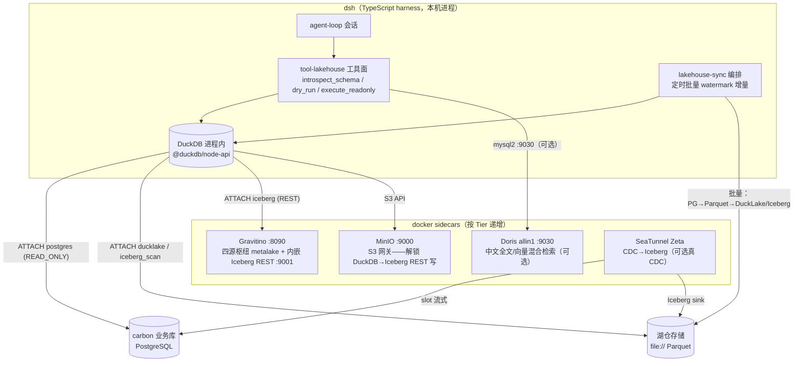

# 第 7 章 每域结论与整合方案草案

本章回答调研问题 7：主选 + 备选 + 理由表（维度：单机可跑性/维护活跃度/许可证/TS 集成面/能力完整度）+ 整合方案草案（部署形态、与 dsh 包的边界、初始化数据策略——食品行业制造业业务数据要能灌入演示）。

## 7.1 六域选型理由总表

### 7.1.1 表格式域

| 候选 | 单机可跑性 | 维护活跃度 | 许可证 | TS 集成面 | 能力完整度 | 裁决 |
|---|---|---|---|---|---|---|
| **Apache Iceberg 1.12** | ✅ pyiceberg sql(SQLite)+file:// 零 JVM | ✅ 1.12.0 @09-30，Apache 顶级 | Apache-2.0 | ◐ iceberg-js（REST）/ DuckDB 扩展 | ✅ 全引擎直读 + REST spec 事实标准 + v3 | **主选** |
| DuckLake v1.0 | ✅✅ 单文件 catalog + Parquet，DuckDB 原生 | ✅ crate 10-03 更新 | **MIT** | ✅✅ @duckdb/node-api 直写 | ◐ DuckDB 系引擎互操作 | **备选（单机极简线）** |
| Delta 4.4.1 | ✅ delta-rs/deltalake 本地直写 | ✅ 4.4.1 @10-05，LF | Apache-2.0 | ◐ DuckDB delta 扩展 | ✅ Kernel 生态 | 次备选 |
| Paimon 2.0 | ✅ PyPaimon 无 JDK | ✅ 2.1.0-rc4 @10-08 | Apache-2.0 | ❌ | ◐ 流式特化 | 观察（流式需求触发） |
| Hudi 1.2.1 | ❌ 无 JVM 不能写 | ✅ 1.2.1 @09-24 | Apache-2.0 | ❌ | ✅ | **出局** |

**理由**：Iceberg 是唯一同时满足「无 JVM + SQL catalog + 完整写 API（append/overwrite/delete/upsert）+ 生态盟主（第 2/3 章全部引擎与 catalog 结论都建立在 Iceberg 面上）」的格式；DuckLake 是单机约束下开发体验最优的"准 Iceberg"（Parquet 数据文件兼容，duckdb 文档载有 iceberg_to_ducklake 互转），作为快速启动与纯 TS 线的备选。

### 7.1.2 查询引擎域

| 候选 | 单机可跑性 | 维护活跃度 | 许可证 | TS 集成面 | 能力完整度 | 裁决 |
|---|---|---|---|---|---|---|
| **DuckDB 1.5.6** | ✅✅ 进程内嵌入 TS（osx_arm64 预编译） | ✅ 1.5.6 @09-28 + node-api 同日 | **MIT** | ✅✅ @duckdb/node-api | ✅ iceberg 读 + REST 写 + VSS/FTS | **主选** |
| Apache Doris 4.1.4.1 | ✅ allin1 arm64 单容器（建议 8GB+） | ✅ 4.1.4.1 @09-29 | Apache-2.0 | ✅ mysql2 9030 + 官方 MCP | ✅✅ Iceberg 读写最全 + 中文全文 + 向量 | **备选（混合检索线）** |
| StarRocks 4.1 | ✅ 官方 4GB 教程（fe+cn+minio） | ✅ 镜像 4.1.6 | ELv2 社区版 | ✅ mysql2 9030 + 官方 MCP | ✅ 湖仓直查性能标杆 | 二备选 |
| Trino 483 | ◐ 单 JVM 但堆=80% 容器内存 | ✅ 周更 | Apache-2.0 | ◐ trino-js-client 1.0（HTTP） | ✅ connector 参照系 | 不部署（参照系） |

### 7.1.3 Catalog 域

| 候选 | 单机可跑性 | 维护活跃度 | 许可证 | TS 集成面 | 四源统一 | 裁决 |
|---|---|---|---|---|---|---|
| **Apache Gravitino 1.3.1** | ✅ 单进程+内嵌 H2 :8090（镜像 1.98GB 偏重） | ✅ 1.3.1 @09-30，TLP 日活 | Apache-2.0 | ◐ OpenAPI 自生成 + MCP + iceberg-js | **3.5/4**（唯缺 Neo4j） | **主选（四源枢纽）** |
| Apache Polaris 1.8.0 | ✅✅ 418MB + in-memory 起步 | ✅ 1.8.0 @09-28，TLP | Apache-2.0 | ◐ OpenAPI（无 TS SDK） | 1/4（Iceberg 专用） | 备选（纯 Iceberg 线） |
| UnityCatalog 0.6.0 | ✅ compose server+UI | ✅ 0.6.0 @08-20 | Apache-2.0 | ❌（npm 404） | 2.5/4 | 观察（AI 资产线） |
| Nessie 0.109.0 | ✅ ghcr 镜像 | ✅✅ 日更节奏 | Apache-2.0 | ❌ | 1/4 + 版本化独特 | 叠加层备选 |
| Amoro 0.8.1-inc | ✅ arm64 | ❌ 13 个月无 release | Apache-2.0 | ❌ | 非枢纽（表维护） | **出局** |
| Hive Metastore | — | 遗留 | Apache-2.0 | — | — | **出局（被联邦收编）** |

### 7.1.4 治理域

| 方案 | 单机可跑性 | 维护活跃度 | 许可证 | TS 集成面 | 四能力 | 裁决 |
|---|---|---|---|---|---|---|
| **轻量自建**（REST catalog 元数据直读 + GE/dbt 质量 + OpenLineage 手工事件） | ✅✅ <1GB，无常驻服务 | —（自持） | 全 Apache/MIT | ✅✅ 纯 TS 侧 | 目录◐ 血缘◐ 质量✅ 告警◐ | **主选** |
| DataHub 1.8rc | ◐ 8GB 常驻（Kafka+OpenSearch 双栈） | ✅✅ acryl-datahub 超活跃 | **Apache-2.0 全仓** | ❌（GraphQL） | 目录✅ 血缘✅ 质量◐ 告警✅ | 备选（要 UI/Neo4j 目录时；OL HTTP 直收是升级路径） |
| OpenMetadata 2.0.5 | ◐ 8GB 常驻（含完整 Airflow） | ✅ 周更 | Apache-2.0 + ingestion Collate 社区许可 | ❌（仅 Py/Java/Go SDK） | 目录✅ 血缘✅ 质量✅(内建) 告警✅ | 二备选（要 UI 内建质量测试时） |
| Apache Atlas 2.5 | ❌ 官方推荐 15G heap + Solr 32G + 无 arm64 镜像 | 维护态 | Apache-2.0 | ❌ | 目录+血缘仅此 | **出局** |
| Soda 4.26 | — | ✅ 周更 | **ELv2（非 OSI）** | ◐ | 质量单件 | 减分出局 |
| GE 1.24 / dbt tests v2 | ✅ Python 单件 | ✅ 双周 / v2 活跃 | Apache-2.0 / 混合（源 Apache） | ◐（Python 侧） | 质量单件 | 轻量自建组件 |
| OpenLineage 1.53 | ✅ 事件规范 | ✅（放缓至 6 周） | Apache-2.0 | ✅（HTTP POST 自发） | 血缘标准 | 轻量自建组件 |

### 7.1.5 同步域

| 方案 | 单机可跑性 | 维护活跃度 | 许可证 | TS 编排 | 裁决 |
|---|---|---|---|---|---|
| **自写 TS 批量**（DuckDB postgres ATTACH → DuckLake/Parquet） | ✅✅ 零 JVM 零服务，MB 级 | —（自持） | MIT（组件全开源） | ✅✅ 纯 TS | **主选（批量线）** |
| SeaTunnel 3.0 Zeta | ✅ 单 JVM + arm64 镜像 | ✅ 3.0.0 @09-29 TLP | Apache-2.0 | ◐（HOCON job 文件 + CLI） | **备选（真 CDC 线）** |
| memiiso/debezium-server-iceberg | ✅ 单 JVM | ✅ 1.2.0 @10-04 | Apache-2.0 | ❌（Java 侧配置） | 二备选（CDC 深水区） |
| pg_mooncake | ✅（业务库内嵌） | ✅ | MIT | ❌ | 特殊备选（业务库可控时） |
| Flink CDC 3.6/3.7 | ◐ 双 JVM 2-3GB | ✅ | Apache-2.0 | ❌ | 不选（资源重；DDL lenient 是唯一优势） |
| Airbyte 2.0 | ❌ abctl 内嵌 K8s | ✅ | ELv2 平台 + MIT 连接器 | ❌ | **出局（违反硬约束）** |

### 7.1.6 LLM 工具调用面域

| 方案 | 许可证 | 形态 | TS 集成 | 裁决 |
|---|---|---|---|---|
| **自研 TS 工具面**（introspect_schema / dry_run / execute_readonly + 三层防御 + Vanna prompt 模板） | 自持 | dsh 插件（tool-lakehouse 扩展） | ✅✅ | **主选** |
| WrenAI MCP sidecar | Apache-2.0（core） | pip + `wren serve mcp` | ◐（MCP 协议） | 备选（语义层整体引入） |
| apache/doris-mcp-server | Apache-2.0 | Python/uvx | ◐（MCP） | 备选（选 Doris 线时） |
| DB-GPT | MIT | Python 平台 | ❌ | 借鉴 AWEL 思想，不引入 |

## 7.2 整合方案草案（分层演进架构）

### 7.2.1 部署形态总图

**分层演进（Tier）**：
- **Tier 0（开发/演示最短路径，纯 TS 零容器）**：DuckDB 进程内 + DuckLake 单文件 catalog + `ATTACH postgres READ_ONLY` 批量同步（第 5 章候选 B 代码）。食品制造业演示数据全量灌入。此层已可支撑「真实查询」验收（LLM 真实执行 SELECT 看到真实数据）。
- **Tier 1（架构升级，docker sidecar）**：+ Gravitino 单容器（metalake 登记湖仓 Iceberg + fileset 知识库 + PG 业务库三源；内嵌 Iceberg REST）+ MinIO（S3 网关解锁 DuckDB→Iceberg REST 写路径——第 2 章证实的存储后端限制）。此层进入「真 Iceberg + REST catalog」形态，DuckDB 经 ATTACH TYPE ICEBERG 读写。
- **Tier 1.5（可选重引擎）**：+ Doris allin1（当需要中文全文/向量混合检索——知识库语义检索面）；mysql2 :9030 或官方 MCP 接入。
- **Tier 2（可选真 CDC）**：+ SeaTunnel Zeta 单 JVM（当分钟级新鲜度不够、业务库可开 wal_level=logical 且机器常驻）。

### 7.2.2 与 dsh 现有包的边界（基于仓库现状）

仓库已存在 `packages/lakehouse/` 组（含 `lakehouse-sqlite-catalog`（src/store.ts——SQLite catalog 存储）与 `tool-lakehouse`（tsconfig 已建）），以及 `docs/subsystems/lakehouse.zh.md` 文档位——W24 的湖仓子系统已有种子。建议包边界：

| 包（建议） | 职责 | 关键依赖 |
|---|---|---|
| `packages/lakehouse/lakehouse-sqlite-catalog`（已存在，扩展） | catalog 持久层：登记湖仓表/列元数据、rowCount、watermark 游标——对齐 pyiceberg SqlCatalog 双表设计（第 1 章源码审计可抄） | better-sqlite3 / dsh-sqlite 惯例 |
| `packages/lakehouse/tool-lakehouse`（已存在，实现） | 第 6 章工具面三工具（introspect_schema / dry_run / execute_readonly）+ 只读三重校验 + 结果回填 session 事件（model-visible ⟺ logged） | @duckdb/node-api、mysql2（Doris 线） |
| `packages/lakehouse/lakehouse-engine`（新增建议） | DuckDB 实例管理（fromCache / READ_ONLY attach / memory_limit / threads / allowed_paths Config 字段化——对齐 AGENTS.md「无硬编码可调项」纪律） | @duckdb/node-api |
| `packages/lakehouse/lakehouse-sync`（新增建议） | 批量同步编排：cron/queue 触发 → ATTACH postgres → watermark 增量 → DuckLake append / pyiceberg sidecar append（B' 变体） | lakehouse-engine |
| `packages/lakehouse/lakehouse-lineage`（可后置） | OpenLineage 手工事件发射（START/COMPLETE 终态对 + 输入输出 facet）；目标端 DataHub HTTP（预留升级） | openlineage 协议自实现（TS fetch） |

**cordis.yml 配置面**（对齐「无硬编码可调项」纪律）：readonly / maxRowsDefault / timeoutMsDefault / memoryLimit / threads / allowedPaths / attachMode / syncSchedule / syncTables 全部为 Config 字段。

### 7.2.3 初始化数据策略（食品行业制造业演示数据灌入）

1. **源**：carbon 业务库 PG（订单/批次/检验/库存等表，演示级 <10 万行/表——与 W5 已验证的 32 模板 30 表 1000+ 行实测数据策略衔接，可扩量）。
2. **首刷**：Tier 0 用候选 B 代码全量 `CREATE TABLE AS SELECT`（DuckLake），建立 `updated_at` watermark。
3. **增量**：dsh lakehouse-sync 定时（Config syncSchedule，默认如 5 分钟）执行 watermark 增量 INSERT；每分区幂等（重跑安全）。
4. **语义层初始化**（对齐第 6 章 BIRD 证据——外部语义注入值 10-20 点）：用 vanna `get_training_plan_generic` 配方（INFORMATION_SCHEMA.COLUMNS → 按表 markdown）自动生成列文档种子 + 食品行业术语表（物料/批次/效期/AQL/追溯 DAG 等——复用 W6 合规四件套语料）人工补全，落 Git（对齐 MDL/knowledge store 思路）。
5. **验收**（对齐用户「真实 API 实跑验证」偏好）：LLM 会话真实执行——①introspect_schema 返回真实列清单；②dry_run 通过后 execute_readonly 真实返回制造业数据行；③只读防御实测（注入 DELETE 语句被拒）；④watermark 增量实测（业务库插行→同步→查询可见）。

## 7.3 风险与缓解

| 风险 | 等级 | 缓解 |
|---|---|---|
| @duckdb/node-api 内 INSTALL postgres/ducklake 社区扩展加载行为未背书（第 5 章矛盾 2） | 高（Tier 0 阻断项） | W24 实施第一验证项：单测加载两扩展 + ATTACH PG 冒烟；失败则降级 B'（pyiceberg sidecar） |
| DuckDB→Iceberg REST 写需 S3 网关（MinIO sidecar），file:// 后端不可用（第 2 章） | 中 | Tier 1 引入 MinIO；或 Tier 0 先用 DuckLake（写不受限），Tier 1 再迁 Iceberg |
| Gravitino 1.3.1 官方 docker 镜像 tag 存在性未验证（第 3 章矛盾 2） | 中 | 落地前 docker pull 验证；fallback = bin/gravitino.sh 裸进程（官方支持 macOS ARM64） |
| DuckLake 规格版本 vs crate/扩展版本双轨（第 1 章矛盾 1） | 低 | 固定 DuckDB 1.5.x + 扩展自动加载版本，锁定写明 README |
| Vanna 8 个月未更新（第 6 章） | 低 | 仅借鉴其 legacy prompt 模板与训练数据组织（已克隆入 sources/vanna/），不引入运行时依赖 |
| 中文口碑证据缺（第 4.8 节环境性封锁） | 低 | W24 实施期以真实运行补齐一手体感 |

## 7.4 与五源架构其余三域的接口约定

本报告覆盖湖仓+治理两域；其余三源对接点：**知识库** → Gravitino fileset（挂本地目录）或 Tier 0 下 DuckDB read_json/read_parquet 直读；**业务系统（carbon）** → 本报告同步链路（批量/CDC）+ Gravitino jdbc-postgresql catalog 联邦；**本体+图谱** → Gravitino model 实体登记 + Neo4j 自管 schema API（3.5/4 折中方案，等 contrib 图连接器）；LLM 会话统一经 tool-lakehouse（湖仓）与后续 tool-kb/tool-graph 工具面消费五源。
