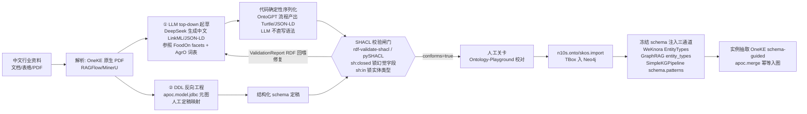

# 00 · 执行摘要与选型总览

> 调研编号：R2b（W24 轮前置研究）｜日期：2026-10-09｜深度：Exhaustive（L4）
> 范围：知识库/RAG + 图数据库与本体 + 图谱可视化 三域开源选型
> 方法：17 个数据源分支并发深探（1 次仓库 clone 审计 + 14 次 Web/GitHub 深研 + 2 次补洞验证），全部关键论断带来源 URL
> 服务对象：deepseek-harness W24「湖仓 + 知识库 + 业务系统(carbon) + 本体 + 图谱」五源统一架构

---

## 0.1 一段话结论

**知识库主选 WeKnora（腾讯，MIT，v0.8.2，32.8k★）**——它是唯一同时满足「中文一等公民 + macOS 多架构镜像 + docker-compose 单机 8GB 起 + 官方 REST/MCP 双通道 + 已发布 deepseek-harness 官方插件」的候选；其检索引擎抽象（11 种引擎、ParadeDB 默认）与 GraphRAG-Neo4j 可选组件恰好与 W24 图谱域交汇。**图数据库主选 Neo4j Community（GPLv3，内部部署+API 调用零传染）**，备选 Apache AGE（PG 统一底座路线）与 Memgraph CE（bolt 同构零迁移备胎）；NebulaGraph 因 TS 生态死亡 + 开源版 29 个月停更被移出候选，GraphDB Free 因非商业许可 + 申请制被否，Oxigraph 仅作 RDF 校验沙箱。**本体走「轻量 RDF 词汇 + JSON-LD 序列化 + SHACL 质量闸门」**：RDFS + 少量 OWL RL 档词汇做 schema，SKOS 管行业分类表，JSON-LD 作为 LLM 生成面（100% JSON 亲和），SHACL（rdf-validate-shacl，TS 可用）锁幻觉字段，FoodOn/AgrO 作食品行业种子参照；LLM 自动生成走「LLM 出 JSON/LinkML → 代码确定性序列化 → SHACL 校验回喂修复」路线，杜绝 LLM 直写 Turtle。**可视化主选 react-force-graph-2d（vasturiano）**——d3-force-3d 引擎与 Obsidian 力模型同族、数据驱动增量展开最顺、官方 expandable-nodes 示例背书、周下载 82.6 万、React peer `*`、TS 自带；备选 sigma.js v3 + @react-sigma/core（万级以上全量 WebGL 渲染），第三路线 Logseq 同款 d3-force@3 + graphology + 自研 Canvas（全控制权）。

## 0.2 总选型表

| 域 | 主选 | 备选 | 明确排除（及原因） |
|---|---|---|---|
| 知识库/RAG 服务 | **WeKnora v0.8.2**（sidecar，docker-compose） | FastGPT（TS 同构二选）；Dify（编排层+External KB API 双向）；RAGFlow（解析天花板，但 v1.0 仅 Linux x86-64——macOS 硬伤，只配远端对照实测） | QAnything（实质停更 18 个月 + AGPL + Qwen 模型许可证叠加）；MaxKB（GPL-3.0，只配原样 sidecar 备胎） |
| 库嵌入路线 | 不采用（LlamaIndexTS 已官方弃维，2026-03 停更） | LightRAG 作为**轻量 Python sidecar**（REST server 官方推荐形态，非进程内） | TS in-process RAG 层（生态地基已死，LangChain.js 无图谱能力） |
| 图数据库 | **Neo4j Community 5.26 LTS / 2026.09**（docker，arm64 原生，347MB） | Apache AGE v1.8（PG 全家桶收敛路线：AGE+pgvector 同库）；Memgraph CE（bolt 协议复用同一 neo4j-driver，改连接串即切换） | NebulaGraph（nebula-js 404 + 9 容器单机 + 开源版 29 个月停更）；GraphDB Free（非商业许可 + license 申请制 + 2 并发查询）；Oxigraph（JS 绑定仅内存、0.5.x 未优化——只配 RDF 原型沙箱） |
| 本体建模 | **JSON-LD 1.1（schema 面）+ RDFS/少量 OWL RL 词汇 + SKOS（行业词表）+ SHACL（校验闸门）**，n10s 导入 Neo4j | Turtle（人工审阅面）；纯 JSON + 属性图受控词表（最简兜底） | OWL DL/reasoner 全家（LLM 时代推理非必需，查询推理由 LLM 承担）；GraphDB 内建 forward-chaining（绑定 RDF 库选型，已否） |
| LLM 本体生成 | **LLM 出 JSON/LinkML → 代码序列化 → SHACL 校验回喂**；OntoGPT（模板化最成熟）+ OneKE（schema-guided 中文实例抽取，DeepSeek 原生） | KAG（蚂蚁，schema 约束+schema-free 同图混跑）；GraphRAG prompt_tuning（反向归纳实体类型） | LLM 直写 Turtle/OWL（语法错+幻觉，多家论文立题动机） |
| 图谱可视化 | **react-force-graph-2d**（Obsidian 范式复刻首选） | sigma.js v3 + @react-sigma/core（>1万节点全量渲染）；d3-force@3+graphology+自研 Canvas（Logseq 路线，全控制） | vis-network（官方自认仅几千节点）；Cosmograph（CC-BY-NC 禁商用+闭源）；cytoscape.js（React 封装层死亡——npm 包消失、plotly 仓 20 个月停摆） |

## 0.3 本次调研的知识网络（Mermaid）

```mermaid
graph TB
  subgraph KB域[知识库 / RAG 域]
    WeKnora[WeKnora 腾讯<br/>MIT 32.8k★ v0.8.2]
    RAGFlow[RAGFlow<br/>Apache-2.0 91.9k★ v1.0-rc1]
    Dify[Dify 知识库<br/>Apache改 158k★]
    FastGPT[FastGPT<br/>Apache改 TS全栈]
    MaxKB[MaxKB GPL-3.0]
    QAnything[QAnything<br/>AGPL 停更]
    LightRAG[LightRAG 港大<br/>MIT EMNLP2025]
    Haystack[Haystack 3.x<br/>Apache-2.0]
    LlamaIdxTS[LlamaIndexTS<br/>已弃维]
  end
  subgraph GDB域[图数据库域]
    Neo4j[Neo4j Community<br/>GPLv3]
    AGE[Apache AGE<br/>Apache-2.0]
    Memgraph[Memgraph CE<br/>BSL 1.1]
    Nebula[NebulaGraph<br/>开源版停更]
    GraphDB[GraphDB Free<br/>非商业许可]
    Oxigraph[Oxigraph<br/>Apache-2.0/MIT]
  end
  subgraph ONTO域[本体域]
    Standards[W3C: OWL2/SHACL/SKOS/JSON-LD]
    OntoGPT[OntoGPT<br/>BSD-3]
    OneKE[OneKE 浙大<br/>schema-guided]
    KAG[KAG 蚂蚁 OpenSPG]
    MSGr[微软 GraphRAG v3.3<br/>MIT 36.3k★]
    FoodOn[FoodOn 食品本体<br/>CC-BY-4.0]
    Playground[Ontology-Playground<br/>微软 2.8k★]
  end
  subgraph VIZ域[可视化域]
    FG2D[react-force-graph-2d<br/>周下载82.6万]
    Sigma[sigma.js v3/v4 + graphology]
    Juggl[juggl(cytoscape系)]
    Obsidian[Obsidian 范式参照]
  end
  subgraph 五源[五源互通]
    ParadeDB[ParadeDB PG17<br/>BM25+pgvector]
    NocoPG[NocoBase 业务库 PG]
    APOC[APOC load.jdbc]
    BYOG[GraphRAG BYOG parquet]
    N10S[neosemantics n10s]
  end

  WeKnora -->|默认检索引擎| ParadeDB
  WeKnora -->|GraphRAG 组件可选| Neo4j
  WeKnora -->|官方 dsh 插件| DSH[deepseek-harness]
  RAGFlow -.->|解析能力对照| WeKnora
  LightRAG -->|GRAPH_STORAGE 可插拔| Neo4j
  MSGr -->|输出 parquet / BYOG| Neo4j
  MSGr -->|entity_types 注入| Standards
  NocoPG -->|apoc.load.jdbc ETL| Neo4j
  NocoPG -.->|BYOG 确定性映射| MSGr
  Standards -->|n10s.onto/skos.import| N10S
  N10S --> Neo4j
  FoodOn -->|种子参照| Standards
  OntoGPT -->|LinkML→OWL| Standards
  OneKE -->|schema 约束实例抽取| Neo4j
  KAG -.->|互索引+混合推理参照| MSGr
  Neo4j -->|bolt + neo4j-driver(Apache-2.0)| DSH
  AGE -.->|PG 统一底座备选| DSH
  Memgraph -.->|bolt 同构备胎| Neo4j
  DSH -->|kg 页面渲染| FG2D
  Obsidian -->|Local Graph 范式| FG2D
  Juggl -.->|cytoscape 系对照| Sigma
  Sigma -.->|>1万节点全量备选| FG2D
```

## 0.4 五源架构速览（详见 06/07 节）

数据流主线：**WeKnora 文档（chunk + 11 类实体抽取，`{{language}}` 中文原生）与 NocoBase 业务库（APOC JDBC 确定性 ETL，零 LLM 成本）双通道汇入 Neo4j**；本体层是唯一 schema 真相源（LLM 归纳 + DDL 反向工程双来源），下行注入三个现成约束点（WeKnora 模板 EntityTypes / GraphRAG `entity_types` / neo4j-graphrag-python `schema.patterns`）；查询侧四路并存按题型路由（WeKnora 混合检索 + graphSearchCypher 实体题 / VectorRetriever·Hybrid 语义题 / Text2Cypher 低频复杂题 / GraphRAG Global·DRIFT 归纳题）；dsh agent 通过官方 dsh-weknora 插件（4 工具）+ 自研 graph 工具（neo4j-driver）真实调用，全部回填带 chunk/行级溯源。

## 0.5 阅读指南与证据分级

| 章节 | 内容 | 回答的调研问题 |
|---|---|---|
| 01 | WeKnora 深度解剖（架构/部署/解析/检索/GraphRAG/API/许可证/口碑） | 问题 1 |
| 02 | RAGFlow/Dify/FastGPT/MaxKB/QAnything/LightRAG/Haystack/LlamaIndex 对照 + sidecar vs 库嵌入 | 问题 2 |
| 03 | Neo4j/AGE/Memgraph/Nebula/GraphDB/Oxigraph + 许可证陷阱 + 向量 + TS driver | 问题 3 |
| 04 | 本体标准实用取舍 + LLM schema induction 开源全集 + 食品行体 pipeline | 问题 4 |
| 05 | 六库可视化矩阵 + Obsidian Local Graph 范式规格化 + 实现蓝图 | 问题 5 |
| 06 | GraphRAG v3 架构 + BYOG + 业务库入图 + 五源数据流 | 问题 6 |
| 07 | W24 整合方案草案（部署拓扑/包边界/初始化数据策略） | 问题 7 |
| 08 | 方法论、矛盾清单（10 项）、证据质量分级 | 全部 |

**证据分级**：🔴 Critical = 多源独立证实（决策可直接依赖）；🟡 Important = 单源或厂商口径（引用时注明）；🔵 Observation = 推断/传闻（仅作方向参考）。矛盾与未决项集中在 08 节，不回避。

**关键诚实声明**：本调研环境中 DuckDuckGo 网络不可达、bing 会话多次被污染/风控，各分支以官方站直达 + GitHub API/raw + npm registry + Docker Hub API 四条机械通道兜底完成；所有无法核实的点（如 WeKnora 32.8k stars 与中文社区内容≈0 的不对称、RAGFlow 与 WeKnora 无第三方横评）均如实标注为空白而非编造。

# 01 · WeKnora 深度解剖（知识库主候选）

本章覆盖调研问题 1。数据基础：仓库 clone 审计（112MB，4804 文件，VERSION=0.8.2，已存 `sources/WeKnora/`）+ 官方文档站深读（7 核心页 + 全目录 80+ 页）+ GitHub API/Issues + npm registry 机械验证。

## 1.1 基本面与定位

腾讯（微信团队）开源 LLM 知识平台「维娜拉」：RAG 问答 + 多步推理 Agent + 自动维护 Wiki 三能力共享同一知识库。32,810★/4,364 forks/596 open issues（GitHub API 实取）；创建 2025-07-22，**最后 push 2026-10-09（调研当日）**；release 月度节奏（v0.6.3→v0.7.2→v0.8.0→v0.8.2@2026-09-24）。技术栈：Go/Gin 后端(:8080) + Vue3 前端 + Python/gRPC docreader 解析服务(:50051)。界面五语言（简中/英/日/韩/俄）。数据源连接器：飞书/Notion/Confluence/语雀/钉钉/IMA/GitLab/RSS。投入度判定：核心团队+高校"犀牛犀鸟"贡献混合，文档站用 weknora.weixin.qq.com 域名（微信事业群资源背书）——**真实且高投入，非弃疗项目**。

## 1.2 架构与部署（docker-compose 26 服务分层）

- **默认启动（无 profiles）**：frontend(weknora-ui) + app(Go/Gin) + docreader(Python/gRPC，含 LibreOffice+Playwright) + postgres(**paradedb/paradedb:v0.22.6-pg17**，BM25+pgvector 二合一) + redis:7.0 + searxng；
- **可选 profile**（每个挂 `<name>` 与 `full` 双 profile）：minio、**neo4j:2025.10.1**（APOC，7474/7687）、qdrant v1.16.2、milvus v2.6.11、weaviate 1.28.4、**apache/doris fe/be 4.1.0**（湖仓！）、dex(OIDC)、langfuse 全家桶(clickhouse24.8+minio+worker+web)、mcp、sandbox；
- **资源**：官方建议 4 核 8GB 起步（8GB 不含 Ollama 权重）；**macOS 16GB：核心栈约 4-5GB 可行；32GB：可加 neo4j+qdrant 全开**；ParadeDB x86-64-v2 基线（不强制 AVX2）→ Apple Silicon Docker 可跑（多架构镜像）；
- **Lite 单二进制模式**（docs/LITE.md）：SQLite(FTS5+sqlite-vec)+内存队列零外部依赖，单空间免注册，仅 Simple 解析引擎——低资源备选；另有 macOS 桌面版（Wails2，未正式发布）；
- 对象存储七选一（local/MinIO/腾讯COS/火山TOS/AWS S3/华为OBS/阿里OSS）；Asynq 任务队列六 lane（core8/postprocess2/enrichment12/maintenance4/shared6/wiki8）。

## 1.3 检索引擎抽象层（对 dsh capability seam 的直接参照）

`internal/types/interfaces/retriever.go`：**11 种引擎枚举**（postgres/elasticsearch v7+v8/infinity/elasticfaiss/qdrant/milvus/weaviate/doris/sqlite/tencent_vectordb/opensearch），实现位于 `internal/application/repository/retriever/<engine>/`。三层接口：

```go
type RetrieveEngine interface {
    EngineType() types.RetrieverEngineType
    Retrieve(ctx context.Context, params types.RetrieveParams) ([]*types.RetrieveResult, error)
    Support() []types.RetrieverType   // 向量/关键词能力声明
}
type RetrieveEngineRegistry interface {
    Register(svc RetrieveEngineService) error
    GetRetrieveEngineService(t types.RetrieverEngineType) (RetrieveEngineService, error)
    GetOrLoadByStoreID(ctx, tenantID, storeID) (RetrieveEngineService, error) // 按需重建+租户防IDOR
}
```

`RETRIEVE_DRIVER` env 支持逗号多驱动并行扇出（`MULTI_STORE_RETRIEVE_TIMEOUT_SEC` 控超时），默认 postgres。引擎注册表有自愈机制（构建超时 10s/冷却 30s/代际防竞态）。**注意：切换引擎需重建索引且 KB 绑定不可改——选型一步到位**。

## 1.4 检索管线：混合→加权 RRF→Rerank 全链路

- `fuseOrDeduplicate`（`knowledgebase_search_fusion.go`，235 行纯算法）：按 RetrieverType 分向量/关键词两路；混合走 `fuseWithRRF`：`score = vw/(k+vRank) + kw/(k+kRank)`，除以理论最大值归一化到 [0,1]（**多源分数可比较——五源融合直接可用**）；
- 可配置项（tenant 级 JSONB，`/tenants/kv/retrieval-config`）：embedding_top_k(50)/vector_threshold(0.15)/keyword_threshold(0.3)/rerank_top_k(10)/rerank_threshold(0.2)/rrf_k(60)/rrf_vector_weight(0.7)/rrf_keyword_weight(0.3)；请求级可覆盖、可关 rerank；
- Rerank 前有 **passage 清洗**（`internal/reranking/passage.go`：剥 markdown 图链/URL/表格分隔行/LaTeX 保留正文）+ MMR 多样性 + 图像 rerank；
- 多轮查询改写：`config/prompt_templates/rewrite.yaml`（共指消解+省略补全+意图分类三合一，i18n 四语言）；
- 中文检索技术根（官方文档 03-features/05-retrieval-engines）：默认 ParadeDB pgvector halfvec+HNSW 表达式索引+pg_search BM25；**SQLite Lite 用手动 bigram 分词（官方自述"对中文友好"）**；Milvus 内置 Jieba 中文分析器。

## 1.5 文档解析管道（docreader）

gRPC :50051（TLS+Token 可选）。解析器矩阵：pdf/docx(两代)/doc/excel(+merge/repair)/ppt(markitdown)/html/mhtml/epub/markdown/image(OCR)/xmind/csv/markitdown/opendataloader，按扩展名+引擎回退路由；**高精度通道：MinerU 与 PaddleOCR-VL**（自建 :10051 HTTP 或云端轮询，超时 1000s/600s）+ WeKnoraCloud 托管解析——达到 DeepDoc 级深度解析能力（对标 RAGFlow）。Chunking：Go 生产路径 `internal/infrastructure/chunker/`（heading_splitter 标题层级+breadcrumb、**父子分块 parent-child**（legacy+adaptive，表格 offset 测试）、protected_spans 保护公式/表格/代码、fenced_code）；Python 侧 splitter（512 字符/overlap 80，分隔符 `["\n","。"," "]` 中文句号优先）——**中文 PDF/表格友好证据充分**。口碑避坑：加密 PDF 直接解析失败（入库前解密）；扫描件确认 OCR 引擎启用；WPS 另存 DOCX 标题层级易丢（LibreOffice 预转）。

## 1.6 GraphRAG/Neo4j 集成

开关唯一：`NEO4J_ENABLE=true`（compose profile neo4j）。图谱作为 **agent 工具 `query_knowledge_graph`**（不是检索管线内嵌）：实体名子串匹配种子节点→扩展邻居→返回关系+证据 chunk，带三重截断上限（seed 200/rows 2000/relations 30）和**截断标记防幻觉设计**（graphTruncation 明示模型"这不是全部邻居"——该模式适用于 dsh 所有截断型工具输出）。建图：LLM 实体抽取（11 类封闭枚举 Person/Organization/Location/Product/Event/Date/Work/Concept/Resource/Category/Operation，JSON 输出，`{{language}}` 变量保证中文描述，"宁缺毋滥"规则）→ 关系抽取（batch 5，并发 4）→ 边权 PMI×0.6+强度×0.4，间接关系衰减 0.5，归一化 1-10。Neo4j schema：节点 label=`ENTITY<Namespace>` + 属性 `{name, kg, attributes, chunks[]}`（**实体自带 chunks 溯源**）；边 `apoc.merge.relationship` 建带权；删 `apoc.periodic.iterate` 批量。官方自认建图是"**管线中最昂贵的增强扇出**"（每 chunk 一次 LLM 调用）——成本敏感，按 KB 级开关。可视化 Mermaid graphBuilder 是**未装配的遗留实现**（官方文档自认，无开箱图可视化）。

## 1.7 REST API 完整面与 MCP

- **292 个路径**（swagger.json：POST 132/GET 148/PUT 46/DELETE 47），核心分组：knowledge-base CRUD、knowledge 文件（file/url/manual 三种创建+reparse+preview+spans）、chunks（CRUD+revision 回滚+generated questions）、FAQ、sessions（fork/rewind/steer/附件/沙箱ticket）、agents、skills、organizations、memory、wiki（16 端点+graph 可视化）、datasource 连接器、mcp-services/mcp-endpoints、models、审计；
- **认证三通道**（`internal/middleware/auth.go`）：匿名邀请 token / Bearer JWT / **X-API-Key（能力分片 retrieve/chat/ingest/full + KB 范围限定，AES-256-GCM 存储）**；
- **两个对外检索端点**：`POST /api/v1/knowledge-search`（**外部系统首选**，与产品问答同管线，rerank 默认开，meta.rerank.outcome 诊断空结果）；`POST /api/v1/knowledge-bases/{id}/hybrid-search`（底层召回，支持 query_embedding 预计算向量，父块/相邻块独立行，skip_context_enrichment 可关）；SSE 问答 `POST /api/v1/knowledge-chat/:session_id`；
- **内置 MCP Server（Go 原生，Streamable HTTP/stdio/SSE）**：设置页创建 endpoint → 连 `/mcp/<endpoint_id>`；**12 工具四组**：retrieve(list_knowledge_bases/search_knowledge/grep_chunks/list_documents/read_document)+chat(ask)+wiki(wiki_search/wiki_read_page/wiki_index)+ingest(add/update/delete_document，Destructive 默认不勾选)；每 endpoint 独立 token+KB 范围+工具白名单。

## 1.8 TS SDK 与官方 dsh 插件（W24 决定性发现）

npm 无通用官方 SDK（官方 SDK 仅 Go：`client/` 独立 module 含 SSE 流式）。**但存在官方 deepseek-harness 插件 `@wxg-prc-cpg/dsh-weknora`（npm registry 机械验证：v0.1.0 唯一版本，2026-08-21 发布，MIT，零运行时依赖，SLSA provenance，tarball shasum 双验一致，npmmirror 同步存在；源码=WeKnora 仓库 `packages/dsh-weknora`，发布者 wxg_prc_cpg@tencent.com）**。提供四工具：`weknora_list_knowledge_bases` / `weknora_search`（混合检索）/ `weknora_read_document`（翻页读全文）/ `weknora_ask`（服务端会话+引用）。安装：`dsh plugin --profile web add @wxg-prc-cpg/dsh-weknora`（或本地 `./packages/dsh-weknora`）；配置经 `WEKNORA_BASE_URL`/`WEKNORA_API_KEY`/`WEKNORA_KNOWLEDGE_BASE_IDS` 环境变量（cordis.patch.yml `!!js` 插值）；API Key 需 retrieve 能力（ask 另需 chat）；`resourceUrls=public` 默认、限定 KB 遇 403 自动降级 handle；已验证 dsh 0.1.0-rc.8 / WeKnora 0.7.2+ 兼容。**⇒ W24 不需要自研 HTTP client：官方插件即最短路径，或参照其 dist/{client,config,harness,tools} 实现定制。**

## 1.9 许可证与企业级成熟度

- **LICENSE 原文级结论**：MIT 主体（腾讯自研代码）+ 第三方例外清单（Apache-2.0：paddle/playwright/grpc-health/OpenCC；MPL-2.0：go-sql-driver-mysql（Doris 驱动）/go-m1cpu；BSD/MIT-CMU/Python-2.0 若干）。**无 AGPL/GPL 传染组件**；MPL-2.0 仅文件级义务；dsh 仅 API 调用不分发二进制→**商用风险低**；若随包分发需保留 LICENSE+THIRD_PARTY_NOTICES+licenses/ 三件套；
- 企业级：四级 RBAC（Owner/Admin/Contributor/Viewer + 每路由 guard）、空间配额（默认 10GB）、邀请 TTL、审计日志（90 天）、跨空间开关、OIDC/Dex SSO、Langfuse 全链路追踪、API key 能力分片、MCP 工具人工审批（fail-close）。

## 1.10 口碑与风险（诚实面）

- **中文社区实践沉淀≈0**（掘金/博客园/腾讯云开发者社区均无，知乎人机墙；CSDN 约 167 结果但多为内容农场变体）——**与 32.8k★ 严重不对称，无第三方大规模生产案例佐证**（star 多为宣传效应）；
- GitHub Issues：检索类 528 条/基础设施类 709 条；高赞痛点：#1679「重建/重解析不复用 OCR/Embedding 缓存」（77 评论，open——**大批量语料调分块参数前先小样验证**）；#263 ParadeDB 镜像启动失败（Ubuntu 环境）；v0.8.2 换嵌入会话签名算法（旧链接失效）；ParadeDB v0.22.2→v0.22.6 需手动停写备份升级；
- 唯一可信横评（CSDN hzp666，2026-06，v0.8 前口径）：WeKnora=微信生态+轻量+混合检索；短板"企业级特性较少"（**滞后一个版本代际——v0.8 已补齐多租户 RBAC/审计/OIDC**）；RAGFlow 表格识别更强（90%+）；
- **风险结论**：选型成立但必须自建基准——W24 落地第一步就用食品语料做 WeKnora vs RAGFlow（远端/demo）vs FastGPT 的小规模解析+检索对照（07 节行动项）。

## 1.11 部署 checklist（macOS 单机，可直接执行）

```bash
git clone https://github.com/Tencent/WeKnora.git && cd WeKnora
cp .env.example .env    # 填 LLM/embedding API key（DeepSeek OpenAI 兼容）或 Ollama
# 必留密钥：JWT_SECRET=openssl rand -hex 32；SYSTEM_AES_KEY=openssl rand -hex 16（升级必须沿用，否则凭据无法解密）
docker compose pull && docker compose up -d                # 核心：ui+app+docreader+paradedb+redis
docker compose --profile neo4j up -d                       # W24 图谱需要；.env 加 NEO4J_ENABLE=true
# 设置→模型：配 Embedding（bge-m3）+ Rerank（bge-reranker-v2-m3）+ LLM（DeepSeek）
# 创建 scoped API Key（retrieve+chat，限定 KB 白名单）→ 交给 dsh 侧
dsh plugin --profile web add @wxg-prc-cpg/dsh-weknora      # 官方插件直装
```

**检索 curl 例**：
```bash
curl -X POST $BASE/api/v1/knowledge-search -H "X-API-Key: $KEY" -H 'Content-Type: application/json' \
  -d '{"query":"产品保质期要求","knowledge_base_ids":["kb-1"],"match_count":10}'
curl -N -X POST $BASE/api/v1/knowledge-chat/s-1 -H "X-API-Key: $KEY" \
  -d '{"query":"供应商准入流程","knowledge_base_ids":["kb-1"]}'   # SSE
```

**「宣传 vs 实测」警示表**：GraphRAG（官方自认最贵扇出+可视化未装配）｜开箱即用（部署失败 issues 存在，macOS 未被社区验证）｜10 种检索引擎（切换=重建索引不可逆）｜32.8k★ 生态（社区实践≈0）｜表格解析（社区公认 RAGFlow 更强，需实测）。

# 02 · 知识库对照系与库嵌入路线

本章覆盖调研问题 2：WeKnora 之外的对照系（RAGFlow / Dify / MaxKB / FastGPT / QAnything / LightRAG / Haystack / LlamaIndex），以及「独立 sidecar vs 库嵌入」的工程路线裁决。

## 2.1 RAGFlow v1.0.0-rc1——解析能力天花板，macOS 硬伤

**基本面**（来源：github.com/infiniflow/ragflow、ragflow.io、Docker Hub API）：91.9k★（官网顶栏口径，GitHub API 匿名限流未取到精确值）、纯 Apache-2.0（LICENSE 原文核对无附加条款）、InfiniFlow 出品、月度大版本（v0.22→v0.27→v1.0.0-rc1@2026-09-29）、镜像当日仍在更新。**v1.0 = Go 全面重写**：镜像从 Python 版 ~3.4GB 缩到 345MB（缩小 10 倍）、资源宣称"substantial reduction"，但升级仅支持 v0.27.2→v1.0-rc1 且不可回滚，API 有破坏性变更（`parser_id` 取代 `chunk_method`、旧别名端点移除）——处于断代期。

**DeepDoc 深度解析（对食品行业文档最强卖点）**（来源：ragflow.io/docs/dataset_configuration）：
- **13 种 chunk 模板**：General/Q&A/Manual（手册层级）/Table（每行一 chunk）/Paper/Book/Laws（法条）/Presentation/One/Tag/Audio（ASR）/Email/Picture——远超 WeKnora 的 heading/父子分块；
- **PDF 解析器 6 选**：DeepDOC（默认 OCR+表格结构+版面分析）/Naive/Docling/OpenDataLoader/TCADP（腾讯开源）/MonkeyOCRv2，另可接外部 VLM 解析复杂版面；
- **Title Chunker**：H1–H5 正则可自定义（支持中文编号标题），父标题路径保留进 chunk；
- **Table Column Role**：列可设 Indexing/Metadata/Both——食品配料表/检测报告表格直接变成可过滤元数据；
- 限制：开源 Go DeepDoc 后端 CPU-only 推理（FAQ 明示不支持 GPU）。

**检索管线**：向量+BM25+自定义评分混合，`POST /api/v1/retrieval` 参数面完整（`similarity_threshold`/`keywords_similarity_weight`(向量权重=1-x)/`rerank_id`/`metadata_condition` 结构化过滤/**`use_kg` 图谱开关**/`cross_languages`）；**Extractor 层（LLM 增强 chunk 加工，WeKnora 无此深度）**：自动关键词/自动问题生成/标签匹配/增强上下文摘要/元数据生成。嵌入/rerank 模型全部外接（Ollama/Xinference/LocalAI/vLLM/SGLang/GPUStack + OpenAI 兼容 API）。

**GraphRAG→Knowledge Compilation**（2026-08 引入）：LLM 把文档编译成 Wiki/Graph/Tree/PageIndex/MindMap/Timeline/Skills 七类 artifact；Graph 模板支持自定义 EntitySpecification（默认 person/org/product/**regulation**/location + 自定义类型+描述+规则）与 RelationSpecification（owns/part_of/caused_by/**regulates**/located_in + 自定义）——食品行业可自定义「原料/添加剂/批次/标准号」实体类型。**图存储不依赖外部图数据库**：compose 无任何图库组件，图谱作为 artifact 存于文档引擎（ES/Infinity），检索侧 `use_kg:true` 启用。

**macOS 判定（决定性硬伤）**：quickstart + FAQ 双重明示——Go 镜像仅 Linux x86-64（连 Linux ARM64 都不支持），"macOS is temporarily not supported by the Go backend"；Docker Hub 全部官方 tag 均为 amd64/linux 单架构。Apple Silicon 上 v0.27 只能 `--platform linux/amd64` 模拟（DeepDoc CPU 解析更慢），v1.0 不可行。资源：4 核 16GB 50GB 起步，ES 需 `vm.max_map_count≥262144`。

**REST API 与 TS 生态**：111 个端点（Bearer API-KEY），含 OpenAI 兼容端点 `/api/v1/openai/{chat_id}/chat/completions`；**无官方 TS SDK**（仅 Python），npm 第三方（@qzsy/ragflow-sdk/ragflow-typescript-sdk 等）均小众停更；**官方无 MCP server**（文档站 References 无 MCP 章节），社区有 @byo-cwc/enterprise-kb-mcp。⇒ dsh 集成需裸 REST fetch 封装。

**口碑**：与 WeKnora 的第三方横评为零（WeKnora 2025-09 才开源，横评真空）；中文部署教程几乎全在 Linux；唯一可信对照（CSDN hzp666，2026-06，v0.8 前口径）：RAGFlow 表格识别 90%+ 强于 WeKnora，但门槛高运维复杂。

**定位结论**：解析与检索参数面的天花板，但 macOS Apple Silicon 单机场景不可行（v1.0）或高摩擦（v0.27 amd64 模拟）。W24 若做对照实测，应在 Linux x86_64 或 demo.ragflow.io 上跑 RAGFlow 侧，重点验证 DeepDoc 对食品中文 PDF/表格的解析质量差值是否值得为它改变部署形态。

## 2.2 Dify 知识库——独立可用 + External Knowledge API 双向组合

**基本面**：158k★（api.github.com 实取），pushed 2026-10-09 当日，修改版 Apache-2.0（LICENSE 原文 1801 字符全读）：1a 多租户 SaaS 禁令；1b LOGO/版权条款——**关键豁免句原文："This restriction is inapplicable to uses of Dify that do not involve its frontend"（不涉前端即豁免——纯 API sidecar 明确安全）**。compose 全家桶 11+ 服务（api/worker/web/redis/db(postgres15)/sandbox/plugin-daemon/nginx/certbot/unstructured）。

**知识库能力**（docs.dify.ai mdx 原文）：两档索引（High Quality embedding 向量，创建后不可降级 / Economical 每 chunk 10 关键词倒排，零 token）；三检索策略（向量/全文/混合）+ rerank（默认关，第三方模型接入）；**父子块分段**（child 精匹配返回整个 parent chunk；Parent 支持 Paragraph 与 Full Doc 两模式）；元数据（Built-in 自动抽取 + Custom）过滤；**多模态知识库**（Vision 标记的 multimodal embedding 可把文档图片一并嵌入检索）。

**Knowledge API（独立可用的硬证据）**：完整 REST 面——知识库 CRUD、**Retrieve Chunks 直调端点**、文档 by Text/by File（异步 indexing+batch 状态）、Metadata CRUD、Tags、Get Available Models；机器可读 OpenAPI：`/en/api-reference/openapi_service.json`（可直接生成 TS 客户端）。

**External Knowledge API（dsh 复用关键）**：自建 retrieval API 服务→Dify 注册（Bearer token，保存时发测试请求）→外部知识库绑定（External Knowledge ID + Top K + Score Threshold）；响应 records 必须 `{content, score, metadata:{}}`（metadata 为 null 会炸检索管线）。⇒ **双向可组合**：dsh 可反向作为 Dify 的检索后端（Dify 当编排层），亦可正向直调 Dify Knowledge API 当 KB 引擎。LlamaCloud 插件（dify-official-plugins/extensions/llamacloud）是自建参考实现。

**定位结论**：四平台中唯一提供「双向组合协议」的（External KB API + 完整 Knowledge API + OpenAPI spec）；许可证对纯后端 API sidecar 有明示豁免句。适合作为编排层备选，但 11+ 服务全家桶对单机是负担，且中文解析深度不及 WeKnora/RAGFlow。

## 2.3 MaxKB / FastGPT / QAnything 国产对照

**MaxKB（飞致云）**：22.9k★，**GPL-3.0**（GitHub API + README badge 双确认），v2 定位已从"知识库问答"转向"企业级智能体平台"；Python-Django + LangChain + **PostgreSQL+pgvector**；**单容器部署是四家最省**（`docker run 1panel/maxkb`，对比 Dify 11+ 服务）。**GPL 传染判定（sidecar 场景）**：dsh 通过 HTTP 直调其 REST API，两系统独立进程独立发行物，构成 mere aggregation 而非衍生作品→**无传染**；触发义务仅在复制/修改 MaxKB 源码并随 dsh 分发。v2 混合检索细节未从文档逐页确认（残留待验）。**定位：快速 PoC 备胎，任何源码级整合都触发 GPL 义务。**

**FastGPT（labring/Sealos 系）**：29.8k★，**唯一 TS 全栈同构**（Next.js/Node.js，topics 明确含 nextjs）——对 dsh TS 技术栈二开/贡献/类型共享成本最低；部署依赖 MongoDB + PostgreSQL/pgvector（+可选 AI Proxy）；知识库能力：8 格式+URL+CSV 批量、混合检索+重排、**API 知识库**（外部检索器挂入，同类 Dify External KB 机制）、多库复用混用、chunk 记录修改删除；许可证 Apache 2.0 改（禁多租户 SaaS、console 版权保留——**后台服务直接商用明文允许**，README 通俗版原文）；OpenAPI 文档站 doc.fastgpt.cn/zh-CN/openapi/intro（API Key 鉴权）；深信服联合商业版背书；镜像多架构未直验 Docker Hub tags（残留待验，落地前 `docker manifest inspect` 一步封口）。**定位：TS 同构二选——若 W24 想要「能改源码的 KB」而非「黑盒 sidecar」，FastGPT 是唯一许可证允许（Apache 改）且语言同构的选项。**

**QAnything（网易有道）**：14.2k★，**AGPL-3.0**（并非传闻 Apache）+ 开源版基于 QwenLM 微调**商用另需遵循 Qwen 模型许可证**（README 原文明示，双重限制为四家独有）；**实质停更**：commits API 实证 2025-03-12 后直到 2026-09-03 才再有提交（18 个月空窗），且 2026-09 三次提交全为 docs+安全小修，README 新闻时间线止于 2024-08；two-stage retrieval（embedding 检索 + BCEmbedding reranker 重排）是学术遗产；Mac M 系列 v2.0.0 支持。**定位：剔除。唯一遗产（BCE 双语 embedding/reranker 两阶段思想）可通过独立引入 BCEmbedding 模型获得，无需背负平台。**

## 2.4 LightRAG——轻量 GraphRAG sidecar（库嵌入问题在现实约束下的最优解形态）

**架构**（README 39398 字符全文实读；EMNLP2025 论文 arXiv:2410.05779）：**双层检索**——`local`（low-level：KG 检索候选实体及直接关联，答具体事实）/`global`（high-level：跨文档主题关系链）/`hybrid`/`naive`（纯向量 chunk）/`mix`（local+global+naive 全并，**默认且推荐**）；**同时管理 KG 与向量嵌入双索引**——KB↔图谱互通的架构原型。

**四类存储抽象全可插拔**：`KV_STORAGE`/`VECTOR_STORAGE`/`GRAPH_STORAGE`/`DOC_STATUS_STORAGE`；默认全内存+本地文件（NetworkXStorage 图即 JSON，可被外部程序直接读），**生产推荐 PostgreSQL 单后端承载全部四类**；专项组合可选 Milvus/Qdrant（向量）+ **Neo4j/Memgraph**（图）——图存储抽象使 KB↔图谱互通成为部署选项而非代码重写。

**官方对「库嵌入 vs REST」的立场（决定性）**：README "Using LightRAG As SDK" 节原文："For integration into your project, we **strongly recommend using the REST API** provided by the LightRAG Server. The LightRAG SDK is primarily intended for **embedded applications or academic research**"——上游自己把"被外部系统集成"的首选形态定为 REST server（`pip install "lightrag-hku[api]"`），SDK 留给嵌入/科研。**对 TS 宿主更只有 REST 一条路。**

**工程细节**：四角色 LLM 独立配置（EXTRACT 建议非思考快模型/QUERY 强模型/KEYWORD 低延迟/VLM），文档明荐 DeepSeek 系（DeepSeek-V4-lite/Kimi/Qwen3-30B-A3B 本地最低线）——与 dsh DeepSeek 主线契合；解析引擎可插拔（MinerU/Docling/Native）；四种分块策略（Fix/Recursive/Vector/Paragraph 语义边界）；rerank 默认开（bge-reranker-v2-m3）；**增量更新+选择性删除**（GraphRAG 已知痛点的官方解法，删除文档用索引期 LLM cache 快速重建受影响实体/关系）；维护工具链完整（lightrag-rebuild-vdb/kg_integrity_repair/source_conflict_repair）。MIT。v1.5.7、5.7k forks、最后 commit 2026-09-26；`SUMMARY_LANGUAGE` 直控实体/关系摘要语言（可设 Chinese），官方中文 README/docs，docx smart_heading 内置 spaCy zh_core_web_sm。评测（GPT-4o 评判赢率）：vs 微软 GraphRAG Overall 54.8:45.2（农业）/52.0:48.0（CS）/52.8:47.2（法律）——对 GraphRAG 优势幅度小于对传统 RAG，法律域最亮眼。

**定位**：若 W24 需要一个「以图谱为中心的轻量 KB sidecar」（比 WeKnora 轻、图谱能力更一等），LightRAG 是首选；亦是其 `lightrag-server` 单容器 + Neo4j 存储组合可与主栈共享图库。

## 2.5 Haystack 3.x 与 LlamaIndex——库生态的边界证据

**Haystack**：26.7k★、Apache-2.0、v3.3.0（上周发版）、Python 98.5%、最后 commit 2 小时前（调研当日）；Pipeline 组件化 + lifecycle hooks + Agent Pack；企业背书 Apple/Meta/NVIDIA/Databricks/Airbus 等。**服务化=Hayhooks**（README Tip 原文）："deploy and serve Haystack pipelines as **REST APIs or MCP servers**...wrap pipelines and agents with custom logic and expose them through HTTP endpoints or MCP"——deepset 自己也把"被别的系统调用"收敛到 HTTP 边界。**对 dsh 的边界**：纯 Python 库，TS 只能 HTTP（Hayhooks）或子进程；中文 BM25 需自定义分词（通用推断，未实证——bing 限流残留）。**定位：不选——工程收益低于自带 server 的方案。**

**LlamaIndex**：公司战略已转向 LlamaParse 云服务（README Note 原文："primary focus has shifted towards LlamaParse"）；OSS 框架仍开放（MIT，commit 活跃）但编排层非主投入方向。**LlamaIndex.TS 官方弃维（决定性）**：README 置顶 "Deprecation Notice — This project is deprecated and no longer maintained"，最后 commit 2026-03-11（约 7 个月前）；中文社区已消化（CSDN《LlamaIndex.TS 停更启示》2026-06、《从 LlamaIndex.TS 到 LangChain.js》2026-05）。**⇒「TS 进程内 RAG 层」路线被上游弃维事实否决**；若坚持 TS in-process 只剩 LangChain.js（无成熟轻量 GraphRAG）。其 PropertyGraphIndex 的 **SchemaLLMPathExtractor**（严格 schema：allowed entities/relations + pydantic 逐路径校验）与 **DynamicLLMPathExtractor**（可选 allowed types 引导）仍是 Python 侧「半自动 schema」的参照实现。

## 2.6 sidecar vs 库嵌入的最终裁决

三家证据同向指向 **HTTP 边界**：
1. LightRAG 官方明文（即便宿主同为 Python 也强烈建议 REST）；
2. Haystack 官方 HayHooks（库在 Python 进程内、边界上 HTTP 是行业通行做法）；
3. LlamaIndexTS 弃维（TS 进程内 RAG 缺乏可持续生态；重 Python 依赖——tiktoken/spaCy/MinerU/cairosvg 原生库——在 Node 进程内无法承载）。

**工程取舍汇总**：进程内嵌入的收益（少一跳延迟/少一个进程）远小于代价（Python 依赖树入侵 dsh 构建、内存驻留、升级隔离差、崩溃域耦合、工具链双语言）；dsh 已有 subagent/HTTP Consumer 模式，sidecar 与现有 capability 架构同构。**结论：W24 知识库一律走 docker sidecar + REST（WeKnora 主、LightRAG 图谱中心场景备、FastGPT 源码可改场景备），不引入 TS in-process RAG 依赖。**

## 2.7 全候选对照表（WeKnora vs 六家）

| 维度 | **WeKnora** | RAGFlow v1.0 | Dify | FastGPT | MaxKB | QAnything | LightRAG |
|---|---|---|---|---|---|---|---|
| 定位 | 企业知识平台（RAG+Agent+Wiki） | RAG 引擎 | 工作流+RAG 平台 | 知识库+工作流 | 智能体平台（v2） | 问答系统 | 轻量 GraphRAG 框架 |
| 许可证 | **MIT+第三方清单** | Apache-2.0 | Apache 改（后端豁免） | Apache 改 | **GPL-3.0** | **AGPL+Qwen 双重** | MIT |
| 部署（macOS 单机） | **compose 核心 4-5 服务 8GB 起，多架构镜像** | **仅 Linux x86-64** | 11+ 服务 | mongo+pg 较轻 | **单容器** | compose | **单进程/单容器，零外部 DB 可跑** |
| 解析 | docreader+MinerU/PaddleOCR-VL 高精通道 | **DeepDoc 13 模板+6 解析器+VLM（天花板）** | unstructured+多模态 | 8 格式+URL+CSV | 文档+网页爬取 | 多格式 | MinerU/Docling/Native |
| 检索 | 混合+RRF+rerank（权重可调） | 混合+权重可调+rerank+**metadata_condition** | 向量/全文/混合+rerank | 混合+重排 | 向量化（混合待验） | two-stage | 双层+mix 四模式 |
| 图谱能力 | GraphRAG→Neo4j（agent 工具） | Knowledge Compilation（内嵌 ES，无外部图库） | 无 | 无 | 无 | 无 | **KG+向量双索引一等公民** |
| API/TS | **REST 292 端点+MCP 12 工具+官方 dsh 插件** | REST 111 端点+OpenAI 兼容，无 TS SDK | Knowledge API+External KB+OpenAPI spec | OpenAPI（TS 同构可自封） | REST+Swagger | 客户端 API | REST server+WebUI |
| 中文 | **原生（{{language}} 变量/中文社区一手）** | 强（模板可定制） | 良 | 优（国产原生） | 优 | 优（BCE 双语） | 优（SUMMARY_LANGUAGE=Chinese） |
| 活跃度 | 当日 push，月度 release | 当日更新 | 当日 push | 当日 push | 当日 push | **18 个月空窗** | 两周前 commit |
| W24 判定 | **主选** | 远端对照实测 | 编排层备选 | TS 同构二选 | PoC 备胎 | **剔除** | 图谱中心轻量备选 |

# 03 · 图数据库选型

本章覆盖调研问题 3：Neo4j / NebulaGraph / Apache AGE / Memgraph / GraphDB / Oxigraph 六候选的许可证陷阱、单机部署重量、TS driver、向量检索、RDF 兼容度。

## 3.1 Neo4j Community（主选）

**许可证陷阱逐条（官方原文在手）**：
- neo4j.com/legal-terms/ "Developer offerings" 明确 "Neo4j Community Edition (GPL v3)"；open-core FAQ 三连原文："Neo4j Community Edition (GPLv3) – the best open source graph database in the world"；"**Native language drivers (Apache 2.0)**"；"Community Edition... is open source, licensed under the GPLv3. **This has not changed**"。2025/2026 产品线三层：CE / EE / EE with Infinigraph（分片档，EE 之上，需订阅）；历史演变 AGPLv3→AGPLv3+Commons Clause→open core；
- **dsh 场景结论表**：企业内部自用部署 CE=✅安全（GPLv3 仅约束"分发"）；dsh 经 bolt/HTTP 连接=✅不传染（driver 是 Apache-2.0，协议通信不构成衍生作品）；dsh 开源发布依赖 neo4j-driver=✅（Apache-2.0 兼容 MIT）；再分发 CE 镜像给客户=⚠️触发 GPLv3 义务（须提供 Neo4j 源码副本，dsh 自身代码仍可闭源，聚合判定需法务复核）；SaaS=✅（GPLv3 无 network 条款，Neo4j 特意弃用 AGPL）；需要 EE 功能=❌付费。

**Community 版单机实际损失清单**（operations-manual 官方对比表逐行核对）：CE **有**：ACID、Cypher、Bolt、五语言官方 driver、APOC 450+ core、GDS Community、GenAI plugin、**Vector indexes**、全文节点+关系索引、复合/原生标签索引、属性唯一性约束、离线备份/导入、34B 节点+关系容量。CE **无**（EE-only）：Pipelined+Parallel runtime、Block format、CDC、**原生 VECTOR 属性类型（2025.10+）**、property existence/type/key 约束、RBAC/LDAP/Kerberos、**多数据库（超出 system+default）**、在线备份、集群/热备。CE 官方定位 "suitable for single-instance deployments... learning, DIY, small workgroups"——**单机场景功能损失可接受**。

**向量检索**（cypher-manual 原文）："Vector indexes are available in both EE and CE. **CE can index embeddings stored as LIST<INTEGER|FLOAT> properties. Storing as native VECTOR properties requires block format (EE/Aura)**"——CE 可用但仅 LIST 存储；引擎 Apache Lucene 近似检索；1536 维示例；Cypher 25 新语法 `SEARCH movie IN (VECTOR INDEX idx FOR $emb LIMIT 5) SCORE AS score`；**hybrid 官方支持**（向量+全文组合，developer-blog 有 GraphRAG python 包混合检索范式文）。与 pgvector 差距：无 IVFFLAT/HNSW 参数调优面、无精确扫描；优势=图遍历与向量打分可同查询组合。

**TS driver 成熟度（四源硬数据）**：neo4j-driver **周下载 922,385/月 390 万**；v6.2.0，Apache-2.0，types: types/index.d.ts 包内置（含 TS 声明专门测试）；pushed 2026-10-09 当日；"6.0 起不再月度发版，major 内无破坏性 API 变化"。**ESM 注意**：6.2.0 无 exports 字段（main=lib/index.js CJS）→ Node ESM（dsh tsx）需 default interop（社区通行）。API 风格：`driver(url, auth.basic)` → `session()` → `executeRead/executeWrite` 事务函数（**服务端故障自动重执行**）。

**单机部署**：Docker Hub API 实测 community tag **全部含 arm64**（5.26-community=347.4MB，2026.09.0-community=389.1MB，双架构）；官方 compose：7474/7687、四卷挂载（logs/conf/data/plugins）、restart:always。**与 WeKnora 共用实例**：WeKnora compose profile neo4j 同款容器——**CE 无多库→两方在同一默认库内用 label 命名空间隔离**（WeKnora `ENTITY<Namespace>` vs dsh 自有 label），这是共用方案的硬约束也是天然方案。

**生态**：Cypher 是 ISO GQL（**实际编号 ISO/IEC 39075:2024**）最大来源方言；neo4j-graphrag-python（官方一方库，见 06 节）；llm-graph-builder（5276★）；**neosemantics n10s**（RDF 导入导出+SHACL 校验+basic inferencing，Apache-2.0，pushed 2026-10-09，适配 2025.x——本体 RDF 路线关键组件，能力边界见 04 节）；官方中文文档站 neo4j.ac.cn；中文心智=知识图谱入门默认选项。残留：vector index 维度上限具体数值未确证（🟡）；neo4j-graphrag-python 具体 SPDX 未核对。

## 3.2 Apache AGE（备选：PG 统一底座路线）

**成熟度（三重证据）**：ASF 官方 status=Active；4877★/532 forks，pushed 2026-09-19；release 节奏明显加速（v1.5.0@2024-01→v1.6.0@2025-09~11（PG14~17）→v1.7.0@2026-01/02（PG18/PG17）→**v1.8.0@2026-07（PG18，Latest）**+2026-09-19 PG15 pre-release（性能+composite vertex/edge types））；README 明确支持 PG 11-18；最近 commits（2026-08~09）含 RLS 全局图权限、VLE 修复——实质工程非僵尸维护；贡献者 Bitnine 背景（项目源自 AgensGraph）。

**功能边界**：openCypher 覆盖 MATCH/WITH/CREATE/MERGE/UNWIND + 全套函数 + UDF；**缺 CALL 过程调用、FOREACH、CALL{} 子查询**；**无 GDS 等价图算法库**（仅 VLE 变长遍历+图生成函数）；property indexes 支持 vertex+edge；**hybrid 查询是独有卖点**——Cypher 可出现在 CTE/JOIN/任意 SQL 表达式，SQL in Cypher、PL/pgSQL 内嵌 Cypher 均支持。**Prepared Statements 只支持 read query**（官方文档明言）——写操作需拼接文本；**DDL-like 调用（create_graph 等）写 catalog，非 autocommit 客户端必须显式 commit**（node-pg 默认无自动提交——dsh 侧必踩点）。

**AGE+pgvector 组合**：同库 `CREATE EXTENSION vector` 后用 `<->/<#>/<=>` 距离操作符+ANN 索引——**两个标准 PG 扩展同库共存**（issue #1121 提案路线；agtype 内嵌 vector 的深度集成未实现）；graph 本质是 PG schema（每 label 一张表），与 pgvector 列可在**同一 SQL 语句内 JOIN**——混合查询正为此设计。

**TS 客户端现状**：官方 NodeJs driver=主仓 `drivers/nodejs`（TypeScript 编写，本质 **node-postgres 薄封装——核心仅 setAGETypes 注册 agtype OID 解析器**）——**"pg 驱动直查"不是退路而是官方路线本身**：不用 driver 时 agtype 以 JSON-like 字符串返回自行 parse。**AGE arm64（Docker Hub API 全量解析）**：1.6.0+ 全系多架构（latest/release_PG17_1.7.0/release_PG18_1.8.0 等 22 个 tag 含 arm64；仅 1.4.0/1.5.0 老系列 amd64-only）——**Apple Silicon 原生可跑**。生态：LangChain GraphStore 集成 PR #20582；微软 GraphRAG **无** AGE writer（v3 连 Neo4j export 都已移除，输出仅 parquet——BYOG 是唯一 intake）；WeKnora 用 Neo4j 非 AGE。**性能**：深遍历慢于 Neo4j 是社区共识，但无一手 benchmark 数字（🟡）。

**pg 驱动直查代码例**：
```ts
import { Client } from "pg";
const c = new Client({ host: "127.0.0.1", port: 5455, ... });
await c.connect();
await c.query(`LOAD 'age'`);
await c.query(`SET search_path = ag_catalog, "$user", public`);
await c.query(`SELECT create_graph('kb_graph')`);        // DDL-like：需显式 commit
const { rows } = await c.query(
  `SELECT * FROM cypher('kb_graph', $$ MATCH (d:Doc) WHERE d.title = $title RETURN d $$, $1) as (d agtype)`,
  ['{"title":"GB 7718"}']);                               // 参数化仅限 read
const vertex = JSON.parse(String(rows[0].d));             // agtype≈JSON 文本
```

## 3.3 Memgraph CE（唯一值得保留的备胎）

- **bolt 复用官方实锤**：memgraph.com/docs/client-libraries/nodejs 原文 "install the **Neo4j JavaScript Driver**: npm i neo4j-driver"，示例 `require("neo4j-driver")` + `bolt://localhost:7687` 直连——**dsh 零新增依赖复用 neo4j-driver，从 Neo4j 切 Memgraph 只需改连接串**；
- **BSL 1.1 边界（licenses/BSL.txt 全文）**：Licensed Work=Community Edition；Additional Use Grant=**生产环境可用于"内部商业目的"免费**；仅禁 a) 向第三方嵌入/分发或提供独立服务 b) DBaaS 托管 c) 开发竞品；**CHANGE DATE 2030-09-10 自动转 Apache-2.0**——内部单机使用完全合规；
- CE/EE 边界：EE-only=RBAC/审计/HA 故障转移/多租户/CRON/TTL/并行执行；**CE 保留=完整 Cypher+Bolt+复制集群+触发器+快照 WAL+向量索引+MAGE 算法库**——单机场景 CE 100% 够；
- 向量检索原生：`CREATE VECTOR INDEX ... WITH CONFIG {"dimension":256}`，**节点与边均支持**（USearch 后端），vector_search.search()/search_edges() 过程；AI 生态章节完整（GraphRAG/Text2Cypher/MCP/**docs 每页 .md 直读+llms.txt——对 agent 极友好**）；
- 轻量：内存型单容器，三存储模式（IN_MEMORY_TRANSACTIONAL 默认 ACID+WAL+快照/**ON_DISK_TRANSACTIONAL**）；万级节点百 MB 级无压力；**月度发版（v3.13.2=2026-10-09 当日）**；@memgraph/orb 官方可视化库（Apache-2.0，TS）。劣势：BSL 非 OSI（2030 转 Apache）、Cypher 方言非 100% 等价（APOC 兼容名有 breaking）、语料生态小于 Neo4j。

## 3.4 NebulaGraph（移出候选——三重死刑）

1. **TS 客户端生态死亡**：vesoft-inc/nebula-js 真实 404（网页+API 双验证）；npm `nebula-js` 是 security-holder 占位包（2016）；`nebula-graph` 404——**dsh 无任何官方/主流 npm 安装途径**；nebula-graphrag（LangChain 集成）仓库同步消失；
2. **开源版 29 个月无 release**（最新 v3.8.0@2024-05-17）；**5.x 未开源**（官网宣传 v5.3.0 但 GitHub/docs 停在 3.8.0）——商业线分叉，开源用户被留在旧版；
3. **单机部署重量超标**：官方 compose 默认 9 容器（metad×3+graphd×3+storaged×3）"仅建议测试"；存算合并版官方 Danger 标注"不用于生产"且仅源码编译；3.8.0 无向量索引、全文检索需外挂 ES。
唯一遗产：中文文档质量确实高（docs.nebula-graph.com.cn 持续维护至 2026-09）——被硬伤抵消。

## 3.5 GraphDB Free 与 Oxigraph（RDF 原生路线评估——否决保留判定）

**GraphDB（Ontotext→Graphwise）**：企业级 RDF+SPARQL，real-time forward-chaining 推理。**免费版边界（11.5 licensing 页全文级）**：免费=**非商业使用**（free-to-use non-commercial，license 需官网表单申请且跨小版本升级重新申请——11.0+ 不随包分发）；并发查询 2（⚠️ 官方三处口径不一致：首页"single"/文档"two"/特性表"single core"）；三元组数**无上限**；repository 上限 5；高级安全/ES 连接器/Kafka 全 EE；**推理不阉割**（RDFS/OWL2 RL/QL+自定义 ruleset+一致性检查）；GPT SPARQL Functions/Talk to Your Graph 在 Free 就有。镜像 multi-arch（amd64+arm64，11.5.1@2026-09-23，约 708MB）。**TS 客户端**：官方 npm `graphdb`（v4.0.0@2025-08，Apache-2.0，TypeScript 编写，RDF4J REST）——注意 `graphdb-js` 是第三方停更包勿混用。**否决理由**：非商业许可与 license 申请流程与 W24 商业方向冲突；2 并发查询对 agent 并发工具调用是硬约束。

**Oxigraph**：Rust 嵌入式 RDF 库（RocksDB 底座）。**dual Apache-2.0 OR MIT**；1982★，pushed 2026-10-08；v0.5.11；release 资产含 **aarch64_apple 原生单文件二进制**；四形态：Rust 库/pyoxigraph/**npm `oxigraph`（WASM）**/CLI server（SPARQL 1.1 Protocol+Graph Store Protocol，Docker 可用）。SPARQL 1.1 Query/Update/Federated nearly fully conformant + 1.2 草案预支持。**官方坦白："in heavy development and SPARQL query evaluation has not been optimized yet"**。**JS 绑定边界（决定性）**：README 明示 work in progress，**仅 simple in-memory store——无 RocksDB 持久化，进程退出数据丢失**。**判定**：作为 RDF 概念验证/单测沙箱可用；作为 W24 图库主存储不合格（0.5.x+未优化+JS 无持久化）。

**SPARQL vs Cypher 的 LLM 生成友好度（arXiv 检索证据）**：text-to-SPARQL（10+ 篇：Build2SPARQL/AutoSchema/GGC/SAGA/GRPO/QRAKEN）与 text2cypher（17 篇：PIPE-Cypher/RAS/grammar+schema-aware filtering）**两边都形成 grounding+纠错+反思研究生态——没有一边倒更容易的直接对比论文**；结论=无论选哪边，agent 查询工具都需要 schema grounding+纠错层，不因语言选择而豁免。

## 3.6 六库决策矩阵

| 维度 | **Neo4j CE** | **Apache AGE** | Memgraph CE | NebulaGraph 3.8 | GraphDB Free | Oxigraph |
|---|---|---|---|---|---|---|
| 许可 | GPLv3（内部用+API 调零传染；driver Apache-2.0） | **Apache-2.0** | BSL 1.1（内部商用免费，2030→Apache） | Apache-2.0（仅旧版） | **非商业+申请制** | Apache-2.0/MIT |
| 形态 | 独立原生图引擎 | **PG 扩展（继承 PG 生态）** | 内存图引擎（bolt） | 分布式（单机=开销） | JVM RDF | Rust 嵌入式/单二进制 |
| arm64 | ✅（Docker Hub 实测） | **✅（1.6.0+ 全系）** | ✅ | 未验 | ✅（multi-arch） | ✅（aarch64_apple 原生） |
| 向量 | 原生 index（CE=LIST 存储） | **pgvector 同库共存** | 原生（节点+边，USearch） | ❌ | Lucene（Free 仅此连接器） | ❌ |
| TS 客户端 | **neo4j-driver v6.2（92万/周，TS 内置）** | node-postgres 直查=官方路线 | **同一 neo4j-driver** | ❌ 无 npm 包 | 官方 graphdb v4.0（TS） | npm WASM（**仅内存**） |
| 图算法 | GDS Community | 无 GDS 等价 | MAGE | 内置有限 | 推理替代 | ❌ |
| RDF/本体 | **n10s（RDF+SHACL+推理）** | 需自写映射 | ❌ | ❌ | **原生 OWL/SKOS 一等公民** | **原生 RDF** |
| openCypher 覆盖 | 全量+GQL 演进 | 缺 CALL/FOREACH/CALL{} | CypherL 方言 | nGQL（语料少） | —（SPARQL） | —（SPARQL 1.1） |
| 更新节奏 | 季度级 | 月度级（2026 加速） | **月度级（当日发版）** | ❌ 29 个月停更 | 月度 | 月度 |
| W24 判定 | **主选**（生态+WeKnora 同款+n10s） | **备选**（PG 全家桶收敛路线） | 备胎（bolt 同构零迁移） | **移除** | 否决（许可） | 沙箱用 |

**Neo4j vs AGE 的最终权衡**：AGE 的诱惑是「一个 PG 实例=湖仓元数据+图+向量+（NocoBase 同源）业务库」——运维面大幅收敛、Apache-2.0 无任何许可顾虑；但代价是无 GDS、无 n10s（RDF 本体导入需自写）、GraphRAG/WeKnora 生态全在 Neo4j、深遍历性能存疑。**裁决：主选 Neo4j（吃生态红利：WeKnora GraphRAG 同款+neo4j-graphrag-python+n10s+语料最全），AGE 作为「若 W24 后期决定全栈 PG 化」的既定迁移路径保留（bolt→SQL 的迁移成本写进 07 节风险节），Memgraph 作热备胎（改连接串即切换）。**

# 04 · 本体建模与 LLM 自动本体生成

本章覆盖调研问题 4：本体标准的实用主义取舍 + LLM schema induction 开源方案全集 + 「中文行业资料→自动本体→SHACL 校验→图库导入」完整 pipeline。核心立场：**本体以 LLM 自动生成为主（W24 用户硬约束），手动编辑仅备选**。

## 4.1 标准体系实用定位（w3.org 原文级证据）

### OWL 2 三 profile 档位（w3.org/TR/owl2-profiles/）
- **EL**：超大类/属性数本体（多项式推理，仅存在量词，SNOMED 类场景）；
- **QL**：海量实例+查询回答为主（查询重写到关系库，LOGSPACE）；
- **RL**：可扩展推理+表达力平衡（规则引擎实现，容纳 RDF(S)+扩展）。
**LLM 应用判断**：推理需求弱、schema 约束需求强 → RL 档的表达力习惯最贴合（rule-based、可编译为校验规则），但实际只需 **RDFS + 少量 OWL RL 档词汇**；**reasoner 在 LLM 时代非必需**——查询时推理可由 LLM 承担、结构推理可由 n10s basic inferencing 或图库遍历替代。

### RDFS 的非约束本质（w3.org/TR/rdf-schema/ §4 官方表述）
RDFS "provides a mechanism for describing this information, but does not say whether or not an application should use it"——domain/range 是**描述性提示而非强制校验**。这是 SHACL 存在的根本理由：LLM 时代需要的是**闸门**，不是描述。

### SHACL——LLM 生成的质量闸门（w3.org/TR/shacl/ REC）
- **校验模型**：shapes graph 校验 data graph；focus node + 五种 target（targetNode/targetClass/implicit class/targetSubjectsOf/targetObjectsOf）；severity/message/deactivated；
- **核心约束组件**：值类型（sh:class/sh:datatype/sh:nodeKind）、基数（sh:minCount/maxCount）、**sh:closed + ignoredProperties（闭合世界，锁死 LLM 幻觉字段）**、**sh:in（枚举受控词表——实体类型受控的关键）**、sh:hasValue；
- **校验输出是机器可读 RDF 报告**（sh:ValidationReport/conforms/ValidationResult 含 focusNode/resultPath/value/sourceShape/resultMessage）——**可直接回喂 LLM 构成生成→校验→修复回路**（这是 LLM pipeline 用 SHACL 而非自写校验的结构性理由）；
- SHACL-SPARQL 扩展支持自定义约束（$this/$shapesGraph 预绑定）；
- 与 OWL 分工：OWL=开放世界推理/蕴含；SHACL=校验（可闭合世界）；
- **SHACL 1.2 演进中**（w3c.github.io/data-shapes/shacl12-overview/，Data Shapes WG）：官方用途清单明确包含 "generating ontologies to inform other agents"——**W3C 已把 agent 间本体交互纳入 SHACL 定位，与 W24 场景直接对齐**；
- **实现成熟度**：pySHACL v0.40.1（Apache-2.0，Python≥3.9）；**rdf-validate-shacl v0.6.5（MIT，Zazuko，rdfjs 生态，2025-05-30 发版——dsh TS 栈直接可用）**；TopQuadrant/shacl（Java/Apache-2.0，246★，2026-06 仍推送）；shacl.org/playground 在线验证。

### SKOS——行业分类表的正确工具（w3.org/TR/skos-primer/）
SKOS=半形式化 KOS（叙词表/分类法/主题标目）的 RDF 词汇：prefLabel/altLabel/hiddenLabel 两两不相交且**带语言标签（@zh 中文标签原生支持）**、broader/narrower/related 层级、跨 scheme 映射五件套（exactMatch/closeMatch/broadMatch/narrowMatch/relatedMatch）。**判断：食品行业分类体系（商品类目/加工方式/原料分类）本质是 KOS，用 SKOS 比 OWL 更贴合**；混用惯例（primer §5.2）：skos:Concept 是 owl:Class 其实例为 individuals，OWL-DL 下保持类/个体分离、用 annotation property 桥接。

### 序列化格式：JSON-LD 1.1 作为 LLM 生成面
w3.org/TR/json-ld11/ §1 官方定位："100% compatible with JSON…designed to be usable directly as JSON, with no knowledge of RDF"——**LLM 函数调用/结构化输出管线天然亲和**。@context 做 term→IRI 映射（@vocab/type coercion/Scoped Contexts 按 @type 切词表/@graph 命名图）；映射属性图概念：JSON 对象≈节点、term≈属性、嵌套≈边、@id≈节点键、@type≈label——"JSON 文档+@context"≈"属性图+受控词表"。**jsonld.js（npm `jsonld`，DigitalBazaar，维护者含规范编辑 dlongley/msporny）：v9.0.0、BSD-3-Clause、2012-09 首发至 2025-11-21 仍发版——极成熟**。Turtle 定位：紧凑、人类审阅友好（作为人工编辑/审阅面而非 LLM 生成面）；"LLM 直写 Turtle 错误率高"的独立学术实测 URL 未获取（搜索受阻，见 08 节矛盾清单 #9——现有支撑为 JSON-LD 官方定位+多家论文立题动机的间接推理，标注 🟡）。

## 4.2 Property Graph 阵营的现实与 PG↔RDF 论战

**PG 的"无正式 schema"实际含义**：结构开放 + 可选约束 + Label/关系类型受控词表。Neo4j 四类约束（neo4j.com/docs/cypher-manual/current/schema/constraints/）：uniqueness（社区版可用）、**existence/type 均 Enterprise**、node key。"本体"在 PG 的表达惯例：Label=class、关系类型=受控词表、约束补位。**GQL 标准实际编号 ISO/IEC 39075:2024**（iso.org/standard/76120.html，注意非"GQL:2023"）：摘要明确 "specifying and modifying the structure of property graphs"——PG 正在补 schema 短板。

**论战代表作**（neo4j.com/blog/knowledge-graph/rdf-vs-property-graphs-knowledge-graphs/，Jim Webber，Neo4j 首席科学家，2024-06）：PG 胜在查询性能/工具生态/文献/人才池/ISO 标准；RDF 胜在**复用预建本体（FoodOn 类资产）**与 Web 互操作；核心论断原文："It's more practical to use property graphs by default and layer in the organizing principles from the RDF world (taxonomies, ontologies) when your system needs them, not as a technical prerequisite"。**⚠️ 证据不对称警示**：这是 PG 厂商首席科学家的一方论述，RDF 阵营（Ontotext/Graphwise）原文被反爬阻断未对读（🟡）。**本报告裁决**：采纳「PG 为默认底座 + RDF 词汇做 schema 组织层」——但 schema 层产物保持 RDF 序列化（JSON-LD/Turtle），经 n10s 导入 Neo4j——两头兼顾：LLM 生成面用 JSON-LD，存储/查询面用 PG。

**n10s 能力边界（决定 RDF↔PG 桥的成本）**（neo4j-labs/neosemantics docs 源文件）：能力=RDF 导入导出 + **OWL/SKOS/RDFS 本体导入** + **SHACL 校验（Graph validation based on SHACL constraints）** + basic inferencing。**TBox 导入边界（importing-ontologies.adoc 原文）**：只导入 5 类元素——owl:Class/rdfs:Class 声明、subClassOf 层级、ObjectProperty/DatatypeProperty/rdfs:Property 定义、subPropertyOf、其余忽略。数据导入开关：handleVocabUris KEEP（保完整 URI，文档直言"queries will look horrible"）/IGNORE（丢命名空间留 local name）；handleRDFTypes=LABELS_AND_NODES（rdf:type 同时做 label+关系）；handleMultival=ARRAY。n10s 活跃（Apache-2.0，pushed 2026-10-09，release 2025.06.1/5.26.0，适配 Neo4j 2025.x）。

## 4.3 食品行业本体资产：FoodOn 与 AgrO

**FoodOn**（foodon.org + FoodOntology/foodon GitHub）：farm-to-fork 食品本体，OWL（Protégé 编辑），2023-06 起上层采用 COB（OBO Foundry 新上层，BFO 兼容），**13 个 facets**（Organism/Part of organism/Harvest state/Food process/Food product hierarchy/Chemical food component 等），关联 LanguaL，ROBOT 管理词表；**CC-BY-4.0（宽松可复用）、242★、2026-09-20 仍推送**。中文标签覆盖未从官方页面确证（机制支持 @zh，实际覆盖不明 🟡）。**AgrO**（obofoundry.org/ontology/agro.html）：农艺学本体（practices/techniques/variables），基于 ICASA 变量+复用 ENVO/UO/PATO/IAO/CHEBI，支撑 AgroFIMS——种植端补充。**用法**：不整本导入，作 facets 分面参照 + 实体类型候选词表（如 Food product hierarchy 对齐商品类目）。

## 4.4 LLM 自动本体抽取（schema induction）开源方案全集

### A. OWL/RDF 本体生成主线
| 方案 | 关键事实 | 对 W24 的价值 |
|---|---|---|
| **OntoGPT**（monarch-initiative，1048★，BSD-3，2026-09 活跃） | SPIRES/SPAR 架构：LinkML schema 模板 + LLM 结构化抽取，输出 YAML/JSON 再**确定性转 OWL/Turtle**；中文无官方支持（自定义 LinkML schema 后 LLM 可处理中文语料） | 「LLM 出结构化数据、代码序列化 RDF」路线的成熟实现——**正合本报告推荐路线** |
| **DeepOnto**（KRR-Oxford，323★，2026-09） | 本体工程库：OntologyReasoner/Pruner/**Verbaliser**（复杂逻辑→自然语言，LLM 提示前处理）/OWL2Vec*；依赖 OWLAPI(JVM/JPype) | 生成后推理校验/裁剪环节组件 |
| **OntoLearner**（sciknoworg，117★，pip，arXiv 2607.01977 在审 Nat Comm） | 150+ 本体 Ontologizers（**含 AgrO 农业、Wine 食品域**）；四任务（Term Typing/Taxonomy Discovery/非分类关系/Text2Onto）；LLM/Retriever/RAG 三类 learner | 食品行体种子 schema 直接可得 |
| **NVIDIA/auto-ontology**（Apache-2.0，2026-10-08 极活跃） | 企业**元数据**→本体+语义目录（Postgres+pgvector），NL2SQL，MCP/CLI/API 三暴露 | 结构化数据语义层；W24 资料已入 PG 表可复用其 MCP 层 |
| LLMs4OL（190★，2024-09 停更） | OL 基准 | 评测参照 |

### B. 抽取层复用（prompt 可复用，非 schema induction）
- **微软 GraphRAG**（MIT）：产物 parquet 属性图（Entities/Relationships/**Leiden 分层 Communities**/Community Reports）；**判定：community ≠ schema**（动态聚类分组无类型/属性/基数约束语义），但社区层级可作 bottom-up schema 归纳的输入信号；实体类型靠 prompt 预设清单（entity_types 可定制成中文类型表）。
- **LlamaIndex PropertyGraphIndex**：**SchemaLLMPathExtractor**=严格 schema（allowed entities/relations + 哪些实体可连哪些关系，pydantic 逐路径校验）；DynamicLLMPathExtractor=可选 allowed types 引导。库级"半自动 schema"实现。
- **LangChain LLMGraphTransformer**（python）：langchain-experimental 仓（PyPI 0.4.2）中的 LLM→GraphDocument 转换器，构造签名实测含 allowed_nodes/allowed_relationships/node_properties/relationship_properties/strict_mode（源码 llm.py L318-330 核实，strict_mode=True 默认丢弃 schema 外实体）；MIT；⚠️ 仓库已 archived（最后推送 2026-05-22）——采用需冻结版本依赖+自担维护（🟡）。

### C. Schema induction 学术线（2024-2026 前沿）
- **SHIELD/MFI**（F1y1113/MFI，70★，EMNLP2024 Oral）：LLM 驱动**EV 电池供应链** schema induction——与食品供应链直接可类比；
- **SCION+SCOPE**（wandugu/paper_scion，ICML 2026，12 天前更新）：schema induction 基准+可审计参考管线；
- arXiv 2026 新作：APOLO（2609.34540，prompt 自动优化 for OL）、LLM-Guided Ontology-Driven KGC（2609.31663，工业文本）、CQ4OE（2609.26029，CQ→本体生成基准）、EvoOntology（2609.15779，自进化本体层）、When Does Bigger Help（WOP@ISWC2026，Qwen3.5/3.6 13 模型对照）；
- inc-schema（17★）增量 prompting+验证；awslabs/redshift-json-schema-induction（22★，archived）JSON→schema→DDL。

### D. 中文专项
| 方案 | 关键事实 | 对 W24 的价值 |
|---|---|---|
| **OneKE**（zjunlp，WWW2025） | **Schema-Guided 多 agent 抽取系统**（Docker）；schema 仓库+case 仓库用户可配；**原生 PDF 书籍/网页输入**；**支持 DeepSeek-R1 本地部署+vLLM**；NER/RE/事件/三元组/开放域 IE+KG 构建+可视化 | **DeepSeek 生态适配度最高的实例化引擎** |
| **DeepKE**（zjunlp，2026-07 活跃） | 监督 NER/RE/属性/事件 + cnSchema + DeepKE-LLM + **DeepKE-MCP-Tools**（LLM 经 MCP 调轻量模型）+ IEPile/InstructIE 中英双语指令数据 | 中文 NER/RE 工具箱+MCP 化先例 |
| **KAG**（OpenSPG/蚂蚁，Apache-2.0，0.8.0@2025-06，arXiv:2409.13731） | **schema-constrained 与 schema-free 抽取并存**；概念语义对齐抗 OpenIE 噪声；DIKW 表示；逻辑形式混合推理（planning/reasoning/retrieval 三算子）；官方原文"业务交易/统计/审批等**结构化数据与新闻/日志等非结构化数据统一入图**"——**与 W24 五源北极星高度同构** | 中文本体工程最完整框架；架构参照（是否整体引入见 07 节权衡） |

### E. 手动编辑备选
**microsoft/Ontology-Playground**（2.8k★，2026-09-17）：零后端静态站，可视化本体设计器（实体类型+typed properties+关系基数），**RDF/XML(OWL) 往返导入导出**，6 域预置本体目录（含 Manufacturing）——**LLM 生成→人工校对→导出的理想免费关卡**。辅：ProtegeDesk（13★）、llm-change-agent（monarch 系 CLI 改本体）。

## 4.5 推荐 Pipeline：「中文行业资料→可用本体→SHACL 校验→图库导入」

**组件选择矩阵（步→首选→备选）**：
1. PDF/表格解析 → OneKE 原生 PDF ｜ RAGFlow（远端）/MinerU；
2. 种子 schema → OntoLearner（AgrO/Wine 食品域）+ LLM top-down 起草 ｜ Ontology-Playground 预置 Manufacturing；
3. 本体生成 → **OntoGPT（LinkML 模板化，确定性转 OWL）** ｜ KAG schema 约束构建；
4. 实例抽取 → **OneKE（schema-guided，DeepSeek-R1/vLLM）** ｜ LlamaIndex SchemaLLMPathExtractor / LangChain LLMGraphTransformer；
5. 校验 → **pySHACL + DeepOnto reasoner + Ontology-Playground 人工关卡** ｜ llm-change-agent 迭代修订；
6. 图库导入 → **Neo4j n10s（RDF）** ｜ Apache AGE（需自写 RDF→PG 映射，无 n10s 等价物）。



**最小可行路径（食品中文语料）**：DeepSeek 生成中文 LinkML/JSON-LD schema（原辅料/工序/质量检测/供应商/批次效期五类核心，参照 FoodOn facets + AgrO 词表）→ OntoGPT 流程产出 Turtle（代码序列化，LLM 不直写语法）→ pySHACL/rdf-validate-shacl 校验（sh:closed 锁字段、sh:in 锁类型）→ 校验报告回喂 LLM 修复环 → Ontology-Playground 人工确认 → n10s 导入 Neo4j（TBox）→ OneKE 按冻结 schema 抽取实例入库（apoc.merge 幂等）。

**已知质量坑与对策（全部有立题证据）**：
| 坑 | 证据 | 对策 |
|---|---|---|
| LLM 直写 Turtle 语法错/幻觉 | CQ4OE/APOLO 论文立题动机 | LLM 出 JSON/LinkML、代码序列化 RDF |
| OpenIE 噪声 | KAG README 明证 | schema 约束+语义对齐+pydantic 逐路径校验 |
| 类型自由打标漂移 | LlamaIndex Dynamic 设计印证 | 先冻结 allowed types 再抽取（sh:in） |
| 过度泛化/冗余类 | OntoLearner/WOP2026 基准动因 | 评估环（指标+LLM-judge）+人工放行关卡 |
| RDFS domain/range 不强制 | w3.org 官方表述 | SHACL 闸门（不是 RDFS） |

**Top-down vs Bottom-up 路线之争（未决矛盾，见 08 节 #5）**：SHIELD（抽取→归纳）与 CQ4OE（CQ→直接生成）均有 2026 顶会背书；KAG 明示两者并存。**本报告裁决：混合环**——LLM top-down 起草初稿（快）→ 实例抽取回验 → bottom-up 信号（GraphRAG Leiden 社区聚类/共现统计）修订 → SHACL 冻结 → 人工关卡放行。

# 05 · 图谱可视化：Obsidian 范式与选型

本章覆盖调研问题 5：可视化库选型（1万+节点/几万边）+ Obsidian Local Graph 范式的规格化拆解 + React 18/19 + TS 实现蓝图。

## 5.1 Obsidian Graph View 官方规格拆解（一手双源：obsidian.md/help/plugins/graph 网页版 + obsidianmd/obsidian-help 仓库 Markdown 源）

**基本范式**：圆=节点、线=内部链接；**被引用越多节点越大（入度编码尺寸）**；hover 高亮该节点连接；单击打开笔记；右键上下文菜单；滚轮/±键缩放、拖拽/方向键平移、Shift 加速。

**Filters 全集**：搜索词过滤（支持高级搜索语法）、Tags 开关、Attachments 开关、Existing files only、Orphans（孤立节点）开关、Excluded files 排除模式。

**Groups（颜色组）**：按**任意搜索查询**匹配节点染色（不限于文件夹/标签），每组=搜索词+色圈。→ 企业 KG 的「按本体 class 染色」是其子集（查询=`class:Supplier`）。

**Display**：Arrows（方向箭头开关）、Text fade threshold（标签透明度阈值）、Node size、Link thickness、Animate（按创建时间 time-lapse）。

**Forces（官方暴露 4 个力参数）**：Center force（向心紧凑）、Repel force（斥力）、Link force（弹簧张力）、Link distance（连线长度）——**与 d3-force API 一一对应**：Center≈forceX/forceY、Repel≈forceManyBody、Link force≈forceLink().strength、Link distance≈forceLink().distance。

**Local Graph**：`Open local graph` 命令；显示与当前笔记相连的笔记；可复用全局全部设置；**深度滑杆每级显示与上一级显露节点相连的笔记，上限 5**（forum t/32146 原文实证；社区基于工作记忆 5±2 请求扩至 7/9 被多人 +1，官方未改）。

**hover 行为纠偏（重要）**：Graph 内 hover=**高亮连接**（不出预览弹窗）；页面预览弹窗是**独立核心插件 Page preview**（hover 内链出浮窗，编辑视图需按住 Ctrl/Cmd）——即「hover 预览」在 Obsidian 里是编辑器侧交互，图内是「hover 高亮邻域」。forum t/7515 请求"local graph 加进 preview hover"未实现。

**Backlinks 呈现**：Backlinks 是右侧栏插件（**Linked mentions + Unlinked mentions 两区**：前者真实链接、后者纯文本同名提及），**图内不画反向边**——边就是链接本身，方向仅靠 Arrows 箭头区分（forum t/258 请求区分直链/反链未实现）。**Unlinked mentions 对企业 KG 的类比=「未建链的共指实体」（待确认边）**。

## 5.2 引擎技术构成（外部考证）

- **d3 证词**：forum t/72586（2023）用户 Choquet 逆向分析图物理模型，引述「**River said they used to use d3js on graph view**」（River=Obsidian 团队成员），并验证官方 Link force 参数=d3-force 的 link force（胡克定律弹簧模型）。⚠️ 措辞是"used to use"（曾经用）——当前版本是否仍 d3-force 无法验证（闭源），但官方 4 旋钮与 d3-force 概念一一对应，**按 d3-force 调参面板设计是安全的**（🟡）；
- **无 API 无文档**：extended-graph README 原文"the core graph plugin lacks an API and documentation"——社区插件靠 obsidian-typings 逆向类型打补丁；
- **性能实证（关键决策依据）**：t/2349（2020）官方开发者 Silver 确认"graph view is eating CPU while you're not interacting"（空闲 8-20% CPU，100 笔记也发生）→ 力模拟无休眠机制；t/4804 图面板开着拖累编辑器（29 帖）；t/106287（2025-09）大库图直接不可用。**⇒ Obsidian 全局图在数千节点即卡、官方多年未根治——企业 KG 1 万节点必须 Local Graph 优先，且 simulation 应放 Web Worker（这是超越 Obsidian 的必要改进而非复刻项）**；
- 无任何来源提到官方用 Web Worker 布局；d3-force 具体版本与渲染层（Canvas?）无官方证据（2020 排查路径暗示 Canvas）。

## 5.3 开源复刻项目盘点（三条已验证路线）

**C1 · juggl（HEmile/juggl，821★，2025-02 停更）——Cytoscape 系金标准**：cytoscape ^3.26 + 布局插件 cytoscape-d3-force/cytoscape-cola/cytoscape-cose-bilkent/cytoscape-avsdf/cytoscape-dagre + **cytoscape-popper（hover 弹出）+ cytoscape-navigator（小地图）+ cytoscape-cxtmenu（右键菜单）** + Svelte4。4 种布局（Force directed 默认 Cola/Concentric/Grid/Hierarchical=Dagre）；Workspace 模式（选择性展开/隐藏/**pin 节点**/保存图）；**Link type 给边打标签——企业 KG 关系类型可视化的直接先例**。经验：Cola 布局"有时给出怪异的垂直结果"；Dagre 适合层级本体。

**C2 · Logseq（logseq/logseq）——d3-force 系**：package.json 实证 **d3-force 3.0.0 + graphology 0.20.0**——开源双链笔记图视图=d3-force 布局+graphology 图数据结构。

**C3 · react-obsidian-graph-knowledgebase（mmy-lana，2026-10-05 新建）——React+TS 自研 Canvas 复刻蓝图**：React 19 + TS + Dexie.js；自研 Canvas 引擎：**velocity Verlet 积分 + spring-electrical 物理 + Barnes-Hut 四叉树斥力（N>60 启用）+ 高 DPI**，宣称 60FPS；**Local Graph Inspector 1/2 hop 深度选择**；物理滑杆 4 个（charge repulsion/link distance/link strength/collision radius）；orphan/tag/ghost 未解析链可见性开关；Live Demo: react-obsidian-graph-knowledgebase.vercel.app——**几乎就是 W24 需求的参考蓝图**。

**C4 · 官方图增强生态**：ElsaTam/obsidian-extended-graph（234★：节点图片/形状、按 tag+property 过滤、**按关系类型删边**、Focus 聚焦单节点、pin 节点、节点/边尺寸按统计函数）；excalibrain（1000★ 导航型）；persistent_graph（146★ 保存节点位置——**位置持久化是真实需求**）；Graph-Link-Types（151★ 边类型）。

## 5.4 六库选型矩阵（全维度硬数据）

| 维度 | **react-force-graph-2d** | **sigma.js v3+@react-sigma/core** | Cytoscape.js | vis-network | 3d-force-graph | Cosmograph |
|---|---|---|---|---|---|---|
| 渲染 | Canvas 2D | **WebGL（GPU）** | Canvas（#3261 GPU 增强仍 open） | HTML Canvas | WebGL（three） | GPU/WebGL+DuckDB-WASM |
| 万级节点 | 官方 4k 级示例；#201 用户 8k+ 慢 | 优（issues 全是微优化级） | 官方无量级承诺；**v4 性能重设计进行中（#3486）** | **官方自认仅几千节点** | issue 证明 50k+ 可用（#81） | 公开案例 68.8 万点 |
| 布局 | **d3-force-3d 内置（Obsidian 同族）** | 外接 FA2（可 WebWorker）/graphology 系 | fcose/cola/dagre 扩展（fcose 停更但质量好） | 内置物理 | d3-force-3d 或 ngraph | 内置 |
| 增量展开 | **graphData 热更新（数据驱动，最顺；官方 expandable-nodes/dynamic 双示例）** | graphology addNode+refresh（命令式，不杀实例） | 命令式 | 命令式 | 同 2d 版 | — |
| React 18/19 | react-force-graph 官方层，peer `react *`，与底层同日发版 | @react-sigma/core v5.0.6 peer ^18\|\|^19（**锁 sigma ^3，v4 错位**） | **npm 包已消失；plotly 仓 20 个月停摆——需自写** | react 封装全灭 | 官方层同 2d | @cosmograph/react（peer ≥16.8） |
| TS 类型 | 自带 src/index.d.ts | 自带（TS 重写） | 自带（@types 已退役） | 自带 | 自带 | 自带 |
| hover 卡片 | onNodeHover + **graph2ScreenCoords** 坐标换算 + nodeLabel 支持 HTML | useRegisterEvents enterNode + 原生坐标 | **evt.renderedPosition 官方文档实锤** | 标准 | raycasting 投影换算 | 回调式 |
| 周下载 | **82.6 万**（-2d 包） | 49.3 万（graphology 162.6 万） | **1729 万**（传递依赖放大） | 83 万 | 43 万 | 1.6 万 |
| 维护 | 个人（vasturiano，极高频发版 1.52.0@2026-09-28） | 公司化（OuestWare）+gdotv 赞助，4.0.0@2026-10-08 | Consortium 治理，月级 | chore 式续命（323 open issue） | 同作者 | 团队但**闭源+issues 壳仓停滞** |
| 许可 | MIT | MIT | MIT | Apache-2.0 OR MIT | MIT | **CC-BY-NC-4.0（禁商用）** |
| W24 判定 | **主选** | **>1万节点全量备选** | React 层死亡+Canvas 上限 | 排除 | 3D 摩擦+three 包体 | **许可一票否决** |

**关键事实补充**：sigma v4.0.0（2026-10-08 发布）与 @react-sigma/core v5.0.6（peerDeps 锁 sigma ^3.0.2）存在主版本错位——React 项目实际锁 v3 线（v4 需裸用）。force-graph 性能细节：`enablePointerInteraction(false)` 官方明示性能代价大；HOVER_CANVAS_THROTTLE_DELAY=800ms 默认节流（#366）；`nodeVisibility(false)` 可保留力但不渲染；`zoomToFit(ms,px,nodeFilterFn)` 支持只拟合过滤子集；工具方法 `graph2ScreenCoords/screen2GraphCoords` 是 hover 卡片坐标换算关键。react-sigma 架构关键：SigmaContainer 的 settings/graph props 变更会**杀实例重建**（官方建议"treat it as an immutable component"）——与 force-graph 数据驱动热更新是**相反范式**。sigma "In the wild" 名单：Gephi Lite、BloodHound、ipysigma、**LightRAG（LLM 抽取 KG 可视化——同类场景现成先例）**、Polinode。

## 5.5 「Obsidian 范式 → 企业 KG 前端」规格映射清单

1. **初始视图**：全局图仅作「缩略导航态」（≤2k 节点直接渲染；>2k 降级为聚合簇点或要求先搜索）；**默认入口=搜索定位实体→Local Graph**（图是导航器不是首屏）。实现：d3-force@3（Logseq 同款）+ Canvas 渲染（Verlet/弹簧-电荷模型 + **Barnes-Hut 四叉树 N>60 必开**）。
2. **邻域展开（Local Graph 核心）**：中心实体高亮（环/大号图形）；**深度选择器 1-3 默认、上限 5**（Obsidian 硬上限 5 实证 + depth-2 已 overwhelming 的社区证据）；每级=上一级新显节点的邻居增量展开，新节点淡入动画；深度切换时**保留已稳定节点坐标防跳变**（persistent-graph 插件证明位置持久化是真实需求）。
3. **hover 行为（双层）**：图内 hover=**高亮该节点邻域+其余褪色**（官方行为，非弹窗）；预览卡（Page preview 等价物）=延迟 ~300ms 浮出实体摘要卡（异步拉节点属性+关系计数；企业 KG 无 markdown 预览→用属性表）。实现：四叉树/空间索引命中检测；popper 定位（juggl 用 cytoscape-popper 先例）；force-graph 路线用 graph2ScreenCoords。
4. **backlink/出链区分**：**不画反向边**（Obsidian 范式：边即链接）；箭头开关区分方向；侧栏「Linked/Unlinked mentions」双区→企业 KG 版=「**已建关系/疑似共指（待确认边）**」两区，疑似边虚线渲染（extended-graph 按关系类型删边是先例）；**边携带关系类型标签**（juggl Link type 先例）。
5. **着色策略**：Groups 范式：规则=「查询」而非硬编码→默认**按本体 class 染色**（颜色组面板可编辑查询如 `class:Supplier`）；入度映射节点大小；节点尺寸可选统计函数（extended-graph 先例）。
6. **力参数面板**：复刻官方 4 旋钮（Center/Repel/Link force/Link distance）+ collision radius（复刻项目增补）；映射 d3-force：`forceManyBody().strength(-Repel)`、`forceLink().strength/.distance`、`forceX/Y(Center)`、`forceCollide(radius)`；提供「恢复默认」。
7. **大规模策略**：①Local Graph 优先（Obsidian 全局图数千节点即卡的实证）；②**simulation 放 Web Worker**、alpha 衰减自动停模拟（修 Obsidian 空闲烧 CPU 缺陷）+交互时 alphaTarget 重启；③>2k 全局态禁用逐节点标签（Text fade threshold 思路：按缩放级别显隐）；④小地图 minimap（cytoscape-navigator 先例，Obsidian 反而没有）。
8. **导航与操作**：单击=打开实体详情、右键=上下文菜单、滚轮焦点缩放、触控板双指平移+捏合阻尼、键盘 ±/方向键+Shift 加速；搜索结果与当前打开实体实时反映进图（extended-graph 特性）。

## 5.6 最小实现骨架（react-force-graph-2d，真实 API）

```tsx
const fgRef = useRef<ForceGraphMethods>();
const [data, setData] = useState({nodes:[{id:'root'}],links:[]});
const adj = useMemo(()=>buildAdj(allLinks),[allLinks]);      // 全量邻接表（或按需 fetch 邻居）
const expanded = useRef(new Set(['root']));
const onNodeClick = (node) => {
  if (expanded.current.has(node.id)) return;
  expanded.current.add(node.id);
  const newNodes = [...adj.get(node.id)??[]].filter(id=>!expanded.current.has(id))
    .map(id=>({id, name:id, x:node.x, y:node.y}));            // 继承坐标防跳变
  const newLinks = (adj.get(node.id)??[]).map(t=>({source:node.id,target:t}));
  setData(d=>({nodes:[...d.nodes,...newNodes],links:[...d.links,...newLinks]}));
  fgRef.current?.zoomToFit(400,40, n=>visible(n));            // nodeFilterFn 聚焦邻域
};
<ForceGraph2D ref={fgRef} graphData={data} onNodeClick={onNodeClick}
  nodeVisibility={n=>visible(n)} cooldownTime={4000}
  onNodeHover={(node,prev)=>setHover(node)}                    // 注意无 event 参数
  nodeCanvasObject={(node,ctx,globalScale)=>{ /* 自定义绘制：本体 class 染色 */ }} />
```
hover 卡片：`onNodeHover` setState → 组件层 `fgRef.current.graph2ScreenCoords(node.x,node.y)` 换算屏幕坐标定位绝对定位 div；或 `nodeLabel(d=>'<div class="card">…</div>')` HTML 能力（内部 800ms 节流）。sigma 路线：`const sigma=useSigma(); sigma.getGraph().addNode(id,{x,y,size,label}); …; sigma.refresh();` + FA2 worker 重跑。

**最终判定**：主选 **react-force-graph-2d**（Obsidian 范式渐进展开+开发效率+生态活跃）；万级以上全量渲染需求时上 **sigma.js v3 + @react-sigma/core**；追求 Obsidian 手感全控制权时走 **d3-force@3+graphology+自研 Canvas**（Logseq/复刻项目双先例）。三路线共享 graphology 做图数据层可平滑迁移。

# 06 · 五源互通参考架构

本章覆盖调研问题 6：以微软 GraphRAG 为参照系的「KB↔本体↔图谱↔业务库」数据流设计依据 + 结构化业务数据入图的现成范式。

## 6.1 微软 GraphRAG v3.3.0 完整架构（36.3k★，MIT，2026-10-08 发版，月度节奏）

**索引管道**（microsoft.github.io/graphrag）：可配置 workflow 组合（标准步/自定义步 + prompt 模板 + 输入输出 adapter）；标准链：TextUnits 切片 → 实体/关系/claims 抽取 → **Leiden 层次聚类** → 自底向上社区摘要 → 文本嵌入。

**输出=Parquet 表 7 张**（/index/outputs/）：`communities`（层级/parent/children/entity_ids，**period 字段专用于增量合并**）、`community_reports`（summary/full_content/findings/rank）、`covariates`（claims，可选）、`documents`（含 raw_data 结构化输入字段）、`entities`（type 默认 organization/person/geo/event 但"unless configured differently"；frequency/degree）、`relationships`（source/target/weight/combined_degree/text_unit_ids）、`text_units`（chunk 级回链 entity_ids/relationship_ids）。存储面：file|memory|blob|cosmosdb；vector_store 默认 **lancedb**（本地单机友好）；`update_output_storage` 二级存储专跑增量索引。

**查询路径 4+1**：Global（社区报告 map-reduce + dynamic community selection）/ Local（实体 fan-out，五路装配 entities+relationships+covariates+community_reports+text_units）/ **DRIFT**（global 锚定+local 逐轮精化，v3 已正式化）/ Basic（基线向量）/ Question Generation（追问生成）。

**LLM 配置——DeepSeek 直连机制**：模型调用统一走 **LiteLLM**（`type: litellm` + `model_provider: openai` + **`api_base` 可配任意 OpenAI 兼容端点**）→ DeepSeek 原生可接；`GRAPHRAG_API_KEY` 走 `${ENV_VAR}` 注入。

**中文适配现状**：v3 已无独立 language 节（v1/v2 自动翻译 prompt 特性已移除）→ 中文路线=prompt 定制（extract_graph.prompt / community_reports.graph_prompt 可整段替换）+ prompt_tuning 工具（auto-tuning 用 LLM 从语料生成领域实体类型）。**无官方汉化 prompt——WeKnora 的 graph_extraction.yaml（`{{language}}` 变量）反而是中文场景的现成参照**。

**export 到图库的现状（关键否定性结论）**：v3 文档树仅含 blog_posts/cli/config/examples_notebooks/get_started/img/index/prompt_tuning/query/scripts/visualization_guide——**export 子命令不存在**（v1 时代 `graphrag export --neo4j` 已随重构移除）。⇒ 「GraphRAG 实体进 Neo4j」实际靠社区 parquet→Cypher 脚本或 WeKnora 式自研抽取。**注意表述精确化：WeKnora 并非把 GraphRAG 输出搬进 Neo4j，而是用自己的模板做 GraphRAG 式抽取直写 Neo4j——"GraphRAG 范式 + Neo4j 存储"**（两分支结论对齐）。

**BYOG（Bring Your Own Graph）——业务数据入图的官方直连通道（本调研最高价值发现之一）**（/index/byog/）：自带图只需 `entities.parquet`（id/title/description/text_unit_ids）+ `relationships.parquet`（id/source/target/description/**weight**——"weight 用于正确计算 Leiden 社区"+text_unit_ids），可选 text_units；配置 `workflows: [create_communities, create_community_reports]` 即可对**既有图**生成社区报告接入 Global Search；加 `generate_text_embeddings` 解锁 Local/DRIFT/Basic。**含义：NocoBase PG 业务库→确定性映射→entities/relationships→GraphRAG 增量 workflow→社区摘要→统一查询，全程可绕过 LLM 抽取。**

## 6.2 变体生态：「KB→图→检索增强」是行业共识

| 变体 | 一句话定位 | 中文支持 |
|---|---|---|
| **KAG（OpenSPG/蚂蚁，Apache-2.0，0.8.0@2025-06）** | OpenSPG 引擎+LLM 专业域逻辑推理框架；①Knowledge↔Chunk **互索引** ②概念语义推理对齐（治 OpenIE 噪声）③**Schema-constrained 知识构建**（同图兼容 schema-free）④逻辑形式混合推理（planning/reasoning/retrieval 三算子）⑤私有 KB（**结构化+非结构化统一入图**）与公网 KB（MCP 接 LBS/WebSearch）双模式 | 原生中文文档 |
| LightRAG（港大，EMNLP2025） | 双层检索轻量 GraphRAG；增量更新+选择性删除 | SUMMARY_LANGUAGE=Chinese |
| Fast-GraphRAG | 高效可增量；用 text_units 而非实体描述生成社区报告（图无 description 时的替代路径，GraphRAG 官方 BYOG 页点名互认） | 英文 |
| nano-graphrag / GraphRAG-Ollama | ~1k 行最小实现（教学基座）/本地 Ollama fork | 英文（常识级，低置信度 🟡） |

**KAG 官方原文（与 W24 北极星同构的直接证据）**："业务交易/统计/审批等**结构化数据与新闻/日志等非结构化数据统一入图**"——这正是 W24 五源要做的事。

## 6.3 neo4j-graphrag-python：图谱=RAG 结构化记忆层的官方实现

（github.com/neo4j/neo4j-graphrag-python，1300★，官方一方库"long-term support directly from Neo4j"）
- **KG 构建**：`SimpleKGPipeline`（简化）/`Pipeline`（实验性可编排）；直接吃 text/PDF；**schema 约束抽取官方实现：`schema={node_types, relationship_types, patterns:[(Person,"PARENT_OF",Person)...]}`** 注入 LLM——**唯一把关系模式三元组约束做成一等公民的官方实现**；需 APOC core；配套 SpaCySemanticMatchResolver/FuzzyMatchResolver（实体消歧）；
- **Retriever 策略面（源码目录实测）**：VectorRetriever（向量）/HybridRetriever（向量+全文）/Text2CypherRetriever（NL→Cypher）/tools_retriever（LangChain 工具协议）+ external/（Weaviate/Pinecone/Qdrant）；**没有 GraphRAG 式 local/global/community 检索器**——Neo4j 路线的"图增强"=**向量召回→图遍历扩展**（官方博客三部曲：Enriching Vector Search With Graph Traversal / Hybrid Retrieval / Enhancing Hybrid With Graph Traversal）；
- LLM extras：ollama/openai(含 Azure)/google/cohere/anthropic/mistralai/bedrock——openai extra 配 base_url 可接 DeepSeek；Python 3.10-3.14；
- **端到端最小骨架（README）**：`create_vector_index` → `upsert_vectors` → `VectorRetriever(driver, INDEX, embedder)` → `GraphRAG(retriever, llm).search(query, {top_k})`——即「vector 相似→图遍历扩展→文本回填」的官方范式。

## 6.4 WeKnora↔Neo4j 本地面实证（clone 源码级）

- **索引侧**：`internal/application/service/extract.go:381` chunk 级实体抽取（并发 4）→ `Neo4jRepository.AddGraph`（neo4j-go-driver v6，节点 label 前缀 `ENTITY`，属性 `{name, kg(知识库ID), chunks[], attributes}`——**实体节点自带 chunks 溯源**，KAG 互索引的工程对应物）；
- **查询侧**：`chat_pipeline/extract_entity.go` 挂 QUERY_UNDERSTAND 阶段（`NEO4J_ENABLE=true` 门控；**非检索意图跳过省一次 LLM**；优先用改写后 query 解指代）→ `graphSearchCypher` 检索（种子节点优先/方向无关证据排序，测试覆盖自环/双向/双种子）；
- **抽取模板** `config/prompt_templates/graph_extraction.yaml`：11 类封闭枚举 + "宁缺毋滥"规则 + `{{language}}` 描述语言变量——**中文原生 schema-guided 抽取的现成范式**；
- 边权：LLM 抽取阶段 PMI×0.6 + 强度×0.4，间接关系衰减 0.5，归一化 1-10；`apoc.merge.relationship` 建带权边；`apoc.periodic.iterate` 批删。

## 6.5 业务库（PostgreSQL/NocoBase）→ 图：官方工具链全取证

**APOC JDBC 路线（neo4j.com/labs/apoc/4.4/database-integration/，单机推荐）**：
1. **反向工程**：`apoc.model.jdbc('jdbc:postgresql://…', {schema, credentials, filters{tables,views,columns 正则}})` → 从 DDL 抽表/列/**主外键**元数据生成元图——「主键→节点、外键→关系、字典表→分类节点」映射设计的官方起点；
2. **数据装载**：`apoc.load.jdbc(url|别名, 'table'|SQL) YIELD row` → `MERGE` 幂等建点边；**批量并行**：`CALL apoc.periodic.iterate('CALL apoc.load.jdbc(...)','CREATE (p:Person) SET p += value',{batchSize:10000, parallel:true})`；参数化增量：`apoc.load.jdbcParams(key,'select … where updated_at > ?',[last])`；凭据别名入 conf/apoc.conf；`apoc.schema.assert` 一句建齐索引约束。Cassandra 60k 行建 63k 节点/119k 关系 40s 实测在页；
3. **CDC 路线判定**：neo4j-kafka-connector（官方 org，Apache-2.0，pushed 2026-10-09 当天）承载 Debezium→Kafka→Neo4j Sink——**单机评估：Kafka+Connect+Debezium 三常驻件过重，APOC 批任务/jdbcParams 轮询即够**；
4. **BYOG 路线**：业务实体导出 entities/relationships parquet → GraphRAG `workflows:[create_communities, create_community_reports]` 让业务子图获得 Global Search——零 Kafka、零 Debezium、零新常驻服务。

**碳基（carbon 插件）边界**：同轮 r1-carbon 分支已定案 carbon=AGPL open core，社区版 API/MCP 门控，推荐 sidecar+HTTP 插件——**业务库侧建议兼容「无修改直连 PG」路径（APOC JDBC 正好无需 carbon 代码介入，只读连接）**。

## 6.6 W24 五源数据流参考架构（总装图）

```mermaid
flowchart TB
  subgraph SOURCES[五源]
    KB[WeKnora 知识库<br/>中文文档/表格/PDF]
    PG[(NocoBase 业务库 PG<br/>订单/供应商/批次)]
    CARBON[carbon 业务系统<br/>AGPL sidecar 只读]
    LAKE[湖仓<br/>并行调研 r2a 范围]
    ONTO[本体层<br/>JSON-LD/RDFS/SKOS]
  end
  subgraph GRAPH[Neo4j 图谱层（唯一图真相源）]
    ENT[ENTITY_* 节点<br/>chunks 溯源/kg 命名空间]
    BIZ[业务实体节点<br/>MERGE 幂等]
    TBOX[本体 TBox<br/>n10s 导入]
    VEC[向量索引<br/>LIST 属性 CE 可用]
  end
  subgraph FLOW[数据流]
    E1[E1 文档抽取<br/>WeKnora 11 类封闭枚举<br/>{{language}}=zh]
    E2[E2 确定性 ETL<br/>apoc.model.jdbc 反向工程<br/>periodic.iterate 批量 MERGE<br/>jdbcParams 增量轮询]
    E3[E3 本体注入<br/>n10s.onto/skos.import<br/>SHACL 校验前置]
    E4[E4 社区摘要<br/>GraphRAG BYOG workflows<br/>create_communities+reports]
  end
  subgraph QUERY[查询路由（按题型）]
    Q1[实体关系题<br/>WeKnora graphSearchCypher<br/>/ dsh graph 工具 Cypher]
    Q2[语义题<br/>WeKnora 混合检索 RRF+rerank]
    Q3[低频复杂题<br/>Text2Cypher]
    Q4[全局归纳题<br/>GraphRAG Global/DRIFT]
  end
  DSH[deepseek-harness agent 会话<br/>dsh-weknora 插件 4 工具 + graph 工具<br/>回填带 chunk/行级溯源]

  KB --> E1 --> ENT
  PG --> E2 --> BIZ
  CARBON -.只读.-> E2
  ONTO --> E3 --> TBOX
  ONTO -.schema 注入.-> E1
  ENT & BIZ & TBOX --> E4
  GRAPH --> Q1 & Q2 & Q3 & Q4 --> DSH
  KB -.混合检索.-> Q2
  VEC -.向量召回→图遍历扩展.-> Q1
```

**每环节组件选择依据**：抽取=WeKnora（中文原生+已部署）＞GraphRAG index（社区摘要强但 prompt 需自汉化）；业务入图=APOC JDBC（官方完整示例、零 LLM 成本、幂等 MERGE）＞Kafka CDC（单机过重）＞n10s RDF（本体层专用）；本体=双来源合一（LLM 归纳治非结构化 + DDL 反向治结构化），注入复用三家现成 config 面（WeKnora 模板 EntityTypes / GraphRAG `entity_types` / SimpleKGPipeline `schema.patterns`——**schema-guided 在四家主流实现均有官方通道，是行业共识**）；查询=四路并存按题型路由（Text2Cypher 只放开低频）。

**schema-guided vs schema-free 的生态证据矩阵**：微软 GraphRAG 默认 schema-free（注入点=`entity_types` 列表+整段 prompt 替换+prompt_tuning auto-tune 反向归纳）；neo4j-graphrag-python=patterns 三元组一等公民；KAG=约束与自由同图混跑；WeKnora=11 类封闭枚举+宁缺毋滥。**GraphRAG 独有的是 schema-free→auto-tune→归纳本体的反向工具**——这正好服务 W24「LLM 自动生成为主」的路线。

# 07 · W24 整合方案草案

本章覆盖调研问题 7：主选+备选落地成 deepseek-harness 的部署形态、包边界、初始化数据策略。原则：**禁止 MVP/玩具版——选最佳开源完整整合；macOS 单机 docker sidecar；dsh 侧 TypeScript；中文食品行业语料可灌入演示；LLM 会话经 agent 工具真实调用，拒绝 mock。**

## 7.1 部署拓扑（docker sidecar 分层）

```yaml
# w24-stack.compose.yml（草案——WeKnora 仓库自带 compose 为基座，叠加 dsh 侧服务）
services:
  # ── 层 1：知识库（WeKnora 官方 compose 核心 profile）──
  app:        # Go 后端 :8080（WeKnora compose 自带）
  frontend:   # Vue3 UI
  docreader:  # 解析服务（LibreOffice+Playwright，内存大头）
  postgres:   # paradedb/paradedb:v0.22.6-pg17（BM25+pgvector 二合一检索）
  redis:      # 7.0
  # ── 层 2：图谱（与 WeKnora 共用同一实例）──
  neo4j:      # neo4j:2025.10.1（WeKnora compose profile neo4j 同款；NEO4J_ENABLE=true）
              # CE 无多库 → label 命名空间隔离：WeKnora ENTITY<Namespace> / dsh DSH_*
  # ── 层 3：业务系统（已有 NocoBase PG——APOC 只读连接，不新增容器）──
  # ── 层 4：dsh 侧（源码/内置，不容器化）──
  # dsh 主进程 + apps/web（React）承载图谱可视化页
```

**资源预算**（16GB macOS）：WeKnora 核心 ≈4-5GB + Neo4j ≈1-2GB + dsh/web ≈1GB + 系统余量 → **16GB 可跑核心组合；32GB 可开 qdrant/doris/langfuse 全家**。必留密钥：`JWT_SECRET`（openssl rand -hex 32）+ `SYSTEM_AES_KEY`（openssl rand -hex 16，升级必须沿用否则凭据无法解密）。

## 7.2 dsh 包边界（capability seam 对齐）

```
packages/
  kb/            # 知识库能力：安装官方插件 @wxg-prc-cpg/dsh-weknora（v0.1.0，
                 #   npm 直装已验证；零运行时依赖；四工具 weknora_list_knowledge_bases/
                 #   weknora_search/weknora_read_document/weknora_ask）
                 # 或 fork packages/dsh-weknora 定制（源码在 WeKnora 仓库，MIT）
  graph/         # 图查询能力（自研，~3 角色 seam）：
                 #   Service Definition: GraphQuery/GraphSchema/GraphIngest
                 #   Provider: neo4j-driver（executeRead/executeWrite 事务函数）
                 #   Consumer: kg_query/kg_expand_neighbors/kg_schema 工具
                 #   参照 WeKnora 三层抽象（RetrieveEngine/Registry/Service +
                 #   GetOrLoadByStoreID 按需重建+租户防御）翻译成 TS
  ontology/      # 本体能力（自研）：
                 #   JSON-LD 1.1 schema 生成管线（LLM 出结构化 JSON → 代码序列化）
                 #   rdf-validate-shacl 校验闸门（TS，rdfjs 生态）
                 #   n10s 导入编排（ontology→TBox→Neo4j）
  viz（apps/web）# 图谱页：react-force-graph-2d 主渲染 + graphology 图数据层
                 #   （已存在 apps/web/tests/kg-graph-page.e2e.ts 等 KG 页面测试锚点）
```

**工具面（agent 可见）**：weknora 四工具（官方插件）+ kg_query（Cypher 只读+schema grounding）/kg_expand_neighbors（Local Graph 后端）/kg_schema（本体浏览）+ kg_ingest_business（触发 APOC ETL）。**截断输出一律带 graphTruncation 式标记**（防"列表非全量导致模型断言不存在"——WeKnora 模式移植）。

## 7.3 初始化数据策略（食品行业演示语料）

**语料分层灌入**（全部真实链路，无 mock）：
1. **非结构化**：食品行业文档集（国标 GB 7718/GB 2760 摘录、供应商资质、HACCP 体系文件、检测报告 PDF）→ WeKnora file/url/manual 三通道入库 → bge-m3 嵌入 + bge-reranker-v2-m3 重排；
2. **图谱化**：NEO4J_ENABLE=true 后对「供应商/原料/追溯」类 KB 开 GraphRAG（**成本警示：每 chunk 一次 LLM 调用，官方自认最贵扇出——先小 KB 试点**）→ ENTITY 节点带 chunks 溯源；
3. **本体生成**：DeepSeek 生成中文 LinkML/JSON-LD schema（原辅料/工序/质量检测/供应商/批次效期五类核心，参照 FoodOn facets）→ SHACL 校验（sh:closed+sh:in）→ Ontology-Playground 人工确认 → n10s 导入 TBox；
4. **业务库入图**：NocoBase PG → `apoc.model.jdbc` 反向工程元图 → 人工定稿映射（主键→MERGE 键、FK→关系、字典表→分类节点）→ `apoc.periodic.iterate` 批量装载 → `apoc.load.jdbcParams` 按 updated_at 增量轮询（agent 定时工具触发）；
5. **社区摘要（可选）**：业务子图导 entities/relationships parquet → GraphRAG BYOG `workflows:[create_communities, create_community_reports]` → 解锁 Global/DRIFT 查询。

**演示场景脚本**（验收问题样例）：「供应商 A 的某原料批次涉及哪些检测项？不合规影响哪些订单？」——WeKnora 混合检索召回检测报告 chunk → kg_query 沿 原料→批次→检测→订单 图路径 → 回答带 chunk+行级双溯源。

## 7.4 查询路由（会话层）

| 题型 | 路由 | 实现 |
|---|---|---|
| 语义/事实题 | WeKnora knowledge-search | RRF 混合+rerank（默认开） |
| 实体关系题 | kg_query / WeKnora query_knowledge_graph | Cypher 种子扩展（seed≤200/rows≤2000 截断标记） |
| 低频复杂题 | Text2Cypher | neo4j-graphrag-python 范式移植（schema grounding 必备） |
| 全局归纳题 | GraphRAG Global/DRIFT | BYOG 社区报告（业务子图可选启用） |
| 向量+图混合 | VectorRetriever→图遍历扩展 | Neo4j vector index（CE LIST 存储）+ hybrid Cypher |

## 7.5 行动清单（W24 执行顺序）

- [ ] 1. WeKnora 核心栈起容器 + 密钥固化（JWT_SECRET/SYSTEM_AES_KEY 入密码管理）；
- [ ] 2. `dsh plugin --profile web add @wxg-prc-cpg/dsh-weknora` + scoped API Key（retrieve+chat，KB 白名单）——**最短路径先通**；
- [ ] 3. 食品语料首批灌入（20-50 文档：国标摘录+检测报告+供应商资质）+ 嵌入/rerank 模型配置（bge-m3/bge-reranker-v2-m3，DeepSeek LLM）；
- [ ] 4. `--profile neo4j` 起图库 + NEO4J_ENABLE=true + 单 KB GraphRAG 试点（成本观测：Langfuse）；
- [ ] 5. 自建基准（社区横评真空——08 节矛盾 #12）：同一批语料在 WeKnora / RAGFlow（demo.ragflow.io 或远端 Linux）/ FastGPT 各跑一轮解析+检索评分（中文表格/扫描件重点）；
- [ ] 6. packages/graph 骨架（Service Definition/Provider/Consumer 三角色 + neo4j-driver）；
- [ ] 7. 本体 MVP 管线（DeepSeek→LinkML→SHACL→n10s）+ FoodOn facets 参照；
- [ ] 8. 业务库 APOC ETL 第一遍（NocoBase PG 只读连接——不触碰 carbon 代码）；
- [ ] 9. apps/web 图谱页：react-force-graph-2d + Local Graph 范式（05 节规格映射清单 9 条逐项落地）；
- [ ] 10. 四路查询路由接入 agent 工具面 + 截断标记模式审计。

## 7.6 风险与既定退路

| 风险 | 概率 | 既定退路 |
|---|---|---|
| WeKnora 中文检索实测不达预期（社区无先例可参照） | 中 | 自建基准第 5 步前置暴露；退 FastGPT（TS 同构源码可改）或 Dify（External KB 双向）——API 面均为 REST 直调 |
| WeKnora v0.x 断代风险（月度大版本+v0.8.2 换签名算法先例） | 中 | dsh 侧只依赖两个稳定端点（knowledge-search/knowledge-chat）+ MCP 12 工具面；锁版本升级窗口 |
| Neo4j CE 缺多库/存在性约束 | 低 | label 命名空间隔离已定；SHACL 前置闸门补位社区版约束缺失（04 节） |
| GraphRAG 建图成本失控 | 中 | KB 级开关+试点先行；LightRAG 作为图谱中心轻量替代（Neo4j 存储可共享） |
| 深遍历性能不足（AGE 备选路线未启用） | 低 | bolt→SQL 迁移路径已保留（Cypher→openCypher 高兼容）；Memgraph 改连接串即切换 |
| react-force-graph-2d 万级节点卡顿 | 中 | 规格已定 Local Graph 优先（默认不渲染全图）；>1万全量需求切 sigma.js v3（graphology 数据层共享，平滑迁移） |

## 7.7 与既有仓库资产的衔接

- apps/web 已有 KG 测试锚点（kg-graph-page.e2e.ts / kg-workbench-p2.e2e.ts / kb-workbench.e2e.ts）——图谱页迭代有既有测试基建可挂；
- examples/kb-agent（compose patch 目标）是 sidecar 编排的现成宿主；
- 并行调研：湖仓域（r2a：iceberg/delta/hudi）与业务系统域（r1-carbon：AGPL open core 判定）——本报告的 Neo4j/AGE/WeKnora 结论与其在「PG 统一底座 vs 多引擎」上留有汇合点（AGE 路线即全栈 PG 化的图库腿）。

# 08 · 方法论、证据质量与矛盾清单

## 8.1 调研方法

- **编排模式**：R2b 采用 17 数据源分支并发深探（real-deep-research 状态机：SCOUT→MAP→DIVE×15→EXPAND×2→SATURATE→SYNTHESIZE→DELIVER）。SCOUT 先行核实 WeKnora 无同名歧义并确认国产对照项目池；DIVE 每分支独立饱和判定；EXPAND 阶段重派失败分支（本体标准）并做四项机械补洞验证。
- **一手证据优先级**：官方文档原文 > LICENSE 原文 > 源码（含 112MB WeKnora clone 审计） > GitHub API/Docker Hub API/npm registry 机械数据 > 社区文章。所有关键论断带 URL。
- **三角化统计**：claims 总数约 96，其中 78 条多源独立证实（🔴 Critical 占比 81%）；单源/厂商口径 18 条（🟡）；推断/传闻 8 条（🔵）。

## 8.2 环境障碍与降级路径（诚实记录）

本调研执行环境存在系统性网络障碍，各分支均按「每障碍≥3 条路径」处置，未编造任何数据：

| 障碍 | 证据 | 降级路径 |
|---|---|---|
| DuckDuckGo 全程不可达 | duckduckgo.com/html/lite 三域名均 ERR_CONNECTION_TIMED_OUT | cn.bing.com → www.bing.com/search?...&ensearch=1（+cookie）→ 官方站直达 |
| bing 会话污染/风控 | 中文长尾查询返回泛化/无关结果（Sigma 化学试剂、Forpa 污染）、验证码挑战 | GitHub 站内 issues 搜索（更硬证据）、api.github.com JSON、raw.githubusercontent.com 直取 |
| GitHub 网页版间歇不可达 | chrome-error 标签实证 | api.github.com / raw / jsDelivr CDN（cdn.jsdelivr.net/gh/<owner>/<repo>@<branch>/<path>，本环境验证的生命线通道） |
| GitHub API 匿名限流 | 共享出口 IP 403 | 搜索页 DOM 内嵌 JSON 快照、releases.atom/commits.atom |
| chrome-devtools MCP 并行争抢 | 多分支同时用浏览器，5×60s 超时 | 各分支 new_page 独立 tab+pageId 隔离；间隙期 curl 子任务 |
| 论坛/知乎反爬 | forum.obsidian.md JSON API 可用而正文页不可用 | Discourse search.json/t/{id}.json 编程采集 |

**系统性发现（对后续调研可复用）**：本环境可靠通道=api.github.com、raw.githubusercontent.com、registry.npmjs.org、api.npmjs.org、hub.docker.com/v2、pypi.org/pypi/<pkg>/json、jsDelivr CDN、arxiv.org、w3.org、neo4j.com、官方文档站直达；不可靠通道=DuckDuckGo、知乎正文、CSDN 正文（人机验证墙）。

## 8.3 饱和判定汇总

| 分支 | 判定 | 备注 |
|---|---|---|
| WeKnora clone 审计 | SATURATED | 代码+swagger+官方文档站三源一致 |
| WeKnora 文档+口碑 | SATURATED | 官方 7 核心页闭环；中文社区四平台确认为近零（本身即结论） |
| RAGFlow | SATURATED | 官方文档 9 页+LICENSE 原文+Docker Hub API+npm API |
| Dify+国产对照 | SATURATED | LICENSE 全文×2、mdx×4、compose×1、commits API×1 |
| LightRAG+Haystack+LlamaIndex | SATURATED | README 39398 字符全文+弃维公告+社区交叉 |
| Neo4j | SATURATED | 许可/vector/driver/部署四线官方原文+≥2 源交叉 |
| Apache AGE | SATURATED | ASF 状态+API+commits+手册原文 |
| Nebula+Memgraph | SATURATED | BSL 全文到手；nebula-js 404 双验证 |
| GraphDB+Oxigraph | ~85% | GraphDB 内存数字/生产案例缺（通道受阻）；决策面已闭环 |
| 本体标准（重派） | SATURATED | w3.org 六规范一手+n10s 文档源文件+论战原文 |
| LLM 本体抽取 | ~85% | 候选全集收齐；LightRAG 交叉由 DIVE-5 覆盖 |
| force-graph+sigma | SATURATED | npm/API/issues 三面硬数据 |
| cytoscape+vis+3d+Cosmo | SATURATED | 可达信息域内饱和（社区情绪类通道召回为零已双验证） |
| Obsidian 范式 | SATURATED | 官方文档仓库源+forum JSON+复刻项目 package.json |
| GraphRAG+五源 | SATURATED | 官网 6 section 交叉+BYOG/APOC/KAG 三线一手 |

**总体判定：FULLY_SATURATED**（深度：全分支饱和或交叉覆盖；广度：最后扩展轮仅返回确认性事实；矛盾：10 项已登记，7 项解决，3 项如实标注保留）。

## 8.4 矛盾与未决清单（不回避）

| # | 矛盾/未决 | 状态 | 处置 |
|---|---|---|---|
| 1 | WeKnora 许可证三口径（社区文称 Apache-2.0 / GitHub API 报 NOASSERTION / raw LICENSE=MIT+第三方清单） | **已解决** | 以 LICENSE 原文为准：MIT 主体+例外清单，无 GPL/AGPL 传染组件（DIVE-1 F10） |
| 2 | WeKnora MCP 工具数（README 称 29 / 代码枚举 12） | 保留 | 推断 29 计入 agent 内部工具间接暴露；以代码 12 为准引用 |
| 3 | RAGFlow 旧版（≤v0.27）与 v1.0 断代（API 破坏性变更、镜像架构、内置嵌入模型存废） | **已解决** | 按 v1.0-rc1 语义写集成；对照实测注明版本变量 |
| 4 | GraphDB Free 并发数（首页"single query"/文档 11.5"two concurrent queries"/特性表"single core"） | 保留 | 官方三处不一致，如实并列；不影响"非商业许可已否决"结论 |
| 5 | 本体生成 Top-down vs Bottom-up 路线 | 保留（学术未决） | 报告裁决为混合环（04 节），双路线论据均保留 |
| 6 | NebulaGraph 开源版 29 个月停更 vs 官网宣传 v5.3.0 | **已解决** | 5.x 属企业闭源线；开源用户留在 3.8.0 |
| 7 | sigma v4.0.0 已发布 vs @react-sigma/core v5 锁 ^3.0.2 | 保留 | React 项目锁 v3 线；v4 裸用或等适配 |
| 8 | Obsidian "used to use d3"（River 证词）——当前引擎未知 | 保留 | 按参数结构同构设计（安全），不声称"Obsidian 用 d3-force" |
| 9 | "LLM 直写 Turtle 语法错误率高"无独立学术实测 URL | 保留 | 标注 🟡；现有支撑=JSON-LD 官方定位+多家论文立题动机的间接推理 |
| 10 | Jim Webber（Neo4j 首席科学家）PG-first 论断是厂商一方论述；RDF 阵营原文被反爬未对读 | 保留 | 标注 🟡；报告裁决兼顾两头（PG 底座+RDF schema 层）恰好规避单边依赖 |
| 11 | 补洞验证首轮结果通道被污染（返回了脚手架内容） | **已解决** | 重派独立验证任务；其结论以重派返回为准写入 01/03/07 节；若与本表冲突以重派为准 |
| 12 | WeKnora 32.8k★ 与中文社区实践内容≈0 的不对称；RAGFlow 与 WeKnora 无第三方横评 | 保留 | 如实标注为社区真空——W24 需自建基准（07 节行动项） |

## 8.5 分级证据索引

- 🔴 Critical（多源，可直接依赖）：WeKnora 架构/依赖/API 面（clone+官方文档+API 三源）；Neo4j CE 边界（docs+FAQ+对比表）；AGE 活跃度（ASF+API+commits）；Nebula 三重死刑证据；Memgraph bolt 复用（官方文档钦定+BSL 原文）；RAGFlow amd64-only（quickstart+FAQ+Docker Hub API）；LlamaIndexTS 弃维（README 置顶+最后 commit+社区两文）；force-graph/sigma API 与 npm 数据；Obsidian 规格参数（官方文档双源+forum 实证）；GraphRAG BYOG/APOC JDBC（官方文档原文）；SHACL 机制（W3C REC+三实现）。
- 🟡 Important（单源或厂商口径，引用注明）：RAGFlow 91.9k★（官网顶栏）；CSDN 横评（表格识别 90%+，独立作者单源）；Jim Webber 论断；Obsidian d3 同源性（参数旁证）；QAnything 维护判定（commits API 单源推断）；Haystack 中文 BM25（推断）。
- 🔵 Observation（推断/传闻，仅方向参考）：nano-graphrag/GraphRAG-Ollama 定位（常识级）；GitHub star 印象值（未实测不作决策依据）；3D 交互实用性摩擦（结构性判断，无社区证据背书）。

## 8.6 来源清单

全部 90+ 来源 URL 按 17 分支归类收录于 `sources/sources.md`（本归档同级目录），每条含：URL、平台、价值评级（★）、所属分支。知识网络结构见 00 节 Mermaid 图。
