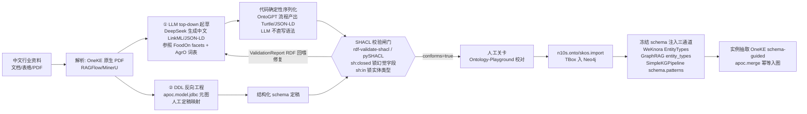

# 04 · 本体建模与 LLM 自动本体生成

本章覆盖调研问题 4：本体标准的实用主义取舍 + LLM schema induction 开源方案全集 + 「中文行业资料→自动本体→SHACL 校验→图库导入」完整 pipeline。核心立场：**本体以 LLM 自动生成为主（W24 用户硬约束），手动编辑仅备选**。

## 4.1 标准体系实用定位（w3.org 原文级证据）

### OWL 2 三 profile 档位（w3.org/TR/owl2-profiles/）
- **EL**：超大类/属性数本体（多项式推理，仅存在量词，SNOMED 类场景）；
- **QL**：海量实例+查询回答为主（查询重写到关系库，LOGSPACE）；
- **RL**：可扩展推理+表达力平衡（规则引擎实现，容纳 RDF(S)+扩展）。
**LLM 应用判断**：推理需求弱、schema 约束需求强 → RL 档的表达力习惯最贴合（rule-based、可编译为校验规则），但实际只需 **RDFS + 少量 OWL RL 档词汇**；**reasoner 在 LLM 时代非必需**——查询时推理可由 LLM 承担、结构推理可由 n10s basic inferencing 或图库遍历替代。

### RDFS 的非约束本质（w3.org/TR/rdf-schema/ §4 官方表述）
RDFS "provides a mechanism for describing this information, but does not say whether or not an application should use it"——domain/range 是**描述性提示而非强制校验**。这是 SHACL 存在的根本理由：LLM 时代需要的是**闸门**，不是描述。

### SHACL——LLM 生成的质量闸门（w3.org/TR/shacl/ REC）
- **校验模型**：shapes graph 校验 data graph；focus node + 五种 target（targetNode/targetClass/implicit class/targetSubjectsOf/targetObjectsOf）；severity/message/deactivated；
- **核心约束组件**：值类型（sh:class/sh:datatype/sh:nodeKind）、基数（sh:minCount/maxCount）、**sh:closed + ignoredProperties（闭合世界，锁死 LLM 幻觉字段）**、**sh:in（枚举受控词表——实体类型受控的关键）**、sh:hasValue；
- **校验输出是机器可读 RDF 报告**（sh:ValidationReport/conforms/ValidationResult 含 focusNode/resultPath/value/sourceShape/resultMessage）——**可直接回喂 LLM 构成生成→校验→修复回路**（这是 LLM pipeline 用 SHACL 而非自写校验的结构性理由）；
- SHACL-SPARQL 扩展支持自定义约束（$this/$shapesGraph 预绑定）；
- 与 OWL 分工：OWL=开放世界推理/蕴含；SHACL=校验（可闭合世界）；
- **SHACL 1.2 演进中**（w3c.github.io/data-shapes/shacl12-overview/，Data Shapes WG）：官方用途清单明确包含 "generating ontologies to inform other agents"——**W3C 已把 agent 间本体交互纳入 SHACL 定位，与 W24 场景直接对齐**；
- **实现成熟度**：pySHACL v0.40.1（Apache-2.0，Python≥3.9）；**rdf-validate-shacl v0.6.5（MIT，Zazuko，rdfjs 生态，2025-05-30 发版——dsh TS 栈直接可用）**；TopQuadrant/shacl（Java/Apache-2.0，246★，2026-06 仍推送）；shacl.org/playground 在线验证。

### SKOS——行业分类表的正确工具（w3.org/TR/skos-primer/）
SKOS=半形式化 KOS（叙词表/分类法/主题标目）的 RDF 词汇：prefLabel/altLabel/hiddenLabel 两两不相交且**带语言标签（@zh 中文标签原生支持）**、broader/narrower/related 层级、跨 scheme 映射五件套（exactMatch/closeMatch/broadMatch/narrowMatch/relatedMatch）。**判断：食品行业分类体系（商品类目/加工方式/原料分类）本质是 KOS，用 SKOS 比 OWL 更贴合**；混用惯例（primer §5.2）：skos:Concept 是 owl:Class 其实例为 individuals，OWL-DL 下保持类/个体分离、用 annotation property 桥接。

### 序列化格式：JSON-LD 1.1 作为 LLM 生成面
w3.org/TR/json-ld11/ §1 官方定位："100% compatible with JSON…designed to be usable directly as JSON, with no knowledge of RDF"——**LLM 函数调用/结构化输出管线天然亲和**。@context 做 term→IRI 映射（@vocab/type coercion/Scoped Contexts 按 @type 切词表/@graph 命名图）；映射属性图概念：JSON 对象≈节点、term≈属性、嵌套≈边、@id≈节点键、@type≈label——"JSON 文档+@context"≈"属性图+受控词表"。**jsonld.js（npm `jsonld`，DigitalBazaar，维护者含规范编辑 dlongley/msporny）：v9.0.0、BSD-3-Clause、2012-09 首发至 2025-11-21 仍发版——极成熟**。Turtle 定位：紧凑、人类审阅友好（作为人工编辑/审阅面而非 LLM 生成面）；"LLM 直写 Turtle 错误率高"的独立学术实测 URL 未获取（搜索受阻，见 08 节矛盾清单 #9——现有支撑为 JSON-LD 官方定位+多家论文立题动机的间接推理，标注 🟡）。

## 4.2 Property Graph 阵营的现实与 PG↔RDF 论战

**PG 的"无正式 schema"实际含义**：结构开放 + 可选约束 + Label/关系类型受控词表。Neo4j 四类约束（neo4j.com/docs/cypher-manual/current/schema/constraints/）：uniqueness（社区版可用）、**existence/type 均 Enterprise**、node key。"本体"在 PG 的表达惯例：Label=class、关系类型=受控词表、约束补位。**GQL 标准实际编号 ISO/IEC 39075:2024**（iso.org/standard/76120.html，注意非"GQL:2023"）：摘要明确 "specifying and modifying the structure of property graphs"——PG 正在补 schema 短板。

**论战代表作**（neo4j.com/blog/knowledge-graph/rdf-vs-property-graphs-knowledge-graphs/，Jim Webber，Neo4j 首席科学家，2024-06）：PG 胜在查询性能/工具生态/文献/人才池/ISO 标准；RDF 胜在**复用预建本体（FoodOn 类资产）**与 Web 互操作；核心论断原文："It's more practical to use property graphs by default and layer in the organizing principles from the RDF world (taxonomies, ontologies) when your system needs them, not as a technical prerequisite"。**⚠️ 证据不对称警示**：这是 PG 厂商首席科学家的一方论述，RDF 阵营（Ontotext/Graphwise）原文被反爬阻断未对读（🟡）。**本报告裁决**：采纳「PG 为默认底座 + RDF 词汇做 schema 组织层」——但 schema 层产物保持 RDF 序列化（JSON-LD/Turtle），经 n10s 导入 Neo4j——两头兼顾：LLM 生成面用 JSON-LD，存储/查询面用 PG。

**n10s 能力边界（决定 RDF↔PG 桥的成本）**（neo4j-labs/neosemantics docs 源文件）：能力=RDF 导入导出 + **OWL/SKOS/RDFS 本体导入** + **SHACL 校验（Graph validation based on SHACL constraints）** + basic inferencing。**TBox 导入边界（importing-ontologies.adoc 原文）**：只导入 5 类元素——owl:Class/rdfs:Class 声明、subClassOf 层级、ObjectProperty/DatatypeProperty/rdfs:Property 定义、subPropertyOf、其余忽略。数据导入开关：handleVocabUris KEEP（保完整 URI，文档直言"queries will look horrible"）/IGNORE（丢命名空间留 local name）；handleRDFTypes=LABELS_AND_NODES（rdf:type 同时做 label+关系）；handleMultival=ARRAY。n10s 活跃（Apache-2.0，pushed 2026-10-09，release 2025.06.1/5.26.0，适配 Neo4j 2025.x）。

## 4.3 食品行业本体资产：FoodOn 与 AgrO

**FoodOn**（foodon.org + FoodOntology/foodon GitHub）：farm-to-fork 食品本体，OWL（Protégé 编辑），2023-06 起上层采用 COB（OBO Foundry 新上层，BFO 兼容），**13 个 facets**（Organism/Part of organism/Harvest state/Food process/Food product hierarchy/Chemical food component 等），关联 LanguaL，ROBOT 管理词表；**CC-BY-4.0（宽松可复用）、242★、2026-09-20 仍推送**。中文标签覆盖未从官方页面确证（机制支持 @zh，实际覆盖不明 🟡）。**AgrO**（obofoundry.org/ontology/agro.html）：农艺学本体（practices/techniques/variables），基于 ICASA 变量+复用 ENVO/UO/PATO/IAO/CHEBI，支撑 AgroFIMS——种植端补充。**用法**：不整本导入，作 facets 分面参照 + 实体类型候选词表（如 Food product hierarchy 对齐商品类目）。

## 4.4 LLM 自动本体抽取（schema induction）开源方案全集

### A. OWL/RDF 本体生成主线
| 方案 | 关键事实 | 对 W24 的价值 |
|---|---|---|
| **OntoGPT**（monarch-initiative，1048★，BSD-3，2026-09 活跃） | SPIRES/SPAR 架构：LinkML schema 模板 + LLM 结构化抽取，输出 YAML/JSON 再**确定性转 OWL/Turtle**；中文无官方支持（自定义 LinkML schema 后 LLM 可处理中文语料） | 「LLM 出结构化数据、代码序列化 RDF」路线的成熟实现——**正合本报告推荐路线** |
| **DeepOnto**（KRR-Oxford，323★，2026-09） | 本体工程库：OntologyReasoner/Pruner/**Verbaliser**（复杂逻辑→自然语言，LLM 提示前处理）/OWL2Vec*；依赖 OWLAPI(JVM/JPype) | 生成后推理校验/裁剪环节组件 |
| **OntoLearner**（sciknoworg，117★，pip，arXiv 2607.01977 在审 Nat Comm） | 150+ 本体 Ontologizers（**含 AgrO 农业、Wine 食品域**）；四任务（Term Typing/Taxonomy Discovery/非分类关系/Text2Onto）；LLM/Retriever/RAG 三类 learner | 食品行体种子 schema 直接可得 |
| **NVIDIA/auto-ontology**（Apache-2.0，2026-10-08 极活跃） | 企业**元数据**→本体+语义目录（Postgres+pgvector），NL2SQL，MCP/CLI/API 三暴露 | 结构化数据语义层；W24 资料已入 PG 表可复用其 MCP 层 |
| LLMs4OL（190★，2024-09 停更） | OL 基准 | 评测参照 |

### B. 抽取层复用（prompt 可复用，非 schema induction）
- **微软 GraphRAG**（MIT）：产物 parquet 属性图（Entities/Relationships/**Leiden 分层 Communities**/Community Reports）；**判定：community ≠ schema**（动态聚类分组无类型/属性/基数约束语义），但社区层级可作 bottom-up schema 归纳的输入信号；实体类型靠 prompt 预设清单（entity_types 可定制成中文类型表）。
- **LlamaIndex PropertyGraphIndex**：**SchemaLLMPathExtractor**=严格 schema（allowed entities/relations + 哪些实体可连哪些关系，pydantic 逐路径校验）；DynamicLLMPathExtractor=可选 allowed types 引导。库级"半自动 schema"实现。
- **LangChain LLMGraphTransformer**（python）：langchain-experimental 仓（PyPI 0.4.2）中的 LLM→GraphDocument 转换器，构造签名实测含 allowed_nodes/allowed_relationships/node_properties/relationship_properties/strict_mode（源码 llm.py L318-330 核实，strict_mode=True 默认丢弃 schema 外实体）；MIT；⚠️ 仓库已 archived（最后推送 2026-05-22）——采用需冻结版本依赖+自担维护（🟡）。

### C. Schema induction 学术线（2024-2026 前沿）
- **SHIELD/MFI**（F1y1113/MFI，70★，EMNLP2024 Oral）：LLM 驱动**EV 电池供应链** schema induction——与食品供应链直接可类比；
- **SCION+SCOPE**（wandugu/paper_scion，ICML 2026，12 天前更新）：schema induction 基准+可审计参考管线；
- arXiv 2026 新作：APOLO（2609.34540，prompt 自动优化 for OL）、LLM-Guided Ontology-Driven KGC（2609.31663，工业文本）、CQ4OE（2609.26029，CQ→本体生成基准）、EvoOntology（2609.15779，自进化本体层）、When Does Bigger Help（WOP@ISWC2026，Qwen3.5/3.6 13 模型对照）；
- inc-schema（17★）增量 prompting+验证；awslabs/redshift-json-schema-induction（22★，archived）JSON→schema→DDL。

### D. 中文专项
| 方案 | 关键事实 | 对 W24 的价值 |
|---|---|---|
| **OneKE**（zjunlp，WWW2025） | **Schema-Guided 多 agent 抽取系统**（Docker）；schema 仓库+case 仓库用户可配；**原生 PDF 书籍/网页输入**；**支持 DeepSeek-R1 本地部署+vLLM**；NER/RE/事件/三元组/开放域 IE+KG 构建+可视化 | **DeepSeek 生态适配度最高的实例化引擎** |
| **DeepKE**（zjunlp，2026-07 活跃） | 监督 NER/RE/属性/事件 + cnSchema + DeepKE-LLM + **DeepKE-MCP-Tools**（LLM 经 MCP 调轻量模型）+ IEPile/InstructIE 中英双语指令数据 | 中文 NER/RE 工具箱+MCP 化先例 |
| **KAG**（OpenSPG/蚂蚁，Apache-2.0，0.8.0@2025-06，arXiv:2409.13731） | **schema-constrained 与 schema-free 抽取并存**；概念语义对齐抗 OpenIE 噪声；DIKW 表示；逻辑形式混合推理（planning/reasoning/retrieval 三算子）；官方原文"业务交易/统计/审批等**结构化数据与新闻/日志等非结构化数据统一入图**"——**与 W24 五源北极星高度同构** | 中文本体工程最完整框架；架构参照（是否整体引入见 07 节权衡） |

### E. 手动编辑备选
**microsoft/Ontology-Playground**（2.8k★，2026-09-17）：零后端静态站，可视化本体设计器（实体类型+typed properties+关系基数），**RDF/XML(OWL) 往返导入导出**，6 域预置本体目录（含 Manufacturing）——**LLM 生成→人工校对→导出的理想免费关卡**。辅：ProtegeDesk（13★）、llm-change-agent（monarch 系 CLI 改本体）。

## 4.5 推荐 Pipeline：「中文行业资料→可用本体→SHACL 校验→图库导入」

**组件选择矩阵（步→首选→备选）**：
1. PDF/表格解析 → OneKE 原生 PDF ｜ RAGFlow（远端）/MinerU；
2. 种子 schema → OntoLearner（AgrO/Wine 食品域）+ LLM top-down 起草 ｜ Ontology-Playground 预置 Manufacturing；
3. 本体生成 → **OntoGPT（LinkML 模板化，确定性转 OWL）** ｜ KAG schema 约束构建；
4. 实例抽取 → **OneKE（schema-guided，DeepSeek-R1/vLLM）** ｜ LlamaIndex SchemaLLMPathExtractor / LangChain LLMGraphTransformer；
5. 校验 → **pySHACL + DeepOnto reasoner + Ontology-Playground 人工关卡** ｜ llm-change-agent 迭代修订；
6. 图库导入 → **Neo4j n10s（RDF）** ｜ Apache AGE（需自写 RDF→PG 映射，无 n10s 等价物）。

**最小可行路径（食品中文语料）**：DeepSeek 生成中文 LinkML/JSON-LD schema（原辅料/工序/质量检测/供应商/批次效期五类核心，参照 FoodOn facets + AgrO 词表）→ OntoGPT 流程产出 Turtle（代码序列化，LLM 不直写语法）→ pySHACL/rdf-validate-shacl 校验（sh:closed 锁字段、sh:in 锁类型）→ 校验报告回喂 LLM 修复环 → Ontology-Playground 人工确认 → n10s 导入 Neo4j（TBox）→ OneKE 按冻结 schema 抽取实例入库（apoc.merge 幂等）。

**已知质量坑与对策（全部有立题证据）**：
| 坑 | 证据 | 对策 |
|---|---|---|
| LLM 直写 Turtle 语法错/幻觉 | CQ4OE/APOLO 论文立题动机 | LLM 出 JSON/LinkML、代码序列化 RDF |
| OpenIE 噪声 | KAG README 明证 | schema 约束+语义对齐+pydantic 逐路径校验 |
| 类型自由打标漂移 | LlamaIndex Dynamic 设计印证 | 先冻结 allowed types 再抽取（sh:in） |
| 过度泛化/冗余类 | OntoLearner/WOP2026 基准动因 | 评估环（指标+LLM-judge）+人工放行关卡 |
| RDFS domain/range 不强制 | w3.org 官方表述 | SHACL 闸门（不是 RDFS） |

**Top-down vs Bottom-up 路线之争（未决矛盾，见 08 节 #5）**：SHIELD（抽取→归纳）与 CQ4OE（CQ→直接生成）均有 2026 顶会背书；KAG 明示两者并存。**本报告裁决：混合环**——LLM top-down 起草初稿（快）→ 实例抽取回验 → bottom-up 信号（GraphRAG Leiden 社区聚类/共现统计）修订 → SHACL 冻结 → 人工关卡放行。
